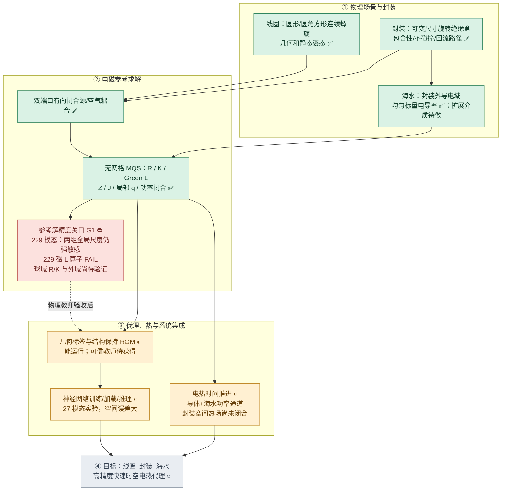

# BFZI 电磁热神经代理｜总体进度与验收看板

> **2026-11-09 XEnergy 工作站实测（覆盖上轮“修复后待测”状态）：** 在独立目录 `D:\\work\\BFZI-D2-verify` 新克隆原分支 `a985c05b`，实际执行 `python -m pytest tests/test_bfzi_d2_galerkin.py tests/test_bfzi_d2_elmer_interchange.py tests/test_bfzi_d2_port_manifest.py tests/test_bfzi_d2_physical_material_mesh.py -q`：**23 passed in 10.91s，退出码 0**，先前 20 passed/3 failed 的三处回归均通过。XEnergy 同次批量检查 `importlib.util.find_spec('gmsh')` 为 True；`ElmerGrid` 和 `ElmerSolver` **未在 PATH 中找到**，尚未确认是否另外安装于非 PATH 路径。此次仅完成完整工作树的**四文件专项 pytest**，未执行真实 Gmsh OCC 双独立 SE(3) 建网，也未执行 ElmerGrid/ElmerSolver 或同源复阻抗/场 h/R 验证；故 **D2 OPEN、G1 FAIL、神经教师冻结**。后续以沙箱优先，只有沙箱缺必要依赖/无法访问完整工程时才在 XEnergy `D:\\work` 下独立目录批量运行；不触碰原研究目录，禁止 GitHub Actions。
>

> **2026-11-09 本地整仓库 pytest 首次反馈与三项定位修复（当前最高优先级）：** 用户工作站真实执行 D2 四个文件的 pytest，结果 **20 passed、3 failed（8.91 s）**：① tree/mixed 规范比较将绝缘区 `-iωA` 当物理 E 逐点比对，但当前 MQS A–φ 仅在 σ>0 内求 φ，绝缘区未包含位移电流/静电方程，因此该区 E **规范依赖、不能做热场标签**；[测试](../../../tests/test_bfzi_d2_galerkin.py) 已更正为**仅导电区逐点严格比较 E、全域 B、端口 Z 和焦耳功率**，保留原容差，未放松任何物理可观测量。② 一四面体顶点换序改变 `_topology` 的**边列出现顺序**，但物理有向边始终从小节点到大节点；测试改为用全局边端点 key 重排后逐项比较（独立 NumPy 复算原生数组最大差 0.0875，按物理边重排后**精确 0**）。③ 原外域裁剪负例被 `BfziScene.__post_init__` 的**更严格球包含规则**先拒绝，导致未到 OCC 预检；改为分别验证场景球边界拒绝及传入显式无效几何对象后 OCC 立方体预检拒绝。独立几何算例表明旋转盒 x 世界最大 0.321421m > R=0.32m，最远角 0.352614m > 0.98R=0.3136m。这三项测试更正、求解器绝缘区 E 规范说明及 NPZ 导电区 E 有效掩码已提交；**本轮修复后的完整仓库 pytest 必须工作站重新执行，尚不得宣告全部 PASS**。真实斜置 OCC/Elmer 独立同源 h/R 仍 OPEN。D2 OPEN，G1 FAIL，神经教师冻结，禁 GitHub Actions。
>


> **2026-11-09 D2 最新源一致性实现（基于 d9b7692）：** 已将 Elmer 端“最终 Whitney 弱载荷”作为独立源比对关口，而不仅只比较两个 `J_s` 体电流数组。新增 [compare_final_elmer_whitney_source](../../../sdfmpneo_bfzi/direct3d_elmer_interchange.py)，接受每条 Elmer 网格有向边的 `ElmerNodeFrom ElmerNodeTo RHS_Port1_A RHS_Port2_A`，通过实际节点坐标唯一映射、端点顺序符号修正与本项目从同一体 `J_s` 精确装配的 `L[p,e]` 两列逐项比较；拒绝边缺失、重复、非法端点、非有限数值。该四列表**不是 ElmerGrid/ElmerSolver 默认产物**，必须将 Elmer WhitneyAVSolver 经任何 `Fix Input Current Density` 修正后、求解前的**真实物理源边元 RHS**独立导出（不能把总场残差/规范约束误认为源本身）。[新主程序](../../../examples/bfzi_d2_elmer_handoff.py) 增加 `--elmer-final-edge-load FILE`，可选源匹配时不一致即明确 FAIL；未提供则继续允许**仅诊断**的本项目体源求解，并将 Elmer 最终源一致性保持 UNVERIFIED。补充有向边换向/载荷漂移专项测试和从真实三材料 BFZI MSH2 测试夹具贯通交接 CLI 的集成测试（含故意不守恒双口体电流的拒绝测试）。**所有新增测试已提交但整仓库 pytest 未实跑**；本环境无真实 Gmsh/Elmer，因此最终 Elmer RHS 比较、双独立 SE(3) 实建网、独立空间场/复 Z 和 h/R/源收敛仍 OPEN。D2 OPEN、G1 FAIL、神经教师冻结、禁止 GitHub Actions。
>


> **2026-11-09 D2 空间热源完整相位输出补充：** `examples/bfzi_d2_elmer_handoff.py --fields-npz` 现在另外存储四点积分**世界坐标**、频率/相量、源合同哈希，以及 `q_port_cross_W_m3[T,Q,p,r] = 0.5*sigma*conj(E_p)·E_r`（复 Hermitian 两端口空间热源矩阵），使任意峰值复相量 `I` 的海水热源可严格恢复为 `q[T,Q] = I.conj() @ Q[T,Q] @ I`，不会漏掉端口间相位交叉热。单独局部 NumPy 两端口复场算例得到 `I=(1,1j)` 的二次型重建误差 1.42e-14，Hermitian 缺陷 0；**此仅公式级验证，不是实际 BFZI/Elmer 场误差或热标签高精度验收**。D2 OPEN。
>

> **2026-11-09 D2 新交付：ElmerGrid → 本项目同源体电流交接主程序（未完成独立参考）：** 新增 [examples/bfzi_d2_elmer_handoff.py](../../../examples/bfzi_d2_elmer_handoff.py)。正式导入此前 Gmsh OCC 生成的独立 SE(3) 双线圈 MSH2 + 原始 `<mesh>.ports.json`（完整验证闭合细丝源合同与物理标签/外域），可选实际调用工作站 `ElmerGrid 14 2 ... -autoclean -names -out DIR`，随后读取真实原生 `mesh.nodes/elements/names/boundary` 完成节点/四面体双射、三材料体及完整 101 外表面的转换对应。只有**另行由真实 Elmer 求解明确导出**七列 `ElmerElementID J1xyz J2xyz`（两端口实单位体源，A/m²）时，才能重排源、检查离散 P1 电流连续性并在**本项目**树—余树 A–φ 求解同源体源的真空与海水响应、两端口复 Z、各复相位组合功率；可选输出按真实 tetra/四点积分存储的 E/B/J/q NPZ。所有输出明确标识 **ElmerSolver 未由该程序执行、Jfix 后的实际 Elmer RHS 是否同一源未核实、1 A 截面通量/真实铜截面及完全相量/边界条件等价未核实**，绝不自动认定独立高精度通过。已与 Elmer 上游 `mesh.names` 和 Elmer CoilSolver → WhitneyAVSolver 源设置文献核实接口字段；此环境仍缺完整仓库工作树、Gmsh/Elmer，可执行入口与新增仓库专项测试**尚未在完整仓库实际跑通**。保持 **D2 OPEN，G1 FAIL，教师冻结，禁 GitHub Actions**。
>


> **2026-11-09 D2 本轮最新推进（基于 0851222）：** 发现前轮体源仅检验 Whitney 积分公式而**不检验闭合电流连续性**。现在 [direct3d_edge_source.py](../../../sdfmpneo_bfzi/direct3d_edge_source.py) 增加离散 P1 梯度源项残差计算， [direct3d_galerkin.py](../../../sdfmpneo_bfzi/direct3d_galerkin.py) 在两端口 A–φ 求解前硬拒绝归一化弱连续性缺陷大于 1e-8 的 RHS， [BFZI CLI](../../../examples/bfzi_d2_aphi.py) 报告残差；真闭合源仍须通过 h/R 等独立场检验。**独立本地 NumPy 实算：** 单四面体闭合线电流残差 2.22e-16，而任意常体电流在早期全局 L1 归一化下为 6.67e-1；本轮进一步修正为不随网格无关边数稀释的局部活动节点归一化，单元算例为 1.0（均被拒绝）；这是局部物理约束检验，并非完整仓库 pytest。新增 [ElmerGrid 映射主代码](../../../sdfmpneo_bfzi/direct3d_elmer_interchange.py)：从实际文本 `mesh.nodes/elements/names/boundary` 按节点坐标+四面体连接还原所有单元 ID，检验转换后的三个材料体域及物理外边界，对两个单位端口的显式七列体源表做重排序，不能按文件位置复制。**另在本地等价 Whitney 弦段裁剪算法（不是仓库 pytest）对 162 四面体、279 全局边的两个真实闭合矩形端口复算新局部守恒指标：1.77e-15/1.16e-14，均小于求解前 1e-8 门槛。** **本地独立合成几何检查：** 8/8 节点、6/6 四面体及材料体、12/12 外边界三角面匹配；缺失面检验被拒绝。新增正式专项测试，但**没有**整仓库 pytest、实际 Gmsh OCC 斜置网格、ElmerGrid/ElmerSolver 运行、物理 CoilSolver 两个闭合源、正式两端口 Z 与空间 E/B/J/q 或 h/R/源联合收敛；本环境无法通过 DNS 连接 GitHub 下载源码，且无 Gmsh/Elmer。当前只支持分片常量实空间单位体电流源，不能把这种离散近似视为 Elmer 原生 Whitney 源、真实有限铜涡流或原细丝物理等价。**D2 OPEN，G1 FAIL，神经教师冻结；不使用 GitHub Actions。**
>


> **2026-11-09 D2 本轮最新推进（继前一轮 Surface 101 强校验）：** 为避免“网格有三材料但独立源合同漂移”，新增 [源合同真实性验证](../../../sdfmpneo_bfzi/direct3d_port_manifest.py)：导入正式物理 MSH2 默认必须匹配 `<mesh>.ports.json`，核对自带 SHA256 与重新从真实 BFZI 场景计算的两条闭合端口（包含世界 SE(3)、馈回流、频率/相量、弦段数、材料、外域）；缺失直接拒绝，只有显式 `--allow-unverified-source-manifest` 可用于**非认证诊断**，并禁止用 `--mesh --export-port-manifest` 覆盖待验源记录。新增 [分片常量体电流 J_s 的精确 Nédélec/Whitney 载荷装配](../../../sdfmpneo_bfzi/direct3d_edge_source.py) 和 [复用同一 A–φ 求解器的体源双端口入口](../../../sdfmpneo_bfzi/direct3d_galerkin.py)，为以后将 Elmer **两套独立单位体线圈电流**映射至同一四面体网格并逐边比较源项提供主接口。隔离 NumPy 实际核对两端口单四面体解析 Whitney 体积分、四点积分和顶点换序一致：**局部公式 PASS**。新增源漂移、重哈希伪造和体源有向边测试，**仓库 pytest 未执行**；本运行环境无 Gmsh/Elmer 且 GitHub 网络克隆不可用。**Elmer CoilSolver 电流尚未输出、单元重编号与闭合/1A/散度性质尚未独立核对，不能把其体源称为与原零截面细丝等价；空间场、完整复 Z、h/R/源联合收敛未执行。D2 OPEN、G1 FAIL、教师冻结；禁 GitHub Actions。**
>


> **2026-11-08 D2 本轮主接口推进（最新）：** 发现旧三材料 MSH2 导入虽然检查实体 1/2/3、外盒极值、几何体积和 SE(3) 材料归属，**尚未检查物理表面 101**。已修改 [MSH2 导入器](../../../sdfmpneo_bfzi/direct3d_mesh.py)：非 legacy BFZI 必须将 Gmsh 101 的每个三角面与实际四面体外边界面逐项集合比对，拒绝缺面、重复面、内部界面误标、非流形面及不位于六个外立方体面上的表面；保留 TEAM7 通用 MSH2 入口及 legacy 明确诊断模式。新增 [物理 MSH 回归测试](../../../tests/test_bfzi_d2_physical_material_mesh.py) 写出真正的 101 表面元素并覆盖缺失与不全的 101。**已执行的仅是隔离 NumPy 六四面体外面算法验证：1 正例＋4 负例 PASS；仓库 pytest 未执行，Gmsh OCC/ElmerGrid/ElmerSolver 未执行**（此环境无 Gmsh/Elmer，无法用 git 网络拉取整树）。物理源仍是闭合细丝，Elmer CoilSolver 默认有限体源不等价；独立 Z 与空间 B/E/J/q 及 h/R/源收敛**均未验收**。下一步工作站先跑专项 pytest，再跑任意独立 SE(3) OCC/ElmerGrid 网格并核对源装配，然后才做同物理求解器对照。**D2 OPEN、G1 FAIL、教师冻结，无 GitHub Actions。**
>


> **2026-11-08 本轮最新 D2 Elmer 物理源合同：** 已将两个真实 BFZI 单根连续圆角方形/圆形候选线圈各自的**有向闭合馈回流、世界坐标路径、1A 峰值相量、线径/铜电导率、独立 SE(3) 姿态、频率/相量约定及 SHA256**导出为确定性 [源合同主代码](../../../sdfmpneo_bfzi/direct3d_port_manifest.py)；[三维主 CLI](../../../examples/bfzi_d2_aphi.py) 已支持无需 Gmsh 的 --ports-only --export-port-manifest，以及正式 --generate-msh 成功后自动输出同名 .ports.json 并将源哈希写入网格元数据。新增 [针对两真实闭合端口与接收端独立旋转的测试](../../../tests/test_bfzi_d2_port_manifest.py)。数学源仍是有向闭合理想线源，其边元 RHS 是每条真实线段的 Whitney 切向积分，**不等价于 Elmer CoilSolver 的有限体积铜线圈电流**。已在 [独立 Elmer 执行合同](D2_ELMER_INDEPENDENT_REFERENCE.md) 明确禁止在源不一致时比较复 Z 和空间 E/B/J/q。当前容器无 Gmsh/Elmer，尚无实际 OCC 任意斜置网格/Elmer 等价源实跑；本轮新增整仓库测试待工作站运行。接下来只推进**等价物理源与成熟 Elmer reference**，不要再写新的旧 G1 调参、论文表格拟合或神经教师。**D2 OPEN、G1 FAIL、教师冻结，未使用 GitHub Actions。**
>


> **2026-11-08 补充真实相对位姿材料网格往返验证：** 对接收端连同封装/闭合回路线圈独立绕 x 轴旋转 90°、发射端及外域不动的 BFZI 工况，重新生成 **2430 个四面体**的材料共形结构化网格，分别赋 sea=1 的 2394 个、tx dry=2 的 30 个、rx dry=3 的 6 个四面体，实际写成 MSH2.2 再由最新**严格物理标签导入器**读回，完成前后各一次 200kHz 两单位真空/材料双端口 Maxwell A–φ 求解。完整复 `ΔZ`、全单元 E/B 和 `I=(1,i)` Joule 的文件往返差均为 **0**；平行姿态 1350 四面体也通过。两种真实物理场复算与负例（错标签、漏标签、单标签、错 R）现共用 [源码专项测试](../../../tests/test_bfzi_d2_physical_material_mesh.py)；[真实两种姿态结构化证据](evidence/d2_three_material_msh2_roundtrip_20261108.json)。**限制：** 此处 90° 为有材料界面共形保证的轴置换；不能把它当作 Gmsh 任意斜置 SE(3) 或独立 Elmer 验证。D2 仍 OPEN，G1 FAIL，教师冻结，禁 GitHub Actions。
>


> **2026-11-08 D2 最新材料共形网格输入修复：** [`direct3d_mesh.py`](../../../sdfmpneo_bfzi/direct3d_mesh.py) 现在直接从 MSH 2.2 的**真实物理体标签**给海水/发射端绝缘盒/接收端绝缘盒赋 `σ=(5,0,0) S/m`，要求三个标签全在、逐四面体核对其实际独立 SE(3) 几何归属、体积与外域一致，不再无条件依据中心点重分类；旧单标签 `.geo` 需显式 `--legacy-single-tag-msh` 才能作为诊断导入。[`--generate-msh --mesh-only` 主入口](../../../examples/bfzi_d2_aphi.py) 也在返回成功前执行实际 MSH2 读回验证，防止产生不可供 Elmer 正确分材的网格。**实际计算证据：** 使用现有两盒物理共形结构化网格写入真实 MSH 2.2（1,350 四面体，海水 1,338 / 发射盒 6 / 接收盒 6），再经新导入器求解 200kHz 两单位闭合 BFZI 端口；与未导出网格直接求解相比，`2×2 ΔZ`、全四面体 E/B、`I=(1,i)` Joule 逐项差为 **0**。交换标签、缺失材料、单标签未授权、外域 R 不匹配四类错误均在本地实际拒绝。新增 [专项可复现测试](../../../tests/test_bfzi_d2_physical_material_mesh.py) 和 [数值证据 JSON](evidence/d2_three_material_msh2_roundtrip_20261108.json)。**这证明的是三材料文件导入及双端口方程没有被网格存取改变，不能冒充真正 Gmsh OCC/Elmer 独立求解**；当前环境 Gmsh 包源无法解析，原项目完整整树测试尚未运行。D2 OPEN，G1 FAIL，神经教师冻结，禁止 GitHub Actions。
>


> **2026-11-08 最新 D2 位姿/Elmer 材料接口（覆盖以下旧状态）：** 已实际使用本地提取的真实 BFZI Nédélec A–φ 双端口求解器，核对两匝圆角方形＋闭合馈回流的**整体刚体 SE(3) 坐标协变性**：完整复 Z 相对差 4.92×10⁻¹²、空间 E/B 相对差 5.52×10⁻¹¹/3.29×10⁻¹²。另真实求解**只旋转接收封装及线圈 90°**的相对位姿（材料界面重新共形）：平行 1350 四面体 Z12 实部 1.11219mΩ，正交 2430 四面体 Z12 实部 0.0477053mΩ；两工况离散端口—体积 Joule 双向一致。两种证据都**不能**证明任意斜置 SE(3) 连续位姿 h/R 收敛。已在 [主 BFZI 运行 CLI](../../../examples/bfzi_d2_aphi.py) 接入 tx/rx 独立旋转向量与平移，并新增 [OCC fragment 来源映射的三材料物理标签共形网格](../../../sdfmpneo_bfzi/direct3d_gmsh_physical.py)：海水 volume 1、发射绝缘 volume 2、接收绝缘 volume 3、有限立方体外边界 surface 101，支持 --generate-msh --mesh-only，不以盒体 AABB 代替旋转几何。[ElmerGrid 的材料/边界标签转换与未完成的真实两端口源说明](D2_ELMER_INDEPENDENT_REFERENCE.md) · [实际双端口位姿证据 JSON](evidence/d2_real_bfzi_pose_20261109.json)。**本容器无 Gmsh/Elmer，新的物理标签 API 尚未实际网格化，Elmer CoilSolver 等效闭合源仍未实现；全仓库 pytest 仍需工作站复跑。** D2 OPEN、G1 FAIL、教师冻结、未使用 GitHub Actions。
>


> **2026-11-08 最新 D2 关键突破（覆盖下列所有历史“12960 四面体解不完”记录）：** 已实现有物理规范不变性依据的 [相对树—余树 H(curl) 规范消元](../../../sdfmpneo_bfzi/direct3d_tree_gauge.py) 并接入 [三维 A–φ 主求解器](../../../sdfmpneo_bfzi/direct3d_aphi.py)、[实际双端口材料/真空差分](../../../sdfmpneo_bfzi/direct3d_galerkin.py) 和 [解析源参与 PDE](../../../sdfmpneo_bfzi/direct3d_primary_secondary.py)。**不是 ILU/GMRES 伪加速**：保留导电区 P1 标势 φ 与电荷守恒，只去掉相对梯度规范边与原规范乘子，仍用可检验残差的稀疏直接求解。独立本地真实 BFZI 两端口：旧 mixed vs tree 的三维复 E/B 相对差 **3.90×10⁻¹¹ / 2.58×10⁻¹²**。前次失败的 h=60mm **12960 四面体**（导电14656/真空11953复未知量）已约15秒实算，线性残差各约 **1.63×10⁻¹⁴ / 7.05×10⁻¹⁵**；进一步 h=40mm **17238 四面体**（导电19544/真空16017复未知量）约28秒实算，残差 **2.91×10⁻¹⁴ / 8.96×10⁻¹⁵**。固定真实双封装/两匝闭合圆角线圈/200kHz/海水5S/m/R=0.52m 的 `h=80/60/40mm`，**Re ΔZ11=7.34428/7.53243/7.71825mΩ**，相邻完整复矩阵偏差 **2.367%/2.377%**，尚无物理 h 收敛。主代码已为每端口增加缩放线性残差硬性判断，并输出有效未知量数；专门测试比较 mixed/tree 的 E/B/Z/Joule。**本地是等价源码抽取后真实运行，原仓库整树 pytest、任意 SE(3) Gmsh 与 Elmer 仍未在本环境执行**。参考 [原理/适用范围/实算与阻塞](D2_TREE_COTREE_GAUGE.md) · [三档全数值 JSON](evidence/d2_tree_gauge_real_bfzi_h_20261108.json)。**D2 OPEN、G1 FAIL、正式教师冻结、未使用 GitHub Actions。**
>


> **2026-11-09 当前最高优先级 D2 真正双端口实算：** 本轮首次在隔离 SciPy 环境中**实际运行**真实两匝连续圆角方形 BFZI 双封装/馈回流的 Nédélec A–φ 两单位端口复电磁系统（采用仓库等价提取的弱式、真空差分与同一闭合源加载，不是整仓库 pytest；数据来源如实标注）。修正了旧 `h` 扫描在 20mm padding 内用 120/80/60mm 步长**并未增加湿侧法向层数**的问题，改用 padding=80mm、真实湿侧 h=80/60/40mm，并增加 `--structured-inner-core-radius .24` 固定真实两盒附近的网格切面，以分离外域 R 改动时的近场网格扰动。实际 **6318 四面体、1400 顶点**下 R=0.32/0.40/0.52m，`Re ΔZ11=5.937/6.721/7.344 mΩ`，`Re ΔZ12=1.026/1.459/1.938 mΩ`，**外域仍明显不收敛**（远场外壳网格也改变，不能把全部差异归为边界）。R=.52m 固定网格下真实源弦段2/4/8/16的复 Z 矩阵相邻相对变动 **3.678%→0.966%→0.246%**；离散互易和端口—体积 Joule 功率差约 `10^-16`，但三个海水实际测点的原始 FEM 与解析源修正 q 差异极大：例如点(0,0,0) `0.002988` vs `0.000159 W/m³`，说明**空间场绝对精度仍 OPEN，教师冻结**。湿侧真正加密到0.06m，12960四面体、18044复未知量时当前 SciPy 直接求解超时，普通 ILU/GMRES也未达到残差要求；**没有提交失败的 GMRES 当成功加速**。下一关是成熟 H(curl) 辅助空间/鞍点块求解或 Elmer/MFEM 独立高保真参考，正式 Gmsh 局部共形任意 SE(3) 与 h/R/空间 E/B/J/q 不可跳过。详细 [本轮真正数值、局限和后继](D2_REAL_BFZI_AXIS_ALIGNED_TWO_PORT.md) · [原始双端口矩阵 JSON](evidence/d2_real_bfzi_two_port_20261109.json) · [实际 3D 探针 JSON](evidence/d2_real_bfzi_spatial_probes_20261109.json)。**D2 OPEN、G1 FAIL、神经教师冻结，禁止 GitHub Actions。**
>


> **2026-11-08 D2 最新主算法修复：** 经复查发现旧 `--structured-box-layers` 仅改变干侧绝缘盒切分，不能单独完成湿侧海水 `h` 收敛。已将 `near_step_m` 真正接入 [双盒共形网格](../../../sdfmpneo_bfzi/direct3d_structured_bfzi.py) 与 [真实两端口运行入口](../../../examples/bfzi_d2_aphi.py)（`--structured-near-step`），并提供 [按同一源/材料分别改变 h、R、圆角弦段数的直接 A–φ 双端口扫描](../../../examples/bfzi_d2_convergence.py)。独立本地网格计算：在 R=0.52m 下，原始 3234 个四面体；近壁步长 80mm/20mm/10mm 对应 5346/29160/124200 个四面体，非导电两盒体积均为 0.0024m³；近壁步长80mm、R=0.80m 时共9438个四面体，外域体积正确变为4.096m³。**这是实际网格几何证据，不是 2×2 端口/空间 E/B/J/q 收敛证书**。张量积几何成本快速增长，任意真实 SE(3) 高保真必须采用 Gmsh 局部共形三维网格。具体 [简明方法、实数表和运行命令](D2_REAL_BFZI_AXIS_ALIGNED_TWO_PORT.md) · [网格 JSON 证据](evidence/d2_bfzi_wet_wall_mesh_20261108.json)。**本轮新增两端口 h/R/source 脚本和集成测试尚未在实际完整仓库上跑通，D2 OPEN、G1 FAIL、教师冻结，不使用 GitHub Actions。**
>


> **2026-11-08 最新 D2（优先于所有后面旧“仅基准/没有 BFZI 真实网格”的段落）：** 新增 [真实 BFZI 两独立盒轴对齐共形四面体网格](../../../sdfmpneo_bfzi/direct3d_structured_bfzi.py) 并接入 [现有两单位闭合源 Galerkin/解析入射源主入口](../../../examples/bfzi_d2_aphi.py)；`--structured-axis-aligned` 允许不安装 Gmsh 时直接执行真实 BFZI 双端口电磁/空间 Joule 基线，且对真正倾斜的盒体**明确拒绝**，绝不把阶梯体素冒称任意 SE(3)。`--outer-radius` 固定 BFZI 几何仅改变有限外域 R，Gmsh 读取会拒绝重复使用与 R 不一致的旧网格。独立本地结构网格几何计算证实固定 R=0.52 m 时 3234/4992/7290 四面体的两盒真实绝缘体积始终 0.002400m³、外立方体积 1.124864m³。新增 [完整 BFZI 两端口集成测试](../../../tests/test_bfzi_d2_structured_ports.py)，**但新提交的两端口 PDE 测试尚未在本环境实际运行**；不可将仅网格几何正确称作 D2 电磁精度完成。详细 [本轮真实 BFZI 求解入口、h/R 命令及局限](D2_REAL_BFZI_AXIS_ALIGNED_TWO_PORT.md)。球磁扩散/椭圆标势独立检验仍有效，但大尺度共形网格、两盒任意 SE(3) Gmsh 实跑、Elmer 独立验证、铜有限截面电流均未通过：**D2 OPEN、G1 FAIL、教师冻结、无 GitHub Actions**。
>


> **2026-11-07 最新 D2 空间场独立物理验证（优先于下面所有历史状态）：** 已新增 [有限频率导电球三维 Maxwell 磁扩散解析参考](../../../sdfmpneo_bfzi/direct3d_sphere_limit.py)、[真正施加解析总 A 切向边界的 A–φ 求解接口](../../../sdfmpneo_bfzi/direct3d_aphi.py)、[五级数值运行脚本](../../../examples/bfzi_d2_sphere_limit.py) 与 [正式理论第18节](../../../theory/sections/18_d2_sphere_ac_diffusion.tex)。使用独立 SciPy 一阶 Nédélec 组装实际求解 48→6000 四面体、50 Hz 铝等效导电球，复 E 体积 L² 误差 **76.69%→23.96%**，复 B 按**四点体积积分**相对 L² 误差 **59.60%→24.42%**；同一多面体 FEM Joule 相对独立解析场误差 **+69.44%→+5.07%**。此前只取单元重心得到的较低 B 误差不作为最终数值。解析 Maxwell–Ampère 方程在非轴内部点的数值残差约 10^-9；完整理想球解析 Joule 0.02684694409 W，单独分离几何体积误差。完整 [方法、真实五级数值和测试](D2_SPHERE_AC_MAGNETIC_DIFFUSION.md) · [JSON 证据](evidence/d2_sphere_ac_20261107.json)。**这一轮是实际独立原型 FEM 运行，仓库新增代码需要工作站完整 pytest 重跑**；虽然验证了真实磁扩散收敛趋势，但一阶 E/B 误差仍大，Gmsh/Elmer TEAM-7 与 BFZI 双 SE(3) 高精度均未验收。另以相同导电球的 **200 Hz** 场解实测更强集肤效应（δ≈5.993 mm），即使 6000 个一阶四面体空间 E/B 误差仍为 **52.95%/45.60%**、同域 Joule **+33.21%**，强调必须按趋肤层加密而非只看自由度总数；详细见 [50/200Hz 实算](D2_SPHERE_AC_MAGNETIC_DIFFUSION.md)。真实 BFZI 两独立 SE(3) 绝缘盒的 [共形 Gmsh 生成器](../../../sdfmpneo_bfzi/direct3d_mesh.py) 已支持**按每个真实旋转盒世界 AABB 自动局部细化、远海水粗网格**（`--near-mesh-size`/`--near-padding`），但尚未在有 Gmsh 的工作站实际建网。 **D2 OPEN、G1 FAIL、教师冻结，禁止 GitHub Actions。**
>

> **2026-11-06 D2 最新物理场修复（覆盖下方旧的“解析源场测点准确”的初期推断）：** 为建立真实 BFZI 空间 `E/J/q` 教师，新增非圆形椭圆柱的独立 `A–phi` 解析极限和五档 FEM 实算（48→6336 四面体，空间 E 相对误差 29.27%→5.29%，Joule 相对误差 −11.80%→−0.29%；非零 `phi` 若忽略会带来约56.55% E 误差）。随后新增 [解析入射闭合源直接参与材料 PDE 求解](../../../sdfmpneo_bfzi/direct3d_primary_secondary.py)，不是旧总场后处理替换。在其专项真空 E 测点测试中发现并**实际修复** [非仿射解析源错误插值](../../../sdfmpneo_bfzi/direct3d_probe.py)：只插值 FEM 反作用 E，再于测点精确加回真空源 E；测试在修正前 FAIL、修正后 PASS。已将该方法通过 `--solve-analytic-primary` 接入 [BFZI](../../../examples/bfzi_d2_aphi.py) / [TEAM-7](../../../examples/bfzi_d2_team7.py) 真正材料 PDE 与空间 E/B/J/q 对照。本地等价核心代码合并 **16 pytest passed（5.33s）**，五档数值 [JSON](evidence/d2_elliptic_limit_20261106.json) 已提交；完整远端仓库/高质量 Gmsh/Elmer 仍待本机运行。粗 TEAM7 三种源离散方法的 Joule 相差很大，**既不能凭端口离散代数功率闭合，也不能凭真空场解析重构判 D2 PASS**。当前独立非轴对称低频材料 PDE 受限检验有实证，D2 正式高精度、铜邻近损耗、海水无限域及独立 B/J 仍 OPEN；旧 G1 FAIL、教师冻结、禁止 GitHub Actions。详见 [D2 本轮方法及真实计算](D2_INDEPENDENT_ELLIPTIC_AND_ANALYTIC_PRIMARY.md) 与 [理论第17节](../../../theory/sections/17_d2_aphi_reference_and_ports.tex)。
>

> **2026-11-06 最新 D2 独立 PDE 验证（覆盖下方旧状态）：** 已新增 [非圆形椭圆柱解析 `E/phi/Joule` 基准和共形 3D 四面体](../../../sdfmpneo_bfzi/direct3d_elliptic_limit.py)、[五档直接数值入口](../../../examples/bfzi_d2_elliptic_limit.py)、[解析非零 `phi`/网格专项](../../../tests/test_bfzi_d2_elliptic_limit.py)。**这是真实独立 Maxwell 低感应强度极限，不是重现论文表格。** 在 `a=0.12m,b=0.07m,H=0.1m,sigma=4S/m,f=1000Hz,B0=1mT,alpha=4.548e-4` 下，48/288/1080/2688/6336 四面体的复 E 体积 L2 误差 **29.27/15.01/10.35/7.88/5.29%**，Joule 相对独立公式 **−11.80/−2.88/−1.22/−0.66/−0.29%**；忽略 `phi` 会使本例 E 错 **约56.55%**。数值记录已提交 [JSON](evidence/d2_elliptic_limit_20261106.json)。针对真实 BFZI/TEAM7 还新增 [解析闭合源直接参与导电 A–φ PDE 的主次场求解](../../../sdfmpneo_bfzi/direct3d_primary_secondary.py)，而不是仅在总场 Galerkin 求解后**替换**解析源场。[BFZI CLI](../../../examples/bfzi_d2_aphi.py)/[TEAM7 CLI](../../../examples/bfzi_d2_team7.py) 提供 `--solve-analytic-primary` 并同时报告物理材料 Joule、旧总场离散 Joule 和事后替换场诊断。TEAM7 粗网格这三种值仍相差较大，**尚无共同 h/R/源收敛，不能选较合意值为真值**。本地科学计算原型 **13 pytest passed**，远端组合/实际 Gmsh+Elmer 正式验证仍待本机运行。[方法/公式/命令](D2_INDEPENDENT_ELLIPTIC_AND_ANALYTIC_PRIMARY.md)。**D2 独立低感应强度物理检验有实证，但三维高保真整体 OPEN；G1 FAIL、教师冻结；禁止 GitHub Actions。**
>

> **D2 表面测点与空间场修正（2026-11-06 最新）：** 独立检验证实在同一 `z=0` 金属/真空界面，两个物理上相同的测点由不同电导率网格分别选单元时会出现**不同的四面体索引**，造成材料反作用场的虚假跳变。已在 [direct3d_probe.py](../../../sdfmpneo_bfzi/direct3d_probe.py) 新增 `cell_indices` 强制复用导电侧四面体，且 [direct3d_fields.py](../../../sdfmpneo_bfzi/direct3d_fields.py) 的导电/真空主次场相减共用相同单元；[专项测试](../../../tests/test_bfzi_d2_mesh_probe.py) 固定该界面条件。独立本地 Python 版本的原型/插值/端口等 **11项 pytest PASS**；此为方法级测试，不替代仓库全组合运行或 Elmer 参考。高保真空间 B/J/E/q 与外域仍未验收：**D2 OPEN、旧 G1 FAIL、教师冻结；禁止 GitHub Actions**。
>

> **最新 D2 空间场推进（2026-11-06，本段覆盖下面关于空间场已通过的历史说法）：** 本地独立真空闭合方环 Biot–Savart 对照，固定外盒 `[-0.4,0.4]^3 m`、4 个非源点，最低阶总场 Nédélec 计算在 **3072/6000/10368 四面体**的向量 B 相对 L2 误差为 **38.20%/28.35%/31.93%**，不单调，明确判定**原始全场 B 未达到空间精度验收**。现已提交 [解析源 B/E＋同网格导电/真空 FE 反作用场分离](../../../sdfmpneo_bfzi/direct3d_fields.py)，并在 [3D 精确测点计算](../../../sdfmpneo_bfzi/direct3d_probe.py) 中用 Whitney 仿射插值替代单元平均 J，输出位置复 `E/J/q`；[TEAM-7 主入口](../../../examples/bfzi_d2_team7.py) 报告原始全场 FEM 与主次场重构两组数值，[BFZI 双端口入口](../../../examples/bfzi_d2_aphi.py) 支持重复 `--probe x y z` 查询及 `I=(1,0),(0,1),(1,±1),(1,i)` 的 B/E/J/q。新增 [可重现真空磁场误差试验](../../../examples/bfzi_d2_vacuum_field.py) 与物理场专项测试；本地直接数值探针插值、原型双端口及真空主次场测试 **9 passed**，远端全部组合测试未在当前环境运行。**真空主次场的解析准确是构造恒等式，不能当材料反作用验证；纠正场 Joule 与 Galerkin 端口功率仍可能相差很大，正式 TEAM-7/Elmer、高质量 Gmsh 网格及外域收敛均 OPEN**。不启动 G1/教师，禁止 GitHub Actions。正式数学说明见 [第17节](../../../theory/sections/17_d2_aphi_reference_and_ports.tex)。
>

> **2026-11-06 D2 空间场真实性新证据（最高优先于下方仅强调功率闭合的记录）：** 一致闭合源/端口 Galerkin 修复确实使端口功率与**自身离散总场** Joule 功率精确相等，但独立按 `A_physical=A_src_exact+(A_medium_h-A_vacuum_h)` 重构真实源场后，固定 TEAM-7 50Hz 四档网格的导体 Joule 功率分别约为 **46.994、23.558、17.447、15.163 W**，而 Galerkin 自身端口/体积功率分别 **6.933、6.834、7.091、6.737 W**。空间逼近误差仍大，不能仅凭离散恒等式称“物理直接法高精度”。已经在 [三维 Galerkin 核心](../../../sdfmpneo_bfzi/direct3d_galerkin.py) 实现`analytic_source_corrected_joule`，并在 [TEAM7](../../../examples/bfzi_d2_team7.py) 与 [BFZI 两端口](../../../examples/bfzi_d2_aphi.py) 输出两种 Joule 对照；TEAM7 磁场测点使用解析 Biot–Savart 源场＋数值材料反作用，避免粗真空场误差。**D2 OPEN**：下一步优先材料/源邻近 h、趋肤层、source chords/截面、外域共形网格及独立 Elmer B/J 结果，严禁用论文曲线拟合代替。完整理论 [第17节](../../../theory/sections/17_d2_aphi_reference_and_ports.tex)，根因和四档数据见 [D2 Galerkin 修正](D2_CONSISTENT_GALERKIN_SOURCE_AND_PORT.md)。G1 FAIL、教师冻结、无 GitHub Actions。
>

> **2026-11-06 D2 当前最新、覆盖下方所有旧的“端口与体积功率不闭合”叙述：** 已找到并修正三维 Maxwell–MQS 的关键离散不一致：旧反作用场体积载荷 `-iω∫σA_src·v` 和闭合源端口 `iω∮A_react·dl` 未在有限元空间中作为严格对偶泛函组装。新增 [精确闭合 Nédélec 源加载](../../../sdfmpneo_bfzi/direct3d_edge_source.py) 和 [一致 Galerkin 总场/同域真空差分求解器](../../../sdfmpneo_bfzi/direct3d_galerkin.py)，同一矩阵 `L` 负责源 `L.T@I` 和电压 `iωL@A`；[真实双闭合 BFZI 入口](../../../examples/bfzi_d2_aphi.py) 与 [TEAM-7 入口](../../../examples/bfzi_d2_team7.py) 均改为新主算法。隔离科学计算环境重跑 50Hz TEAM7 固定材料几何的四档 750/2304/5082/9408 四面体：端口和体积功率分别均为 **6.932518/6.833806/7.091349/6.737204 W**，每档二者差约 `10^-14–10^-12 W`；真实两独立闭合端口 100kHz 复相位下也满足互易及功率一致。**但网格间的绝对输出仍未收敛，因此只认证有限离散源/端口一致性，不能宣布 D2 TEAM-7 高保真 PASS。** Elmer 实测/正式 Gmsh 共形网格、h/R/源截面/弦段及真实 BFZI 双 SE(3) 全域高精度仍未完成。详见 [修正理论、实测数据与命令](D2_CONSISTENT_GALERKIN_SOURCE_AND_PORT.md) · [第17节理论](../../../theory/sections/17_d2_aphi_reference_and_ports.tex)。旧 G1 FAIL、教师冻结、禁止 GitHub Actions。
>

> **2026-11-06 最新 D2 核心进度（覆盖下方旧“端口功率闭合”或“尚无 FEM”的历史段落）：** 独立三维 Nédélec A–φ 已新增 [四面体交段精确闭合源端口](../../../sdfmpneo_bfzi/direct3d_port.py)、[总场人工边界下的有限盒真空镜像扣除](../../../sdfmpneo_bfzi/direct3d_port.py)、[TEAM-7 铝板/偏心孔固定几何的 1–4 档分层共形四面体](../../../sdfmpneo_bfzi/direct3d_team7.py)、[精简输出和完整探针 JSON](../../../examples/bfzi_d2_team7.py)。实际 50 Hz 固定源/外盒试验：**750/2304/5082/9408 总四面体**，材料区体积严格保持 `0.001420668m³`，真实闭合端口平均功率 `8.221→7.388→7.312→7.085W`；金属总场体积 Joule `21.545→13.163→10.899→9.802W`。二者尚不闭合，**不是 D2 PASS**；本轮另确认仅增大外盒而不增加外域网格会恶化求解结果。隔离 Python 主方法共 **9 tests passed**，未运行完整仓库组合测试和 Gmsh/Elmer 正式同域参考。下一关：真实外盒+近/远场联合网格、50/200 Hz/趋肤层收敛、成熟 Elmer WhitneyAVSolver 同源对照；真实 BFZI 双独立 SE(3) 盒的 Gmsh 网格与铜损耗仍待完成。[实际四档数值与运行命令](D2_TEAM7_OFFICIAL_CASE.md) · [理论第17节](../../../theory/sections/17_d2_aphi_reference_and_ports.tex)。**D2 OPEN、旧 G1 FAIL、教师冻结、无 GitHub Actions。**
>


> **2026-11-06 D2 本轮最新（覆盖下方旧“端口功率闭合”措辞）：** 针对真实 Maxwell–MQS 端口修正了关键理论/数值实现：新增有向 Nédélec 总场边界迹 `total_zero`、闭合物理馈回流的真实感生电压 `ΔZ_port=iω∮A_react·dl`，与旧 `iω∫A_src·J` 有限域重叠积分明确分离。小网格实际出现端口/体积功率与双端口互易差异，**如实保持未收敛，不做后验截正/对称化**。隔离计算环境中三维基础+端口方向测试 **7 passed**，远端完整测试仍待用户本机执行。独立成熟参考已锁定 [ElmerCSC 官方 TEAM-7 仓库](D2_ELMER_INDEPENDENT_REFERENCE.md)，对齐其 25×100 mm 体积线圈、−2742 A匝、瞬态 50Hz、`A{e}=0` 和相同外域后才可以比较真实场。实现：[direct3d_aphi.py](../../../sdfmpneo_bfzi/direct3d_aphi.py) · [direct3d_port.py](../../../sdfmpneo_bfzi/direct3d_port.py) · [D2 TeX 第17节](../../../theory/sections/17_d2_aphi_reference_and_ports.tex)。当前尚无可执行的 Gmsh/Elmer 本机安装和标准细网格/实测验收证据：**D2 OPEN，G1 FAIL，正式神经教师冻结，禁用 GitHub Actions**。
>


> **最新 D2 实质进展（2026-11-06，覆盖后面旧的“尚无 FEM 代码”描述）**：已提交独立三维 **Nédélec H(curl) A–φ** 有限元求解器 [direct3d_aphi.py](../../../sdfmpneo_bfzi/direct3d_aphi.py)，包含 Coulomb 规范、导体标量电位与两单位端口源，输出海水/导体增量复阻抗、空间 E/B/J 和 Joule 功率。另有 [共形双 SE(3) 封装网格](../../../sdfmpneo_bfzi/direct3d_mesh.py)、[场探针](../../../sdfmpneo_bfzi/direct3d_probe.py)、[BFZI 三维入口](../../../examples/bfzi_d2_aphi.py)、[COMPUMAG 官方 TEAM-7 物理配置](../../../sdfmpneo_bfzi/direct3d_team7.py) 与 [TEAM-7 入口](../../../examples/bfzi_d2_team7.py)。隔离 Python 环境中三维核心 **5 tests passed**；TEAM-7 官方 294mm 铝板/偏心方孔的 **48 个导电单元粗网格**已在 50/200 Hz 真正求解，得到场/端口同源功率闭合，但**绝不作为测量精度或网格收敛证明**。Gmsh 官方尺寸高精度网格与两旋转实盒尚未实际网格求解，外边界仍有限截断；**D2 OPEN、G1 FAIL、正式教师冻结**。详细 [D2 核心方程与代码](D2_APHI_CORE_IMPLEMENTATION.md) · [TEAM-7 官方几何/实算记录](D2_TEAM7_OFFICIAL_CASE.md)。严格禁止 GitHub Actions。
>


> **2026-11-06 正式决策：BFZI 物理直接法 V1.0 锁定；暂停 G1/P1-C 五模态求积试错。**
>
> **最新权威规范：** [物理场/端口/材料/边界完整锁定](PHYSICAL_DIRECT_METHOD_LOCKED.md) · [文献证据与 D0–D6 独立验收](PHYSICAL_DIRECT_METHOD_EVIDENCE_AND_GATES.md) · [正式理论 TeX 第15节](../../../theory/sections/15_physical_direct_reference_lock.tex)。依据用户 2026-11-05 UWPT 综述的 B 类物理建模论文 [12–14]、成熟三维涡流 BEM/FEM–BEM 和 TEAM-7 标准参考，**必须先得到可信的物理直接法，再谈神经代理**。
>
> **已锁定**：圆形/圆角方形连续单根 BFZI 螺旋和真实闭合两端口、两独立 SE(3) 非磁性绝缘盒、静止线性均匀海水基线、e^{+iωt}、Maxwell–MQS/A–φ、绝缘无穿透与真实无限海水远场、两列复阻抗 Z、各端口空间 J/B/E/q、互易被动与海水端口/体积 Joule 一致。**高保真直接参考**先复现共轴/分层海水半解析模型，再用独立三维 A–φ 求解器与公开 TEAM benchmark、网格/外域收敛核验；BEM/Green–Galerkin 是后续须交叉验证的候选，无体网格只是未来加速目标。
>
> **准确状态**：历史 P0/P1-A/P1-B 仅在限定解析/紧支电流基准 PASS；真实 P1-C/G1 **FAIL**，最后已核对 112 passed 的日志仅证明旧实验代码运行，弱互耦仍不稳定。此前“下一次运行 bfzi-p1-full-sea”的旧建议**自本决策起挂起，不再是默认推进任务**。该句所述锁定版本当时只新增理论及验收文档；**随后已新增 D1 独立谱域基准代码与离线计算**；禁止启动正式神经教师，禁止 GitHub Actions。
>
> **下一步仅 D0→D1→D2：** 锁定源/材料/MQS 适用域；学习并核对 Shafiei 的 Helmholtz 分层算法及 Wang 的场路复端口方法（不追论文表格数字）；优先落实独立 TEAM-7 三维 A–φ 参考及网格/外域收敛。达到明确验收前，不用两类角帽互相对比冒充连续物理参考。


> **2026-11-06 D0→D1 实施进度更新（覆盖下方旧规划）：** 已提交独立三层共轴圆环 Helmholtz–Bessel 谱域求解器 `sdfmpneo_bfzi/layered_helmholtz.py` 与专项测试 `tests/test_bfzi_d1_layered_helmholtz.py`，包括复增量两端口阻抗、空间 `A/E/B/J/q`、MQS 海水 Parseval 体积损耗及复相位功率核对。Shafiei 2025 原论文 85/400 kHz 的无限/半无限海水表 2 已逐项定量复现；400 kHz 有限海水层的 3 个阻值相差约 4–5%，**保留 D1 OPEN，继续查原始论文细节**。已在独立 Python 计算环境运行了谱域原型的 4 项基础检查、部分论文数值与功率结果；远端新提交代码的本机 pytest 结果仍待用户工作站记录。新的公式、误差与下一步见 [D1 复现记录](D1_SHAFIEI_SPECTRAL_REPRODUCTION.md)。D2 独立三维 A–φ/TEAM-7 仅完成技术方案，**尚无 FEM 代码和独立真值**。旧 G1 仍 FAIL、神经教师冻结，禁止 GitHub Actions。
>
> **2026-11-06 D1 第二轮：发表论文 E 场的物理量归属已厘清一大部分（仍未验收）**。新增 [二维矢量化 Helmholtz 场重构](../../../sdfmpneo_bfzi/layered_grid.py)、[Shafiei 表 2 命令行复现](../../../examples/bfzi_d1_shafiei.py)、[专项测试](../../../tests/test_bfzi_d1_layered_grid.py)。在 15/17 匝、两端口各 5 A、85/400 kHz、三种水层场景中，海水反作用电场 `E_secondary = E_medium - E_vacuum` 的六组峰值与论文表 2 解析栏相差约 0.33%–4.15%；而完整 `E_total` 在源附近远大于论文电场表项。**原论文并未明确把表中 E_max 定义为反作用场；这只是高度一致的定量解释，不能据此设置后验 5% PASS 门槛。** 海水真实 `q=0.5σ|E_total|²`，不得以二次场平方替代。独立双源面跳跃满足到浮点精度，二维场批量与逐点积分互核。有限海水层 400 kHz 端口 R 仍与论文解析栏相差约 4–5%，**D1 OPEN；D2 三维 TEAM-7 A–φ 仍待实施，旧 G1 FAIL，教师训练冻结**。详见 [D1 实算与公式记录](D1_SHAFIEI_SPECTRAL_REPRODUCTION.md) 和 [正式理论第 16 节](../../../theory/sections/16_d1_layered_helmholtz.tex)（已由 theory/main.tex 引入）。本轮本地算例数值和部分 pytest 已执行，用户工作站整套测试日志仍待复验；无 GitHub Actions。
>
> **2026-11-06 用户明确纠偏（当前最新进度，覆盖后面所有“追论文表 2/有限层差异”的旧计划）：** 论文用于**学习成熟计算方法，不是论文数值逐项拟合目标**。Shafiei 提取复 Helmholtz、稳定分层界面/源跳跃、涡流场—损耗计算；Wang 提取复端口—电路接口。已更新 [V1.0 锁定规范](PHYSICAL_DIRECT_METHOD_LOCKED.md)、[D1/D2 验收](PHYSICAL_DIRECT_METHOD_EVIDENCE_AND_GATES.md)、[方法迁移与 D2 实施](METHOD_TRANSFER_D1_TO_D2.md) 和理论第 15–16 节。历史论文表格数值/峰值电场比较存档保留，但**不再阻塞 D2**；两项论文表格比对测试降为自愿运行的示例函数，强制测试保留源跳跃、物理极限、场/功率等。**下一个主工作直接是建立独立 H(curl) A–φ 3D 参考求解器并用 TEAM-7 检验，再迁移到真实连续 BFZI 双闭合端口、两独立 SE(3) 绝缘盒。** D1 方法适用性尚待限定验证；D2 3D 代码和实测证据尚未建立；旧 G1 FAIL、教师冻结、禁用 GitHub Actions。
>
## 0. 项目范围（防止与旧 vNext 项目混淆）

**本项目：** 圆角方形／圆形**单根连续螺旋线圈族**，两套独立、可变尺寸与任意合法静态 SE(3) 位姿的**密封绝缘封装**，完整端口馈回流，封装外海水的双端口 MQS 电磁反作用、空间电流与焦耳热，导体损耗、封装／线圈／海水电热时间演化，以及跨几何快速神经代理。

- 几何主类型是 `BFZICoil`，**不是**历史 `SuperellipseSpiral`；不要把旧“双阶数超椭圆线圈”写成本项目目标或进度。
- 目前封装是旋转长方体 `InsulatingBox`，**非导电、非磁性**，通过 `BFZIAssembly` 与线圈、材料、显式回流路径绑定。尺寸和完整姿态可变。
- 目前海水是**均匀、各向同性、正标量电导率** `Seawater`；任意空间分布的复杂介质与完整多层封装材料尚不在当前已实现能力内。
- 旧 `sdfmpneo_vnext` 的 superellipse 能力属于另一条历史代码线；只在必要时复用基础材料／热模型能力，不列入 BFZI 已完成成果。

## 1. 一张图看整个项目



**当前位置：第②层的 G1 验收关口。** 第③层已有可运行原型，但未达到最后要求。图中 ✅ 表示功能及针对性测试已存在，**不是**该模块所有物理精度已认证。

## 2. 分模块进度看板

状态口径：**已实现**＝实际代码存在；**部分验证**＝有单元测试/局部实验但尚欠全面物理收敛；**未通过**＝明确观察到现有准确度/验收条件不满足；**待做**＝缺少完整实现或独立实验。避免使用主观百分比。

| 工作包 | 实现状态 | 数值/物理验收 | 具体结果与尚缺事项 |
|---|---|---|---|
| A1 圆形—圆角方形连续螺旋 | ✅ 已实现 | ◐ 基础测试 | `geometry.py`：圈数、形状参数、绕向、分段曲线与线元；未扩展成旧超椭圆项目 |
| A2 **双封装几何** | ✅ 已实现 | ◐ 基础测试 | `scene.py`：两套长宽厚、旋转/平移、线圈容纳、独立盒 OBB 不重叠、回流始终在盒内 |
| A3 **封装—海水电磁边界** | ✅ 已实现 | ◐ 尚需跨场景收敛 | 海水排除盒内；绝缘壁零法向电流；跟随盒体位姿的 curl 基；盒壁/角部/边缘局部求积 |
| A4 两端口物理源与铜内部损耗 | ✅ 已实现 | ◐ 特定假设 | 闭合回流、有向积分、空气耦合；圆线截面集肤近似，不含充分校验的完整邻近/联合铜海水导电求解 |
| B1 无网格 MQS R/L/K 求解 | ✅ **P0 指定 demo 源数值 83 passed**；双端口 84 探针默认 4 阶 C/B 精度先定门槛通过 | ◐ 严格闭合折线参考 `divC~2e-16`、圆角弦段约二阶几何收敛；**完整有限线径回流自接触及任意参数域未认证** | 源项/端口相量/非磁性封装范围已按 [P0→P1 契约](P1_COULOMB_ANALYTIC_GATE.md)冻结；不借此认证海水 R/K/L 或铜近邻损耗 |
| B2 **空间参考解收敛** | ◐ 27→71→211 严格嵌套构造已实测；新增选取方向 5→11→17 J/q 求解入口待运行 | ⛔ **旧 229 父空间仍未认证** | `structured_level=1,2` 具有解析紧支 curl；可选 `--g1-hierarchy` 在同一 R/K/Green 规则和固定近壁探针比较 J、双端口 J、q、Z，但选取模式不等于完整 27→71→211 认证 |
| B3 积分与磁核独立验证 | ◐ **P1-B 两实际盒旁紧支涡流解析自/非零互项 PASS**；P1-C 已接全湿区 5 模式原核 Taylor L 但没有数值结果 | ⛔ 用户本机最新 94 passed 但 P1-C 主入口在打印 f-string 时发生 SyntaxError，且旧 x_only/y0 节点重合将使原核 Taylor 余项无法定义；G1、真实贴壁 L、无限海水仍 FAIL | 已修复两处运行阻断，pytest 直接导入主 P1-C 模块并拒绝相同 x/y 规则；新 `bfzi-p1-full-sea` 模式将真实全海水 L 分轴日志单独保存到 `runs/p1_full/`；对照连续真值缺失，报告收敛趋势而非 PASS |
| B4 残差估计与稀疏方向筛选 | ✅ 已实现 | ◐ **229 模态自适应已运行；60 tests passed** | 207 模态留一和误差上界已测；229 父空间严格筛选仍要求 229/229。上界只对固定父空间成立，不是连续物理误差保证 |
| C1 跨几何数据记录与固定场景 ROM | ✅ 已实现 | ◐ 父空间未收敛 | 几何、封装、位姿、材料和端口标签；固定场景 rank-4 实响应重建只对当前父空间精确 |
| C2 神经网络训练、加载、推理 | ✅ 实验版 | ⛔ 空间精度不足 | 6 训练/2 留出；27 模态不可靠标签；物理场监督改善 J/q，但数值仍大 |
| D1 电热时间推进和导体温度反馈 | ✅ 基础接口 | ◐ 未完成空间验收 | 两路导体加可选总海水热通道，电流/电压驱动、温度轨迹；海水电磁电导率目前不随温度更新 |
| D2 **封装内部/界面热场** | ◐ 外部 ROM 可配置温度节点 | ○ 真实空间验证待做 | 尚无从可变封装几何自动生成并验证的完整温度场、封装导热/海水扩散与边界热交换 |
| E 最终高精度快速时空代理 | ◐ 部分链路接通 | ○ 未完成 | 待可信教师、跨几何数据、联合热场与误差/速度基准 |

## 3. 封装专项路线图（不能从总进度中省略）


### 当前封装具体能力

- **已落地：** 两个尺寸独立的密封矩形非导电/非磁性封装；任意合法静态姿态；线圈与封装装配合法性；线圈馈回流始终在封装内；封装外海水裁剪；盒壁附近各向异性电流基与积分节点。
- **已作为数据输入：** 两个封装半尺寸与 3×3 旋转矩阵、位置、线圈/回流路径共同被编码到几何特征。
- **只具基础接口：** 可在外部降阶热模型中设置额外封装温度状态，但这**不是**由封装厚度、热导率及边界条件自动生成的高精度封装热场。
- **待完成：** 封装本体的空间导热和海水对流/扩散边界；不同尺寸/摆放下的局部温度与稳态/瞬态验证。当前不应声称已完成完整封装电热耦合。

## 4. 关键可复核的数值证据

### 4.1 207 模态电磁实验

| 同一场景中的比较 | Z 相对变化 | 全海水 `dJ_volume` | 局部热或说明 |
|---|---:|---:|---|
| 159→167：源面引导 | 0.0968% | 3.22% | 固定探针总 `dq=1.66%` |
| 167→199：边缘补丁 | 0.2926% | 5.47% | 固定探针总 `dq=9.82%` |
| 199→207：旋转各向异性 | 0.1492% | **3.96%** | 固定探针总 `dq=3.01%`；法向剖面最大峰值归一化变化 6.24% |
| 207：近壁法向 R/K 5→6 | **0.01335%** | **0.02016%** | `dq=0.01165%`，`response_gate=PASS` |
| 207：独立 uniform-ball 磁 L B/A | **0.02960%** | **0.08758%** | `dL=12.64%`，算子 FAIL、受迫响应 PASS；`dImZ=1.28%` |
| 207→210：新增 0.75× 全局尺度 curl | **179.01%** | **89.21%** | 两端口 J 变化 113.07%；封装法向热源峰值归一化变化 66.44% |
| 210→213：新增 2.4× 全局尺度 curl | **6.15%** | **20.10%** | 两端口 J 变化 22.64%；封装法向热源峰值归一化变化 4.84% |
| 213→229：封装角部源引导 curl | **0.00275%** | **0.7067%** | 两端口 J 变化 0.5617%；封装法向热剖面峰值归一化变化 0.3061% |
| 229：独立 uniform-ball 磁 L B/A | **0.07356%** | **0.15304%** | `dL=13.20%`、`dImZ=2.22%`，算子 FAIL、受迫响应 PASS、综合 FAIL |
| 229：球域极角 R/K 8→10 | **0.00429%** | **0.01378%** | `dq=0.02412%`，`response_gate=PASS` |
| 229：球域方位角 R/K 2→3 | **0.01287%** | **0.28451%** | `dq=0.57272%`，**response_gate=FAIL**；封装法向峰值归一化差 0.62110% |
| 229：球域方位角 R/K 3→4 | **0.00509%** | **0.02326%** | `dq=0.04228%`，**response_gate=PASS**；同一父空间两高阶规则已趋稳定 |
| 229：球域径向 0.06→0.04m | **7.25×10⁻⁷%** | **1.90×10⁻⁶%** | `dq=1.45e-9`（相对量），**response_gate=PASS**；仅此径向分片轴 |
| 229：外域 0.52→0.70m（三阶精细 R/K） | **3.7509%** | **13.1712%**（共同 0.52m 湿区） | 原有四个体积探针 `dq=18.3645%`、海水功率变化 2.5141%，**FAIL** |
| 229：外域 0.70→0.85m（三阶精细 R/K） | **0.6484%** | **1.9287%**（共同 0.52m 湿区） | 原有四个体积探针 `dq=4.0557%`、海水功率变化 0.4269%，**FAIL** |
| 229：外域 0.85→1.05m（三阶精细 R/K） | **0.3700%** | **0.9924%**（共同 0.52m 湿区） | 设备近区 `dJ=0.8356%`、`dq=1.0132%`，探针 q 0.2083%，**FAIL** |
| 229：外域 1.05→1.30m（三阶精细 R/K） | **0.9506%** | **2.2970%**（共同 0.52m 湿区） | 设备近区 `dJ=1.3923%`、`dq=0.5037%`，探针 q 0.5941%，**FAIL**，差异反增 |

这里的“全海水 J”是相同细积分 `R` 下的 `sqrt(Δuᴴ R Δu / u_refᴴ R u_ref)`，不是以有限探针代替整个积分域。表中连续层级的变化只能证明**新方向仍重要**，不能证明新结果比旧结果更接近连续真解。

- **法向 R/K 已有数值证据：** 当前 207 基内 `dR=9.821e-5`、`dK=1.23374e-5`、`dJ_ports_volume=0.000226541`，5→6 阶比较通过。这**不等于**所有积分轴或 Green 磁算子都已收敛。
- **207 模态独立磁 Green L 对照已运行：** B 规则含 **15,154** 个节点，固定同一 207 模态、细 R/K、端口源及空间探针；A/B 得 `dL=0.126388`、`dZ=0.000295995`、`dReZ=5.3489e-5`、`dImZ=0.0128088`、`dJ_volume=0.000875828`、`dJ_ports_volume=0.000953918`、`dq=4.45415e-5`、`max_probe_dq=0.00117331`、`B_on_A_Rinv_residual=0.000954538`，`operator_gate=FAIL`、`response_gate=PASS`。受迫场的差异低于 0.1%，但**磁算子整体仍相差 12.64%，而阻抗虚部相差 1.28%**。这说明当前激励对部分算子差异不敏感；不能把一次 B/A 响应 PASS 外推到不同线圈、封装与介质几何，更不能宣称 L 已收敛。与早先 167 模态的 `dL=0.103331` 一样，算子精度问题依然存在。
- **229 模态外域续测 0.85→1.05→1.30m（最新，2026-11-04 UTC，60 passed）：** 同一套 229 物理高斯方向与三阶精细 R/K。海水功率依次为 `0.0011821263/0.0011842132/0.0011886402 W`。第一步 `dZ=0.00369954`、`dJ_common=0.00992417`、`dJ_near035=0.00835574`、`dq_near035=0.0101324`，**FAIL**。第二步 `dZ=0.00950606`、`dJ_common=0.0229696`、`dJ_near035=0.013923`、`dq_near035=0.00503747`，**FAIL**；其中端口和 J 变化反而增大，可能混合了外域/边界 taper 对真实离散空间的影响，以及各半径独立 R/K、Green L 的求积偏差。已新增统一白化坐标下仅换 R/K、仅换 L 的受控敏感性对照，但尚未实测，不能断言根源。证据：[最新摘要](runs/latest_summary.md)。
- **229 模态固定物理基外域实验（最新，2026-11-04 UTC，60 passed）：** 不随半径缩减模态，三阶精细 R/K 节点分别为 `563728 / 625936 / 667408`；外径 `0.52/0.70/0.85 m` 时海水功率 `0.0012178112/0.0011871948/0.0011821263 W`。第一步 `dZ=0.0375088`、`dJ_common=0.131712`、`dJ_ports_common=0.145801`、`dq=0.183645`、`dP=0.0251406`，**FAIL**；第二步 `dZ=0.00648359`、`dJ_common=0.0192869`、`dJ_ports_common=0.0214407`、`dq=0.0405572`、`dP=0.00426931`，仍 **FAIL**。其中共域指标采样固定半径 0.52m 的海水，包含原人工边界附近，可能高估封装近区的直接影响；已经新增半径 0.35m 近区指标来分别检查。**尚无外域收敛平台，也无法将磁核求积误差与域截断误差完全解耦。**
- **229 模态角向高阶和径向 R/K 收敛（最新，2026-11-04 UTC，60 passed）：** 方位角 2→3 `dJ_volume=0.00284505`、`dq=0.00572717`，q 仍 FAIL；但进一步 3→4 得 `dR=0.000293162`、`dK=0.000118234`、`dJ_volume=0.000232565`、`dq=0.000422756`、封装法向峰值归一化 `0.00045455`，**PASS**。同场景径向分片最大宽度 0.06→0.04m `dJ_volume=1.89663e-8`、`dq=1.45338e-9`，**PASS**。因而细 R/K 方位角最小可靠试验阶数暂取 3；不能把此结论外推至任意封装场景，更不能覆盖 229 磁 L 算子失败。证据：[最新日志摘要](runs/latest_summary.md)。
- **最新独立球域角度 R/K 验证（2026-11-04 UTC，60 passed）：** 固定 229 模态、相同 Green L、同一封装与端口，极角 8→10 对照 `dR=0.000438292`、`dK=0.00020224`、`dJ_volume=0.000137776`、`dq=0.000241242`，**PASS**。方位角复合 Gauss 2→3 得 `dR=0.00340629`、`dK=0.000925737`、`dJ_volume=0.00284505`、`dq=0.00572717`、`max_probe_dq=0.00621096`、`normal_peak_scaled_dq=0.00621096`，整体 q 变化 **0.5727% 超过 0.5% 门槛**，故 **FAIL**；阻抗虚部差 `dImZ=5.49805e-05`，其他单项偏差相对小。该失败还不足以断言当前物理电流基有大错，需检验 3→4 是否稳定和球域径向误差。原始证据：[最新摘要](runs/latest_summary.md)。
- **最新 207→210→213→229 尺度分解（2026-11-03，60 passed）：** 0.75× 全局长度尺度（新增 3 个方向）造成 `dZ=1.79013`、`dJ_volume=0.892147`、`dJ_ports_volume=1.13071`，对应 `min_R_independent_fraction=0.177163`；再加入 2.4× 尺度（新增 3 方向）产生 `dZ=0.0614532`、`dJ_volume=0.201029`、`dJ_ports_volume=0.226387`，对应独立比例 `0.117633`。两个全局尺度都不是可以忽略的装饰基；但条件数 `1.57×10⁵`（归一化 R Gram）并不单独证明其物理准确度。**最新 229 模态磁 L B/A**：`dL=0.131987`、`dImZ=0.0222468`、`dJ_volume=0.00153044`、`dJ_ports_volume=0.00167289`、`operator_gate=FAIL`、`response_gate=PASS`、`combined_gate=FAIL`。此处响应 PASS 是目前已有筛选指标的判定，**并未将 2.22% 的虚部阻抗变化视为已达高精度**；仍须继续独立积分和外域验证。数据来源：[最新自动上传摘要](runs/latest_summary.md)。
- **229 模态定向实验已运行（59 passed）：** 207→213（加六个不同径向尺度的全局电流方向）得到 `dZ=1.95291`、`dJ_volume=0.931925`、`dJ_ports_volume=1.18121`、`dq=0.668683`、`dP=0.868147`，是**严重的父空间敏感性**，不是已被证实的精度提升。新解的端口损耗、全局电流和离封装较远处的 Joule 热都发生显著变化；既可能涉及缺失的长尺度电流方向，也须排除新方向的 Gram 条件数、磁积分与 R/K 求积误差放大。213→229 进一步的角部源引导模式带来 `dJ_volume=0.00706703`、`dJ_ports_volume=0.00561699`，法向热源峰值归一化变化 `0.00306073`。自适应筛选仍是 `FULL_PARENT_ONLY 229/229`，不是连续误差证书。**不能把 229 称为收敛参考解，更不能据此训练正式标签。**
- **固定参考父空间自适应筛选（旧 58 passed、207 父空间）：** 引入组合激励和双端口 `dJ_volume ≤1%` 门槛后，仍仅在 **207/207** 达成 `FULL_PARENT_ONLY`。自适应 199/207 子集虽有 `dZ=0.000169121`，但相对完整 207 父解 `dJ_volume=0.0137221`、`dJ_ports_volume=0.0111407`、`max_probe_dq=1.01893`，因此不能宣称已充分压缩。**注意此自适应 199 模态子集并非前述严格嵌套的原始 199 模态**；两种 199→207 指标不可相互替代。
- **父空间能量残差上界已经运行：** 固定 207 模态父空间的单位端口复解，159/167/199 嵌套层级的 `parent_dJ_energy_upper` 分别为 `0.0795815`、`0.0714843`、`0.0403659`；207 模态自身约 `2.79e-13`。早期 15/27 模态为 `inf`，表示该保守界无法给出有意义的相对上界，并非求解发散。**上界的分子/分母是双端口单位场的总 R 能量**，需与 `dJ_ports_volume` 对比，而不是混同于指定组合电流下的 `dJ_volume`。该界只对应固定积分、固定父空间。
- **完整父空间留一模态实验（最新）：** `mode=186` 是位于海水域中心、宽度约 `0.408322 m` 的长尺度**全局电流模态**，删除时相对完整父解 `dJ_volume=0.301786`、双端口 `0.382202`，提示全局海水环流不可忽略。封装面角部的 `mode=16`、`58`、`56` 删除后，40 点法向热剖面峰值归一化最大变化分别约 `53.60%`、`50.39%`、`50.00%`，说明封装**角部**热源对局部电流方向敏感。它们只是当前父空间内**已有模态的留一影响**，无法定位父空间外尚缺的真实连续电流方向。
- **固定场景 snapshot rank-4：** 在同一频率/几何上对已经求得的有限父空间响应接近机器精度；不能替代父空间精度认证或跨几何神经泛化。

### 4.2 现有神经实验（暂不视为最终性能）

仅有 8 个初步几何样本（6 训练 / 2 留出），来源为尚未通过物理收敛的 **27 模态**教师：

| 留出误差 | 早期网络 | 加入电流及热源损失后的网络 |
|---|---:|---:|
| 双端口阻抗 Z | 9.04% | 9.36% |
| 驱动电流场 J | 79.60% | 70.33% |
| 局部焦耳热 q | 92.71% | 81.20% |

网络的训练、保存、加载与查询功能存在，但**“可以跑”≠“可信高精度”**。优先解决参考标签的空间准确度，再考虑大规模新数据集。

## 5. 待跨越的验收关口（按依赖顺序）

### G1 理论重核结论（2026-11-04 UTC）

已将 [G1 理论重核](../../../theory/sections/11_g1_foundation_recheck.tex) 纳入 `theory/main.tex`，并修正 `03a` 中有限域测试空间的全边界零法向条件及 `03b` 中把多边界分支误同于非平凡拓扑环流的含混表述。

| 理论层级 | 审查结论 | 对当前 G1 的含义 |
|---|---|---|
| 线性 MQS 的 A–φ 与电流弱式 | **条件正确；已修正边界项前提** | 有限域必须处理整个边界的 `φ J·n` 项；人工绝缘截断仅是一种近似 |
| 端口 `Zsw = ω² Kᵀ(R+jωL)⁻¹K` 与功率等式 | **数学上正确**（实闭合端口、R 正定、L 半正定、同源积分） | 证明离散互易/被动，不证明 J/q 真值精度 |
| 当前 curl 高斯空间 | **合规，但未证明稠密/完备** | 229 不自动成为物理真解；边界层将外球切向 J 也压为 0 |
| uniform-ball Coulomb Green | **能保证离散磁能结构，但未证明积分一致性** | 13.20% 的独立 L 算子差异仍需解决；球云不是实际体积分单元 |
| 有限外域与无穷海水 | **尚未收敛** | 默认 `f=200 kHz, σ=5 S/m` 时皮肤深度约 0.503 m；旧 0.52～1.30m 外域缺充分远场依据 |
| 229 父空间残差上界 | **仅固定父空间内部有效** | 不等于连续函数空间残差的上界；热点需独立局部验证 |

### G1 三条路线首轮实测（2026-11-04 UTC，62 passed）

| 路线 | 新增主体实现 | 首轮能验证什么 | 当前不能宣称什么 |
|---|---|---|---|
| ① 固定域 Green L | `sdfmpneo_bfzi/green_coulomb.py`：`1/r` 原核 C² 分拆，近区球坐标消奇异、远区独立 x/y 求积 | 固定 5 模态下局部角度与 x/y 双体积分求积独立加密、原核与 uniform-ball 偏差、动力学无量纲磁算子误差、受迫残差与 Z/探针 q 变化 | 不是 229 模态磁算子已收敛；仍需独立体积求积加密及近/远误差控制 |
| ② 系统性电流空间 | `sea_basis.py`：紧支 C² Wendland curl，加两级封装面片及外区解析模态 | 27→71→211 的严格嵌套构造、curl/边界条件；下一轮在可信 Green L 下检验物理解 | 不是整个连续空间的稠密性证明，也不等于原 229 模态家族的连续收敛 |
| ③ 无限域/透明边界 | `exterior_dipole.py`：球腔 l=1 已验证；新增 `ExteriorSphericalCurrent` 三个 Cartesian J 分量的非局部球面多极 DtN、解析衰减续接及尾区 Joule 损耗（待实测） | 均匀海水外区满足 `(Δ−γ²)J=0`；可将球面相容散度自由 J 迹展开为所有 l,m 的衰减球谐，而不是一常数 Robin | 新映射还没有与双盒内区 Galerkin 求解耦合；有限域 J 球面迹和 div J 相容性未知，**不等于完整 BFZI 无限域解** |

三条路线基础实验已运行至 **67 passed**：球域只加密径向 K 双弱式差降到 4.22%，只加密角向反增到 22.38%；物理射线裁剪法体积误差已很小，但 R/K 仍与 box-shell 有显著差异。已实测 shell R 贡献占主导；新增壁距对数法向积分及 shell-only 2→4 阶/切向分因子待本机复验。**连续 G1 FAIL**。完整日志由本机自动上传，不使用 GitHub Actions。

**最新 G1 数值证据：** 固定 5 模态 / 同一有限域，局部角度阶次 `4/8→6/12` 给出 `dL=4.51102e-7`、`dZ=9.46672e-10`，而外/内体积求积同时加密（x: 4008→4584、y: 4584→6124）给出 `dL=2.98039%`、`dZ=0.182062%`、`dq=0.058998%`，证明不能继续把误差归咎于近场角度。球云与原始 Coulomb 法差 7.78894%，还不能判断哪一个已接近连续真实 L。解析球腔的有限 Dirichlet 截断误差随 R 减小，但仅适用 l=1，不是双盒 BFZI 的透明边界验证。**最新 67 passed：** sphere-only `radial_only` 的 K 双弱式差 4.2172%，`angular_only` 22.3777%；shell R 范数 7.95555 与 sphere R 范数 1.24583；物理射线积分体积误差 0.0131%，却仍有 R/K 方法间 17.44%/12.64% 差异。下一关必须直接优化近壁电流模式的正权重法向积分、同时固定球域贡献；不能用体积误差代替电流场积分误差。

**研发策略已调整：** 不再把“再加三个高斯模态、再扩大一段外域、继续重复经验阈值”当作推进 G1 的默认方法。优先在**固定物理场景与固定外域**完成 Green L 的连续双积分一致性及其作用于实际驱动子空间的验证，再构造具系统加密参数和可解释残差的 curl/Piola 近盒、间隙、远场空间；随后用可靠的无限域截断/透明边界或独立高精度参考控制域误差。外域 `--basis-domain-far` 的 R/K-only/L-only 可作为辅助定位实验，但**不是 G1 验收的主路径**。


**G1 下一个具体行动（按新证据更新）：**

1. ✅ **已完成：** 207 模态的残差上界和物理模态留一分析已本地运行，识别到一个显著的长尺度全局模式及一组封装角部高影响模式；不再重复这项昂贵计算。
2. ✅ **已完成：** 独立 207 模态 uniform-ball Green L B/A 对照，`operator_gate=FAIL`，`response_gate=PASS`，`dImZ=1.28088%`；后续不得把当前受迫响应稳定误读为整体算子收敛。
3. ✅ **已完成 60 passed 实测：** 207→213→229 定向嵌套实验（新 GitHub 日志复现）。发现大尺度新方向引发 **93.19% 全海水 J** 与 **195.29% Z** 变化，原始 207 父空间明显不完整；新增 16 个封装角部源引导方向产生的较小变化，不能掩盖这个全局问题。**先不扩充训练样本。**
4. ✅ **已完成：** 207→210→213→229 双全局尺度分解；0.75× 组造成最大变化，2.4× 组仍显著；229 Green L B/A 算子 FAIL，受迫 J 约 0.15% 相对差异，但 ImZ 约 2.22%。
5. ✅ **已完成：** 球域极角 8→10 PASS；方位角 2→3 的 `dq` 门槛 FAIL（0.5727%＞0.5%），没有隐藏该 FAIL，也没有擅自放宽阈值。
6. ✅ **已完成：** 229 模态方位角 3→4、径向 0.06→0.04m 均 PASS；旧 2→3 q FAIL 保留在证据表。精细 R/K 方位角基准升级到 3（**代码已提交，尚未重跑**），不修改一般 `SeaMQSConfig` 默认值。
7. ✅ **已完成：** 229 个物理模态方向固定的外域 0.52→0.70→0.85 m 三阶精细 R/K 实测，两个步长**全部 FAIL**。尤其 0.70→0.85 m 的 J 共域差 1.93%，探针 q 差 4.06%。不把 0.85m 冒充为已收敛的参考域。
8. ✅ **已完成：** `0.85→1.05→1.30m` 的固定 229 模态外域实测，**两步皆 FAIL**。特别是 `1.05→1.30m` 的 `dZ=0.9506%`、共域 J 2.297%、近区 J 1.392%，并未单调收敛。
9. ✅ **理论重核已完成并入库（不等于 G1 已通过）：** 校正有限域弱式的全边界条件，区分普通远场电流与真正拓扑谐和模态，明确同源被动定理只是离散正确性；审查外球切向 J 过强截断、均体积球核及跨半径基函数非嵌套。详细证明见 `theory/sections/11_g1_foundation_recheck.tex`。
10. ✅ **三路新 G1 基准首次本机实测（62 passed）：** 27→71→211 curl 构造已通过；固定 5 模态 Coulomb 原始核近场角向 `dL=4.51e-7`、体积双加密 `dL=2.9804%`、球云与原核 `dL=7.789%`；精确球腔 l=1 截断下 0.52/0.85/1.30m 电流误差为 9.345/1.488/0.199%。仅限这些物理基准，不能替代 229 模态或双盒无限域参考。
11. ✅ **已实测（62 passed，基线 `149dbfb`）：** 2×2 因子化加密暴露 x-only `9.8049%`、y-only `3.4771%`、双轴 `2.9804%`、非加性 `10.4896%` 的 L 变化。**不是四个结果都收敛，也不能将互易 skew 低当作精度通过。**
12. ✅ **64 passed 实测（基线 `433f914`）：** 新几何裁剪使旧规则 `clip_vs_clearance_dL=5.42375%`；近壁角度 `0.360734%`、补偿半径敏感度 `2.11519%`，x-only L `11.2368%` 仍大、非加性 `12.7894%`，故当前积分仍未收敛。多极球面外区 `l=1,2` 解析尾场的相对误差约 `4.56e-16`，不是双盒透明边界耦合完成。
13. ✅ **65 passed 实测、结果不合格：** 上轮新增盒壁/外球极角与 `a/2` 径向 Gauss 分片，近场角向差降至 `0.1809%`，但 x-only Green L `11.1862%`、x-only R/K `1.0277%`/`3.9566%`。不应以局部改善冒称 L 收敛。
14. ✅ **66 passed 实测但未收敛：** 两盒投影角向规则（6,064 节点）与普通加密规则（4,584）对比，双弱式 K 差由 4.20% 反升到 19.73%，L 相差 14.97%。暂不改变默认方案。
15. ✅ **67 passed 已实测：** sphere-only 加密与独立物理射线裁剪的 R/K/双弱式分解证实尚未收敛：径向 K-dual 4.22%、角向 22.38%、射线积分 23.36%，shell 的 R 贡献高于 sphere。新代码不盲目提高球域全局节点数。
16. ✅ **69 passed 本机实测：** 壁距对数 Gauss 已实现但近壁 R/K 双弱式未收敛；log-2→log-4 的 K 双弱式仍约 18.49%→18.38%，log-4+0.05m 切向分片降至 6.17%；不可把后者冒充真值。
17. ✅ **70 passed 本机实测：** 155k/175k 节点源几何面板未改善 K 双弱式差（7.35%/7.67%，对比 14.7k 普通切向的 6.17%），不再安排为默认 G1 试验。
18. **本轮新主算法待本机运行：** `BfziScene.box_shell_qmc` 独立正权重扰乱 Sobol 球域+12 旋转 OBB shell 的 3D 连续积分映射，盒壳对数法向使用准确 Jacobian；默认 G1 打印 `g1_volume_qmc` 和 `g1_volume_qmc_step`，对比 `2^9`/`2^{10}`、两扰乱种子及 14.7k Gauss 算出的 R/K/K-dual，新增旋转盒域、权重、体积测试。旧 155k 源面板仍可用 `--g1-source-panels` 显式重现。
19. **远场已完成解析模块本机验证，但整体仍 FAIL：** 均匀导电海水的多极球面 DtN、尾区 Joule 和 l=1/l=2 环向电流解析一致性已运行；仍需以散度相容/边界项方式真正与双盒 Galerkin 内区耦合，不能由解析外区 PASS 推出无限域 G1 通过。
20. **当前任务仍为 P1-C 真实 BFZI 全海水 curl 字典原始 L，先解除主实验运行阻断。** 用户本机 94 项 pytest PASS，但 P1-C 主脚本的两个相对指标 f-string 漏闭合括号造成 SyntaxError；修复后又发现原 x_only 的 x1=y0，在同一 Gauss 张量节点上计算 Taylor 余项违反原核积分的对角限制，因此独立改用 x0=(3,5,8)、y0=(4,6,10)、x1=(5,7,12)、y1=(6,8,14)，各组合保留不同角度中点。新增独立 `bfzi-p1-full-sea --with-tests` 自动上传 `runs/p1_full/`，省去反复运行 P1-A/P1-B。先取得真实 5 模态 `base/x_only/y_only/both` 的 x/y 收敛数据，**尚无连续真值，不得提前认证 G1**。
21. `--basis-domain-far` 的 R/K-only/L-only 对照仅为可选归因实验，**不再作为 G1 主推进路线**。

当前可复现命令（在本地工作树执行，非 GitHub Actions）：

```powershell
git pull --ff-only
# 新 G1 主实验：原始 Coulomb 奇异积分 + 两级紧支 curl + 球腔无限域解析基准
# 自动保存并上传本机原始日志；这不是 229 模态精度证书
python run.py --mode bfzi-g1-foundations --with-tests
# 核积分可用性确认后，再运行选取模式的层级 J/q 试验（更昂贵、非完整 211 模态证明）：
python run.py --mode bfzi-g1-foundations --g1-hierarchy
# 旧的外域拆分只作为可选归因诊断：
# python run.py --mode bfzi-convergence --basis-domain-ball --basis-ball-targeted --basis-domain-far --with-tests
# 可选：--verbose-log 恢复终端详细输出；--no-publish-log 只保存在本地
# 已完成并保留的对照重现（可选，均比较昂贵）：
python run.py --mode bfzi-convergence --basis-ball-aniso --basis-ball-check-l
python run.py --mode bfzi-convergence --basis-ball-aniso --basis-ball-ablate
```

## 6. 维护规约：怎样保持“及时更新”

本文件是**当前进度的单一权威来源**，`README.md` 和本研究目录的索引只链接到它；历史 `validation_roadmap.md` 与阶段研究日志是当时的计划快照。

- **发生实质代码变更时：** 同一轮提交或紧随其后的提交，更新第 2 节模块状态、第 5 节下一关口；尚未运行的测试必须标明“待验证”。
- **收到新的本地 pytest/数值日志时：** 在更新实现的同时维护第 4 节证据，写清**测试运行日期、模态数、对照条件、指标与 PASS/FAIL**。保留关键失败结果，不以最新实验覆盖历史重要问题。
- **封装、电磁、网络、热进展改变时：** 同步修改第 1/3/5 节图节点；不要只改文字而忘记 Mermaid 图和验收状态。
- **状态规则：** 数值可运行 ≠ 物理场收敛；一条轴的积分通过 ≠ 全域通过；固定场景重建 ≠ 跨场景泛化；未运行的测试不得写成 PASS。
- **执行方式：** 随日常代码/实验更新直接修改 Markdown，无 GitHub Actions、无后台定时提交、无新增审计体系。若没有新证据，保留原状态，不人为推进进度百分比。

### 更新记录

| 日期 | 进度变化 | 依据 |
|---|---|---|
| 2026-11-01～02 | 理论和物理原型已落地；海水试探基从 27 扩展至 199 模态 | 仓库主代码、用户数值日志 |
| 2026-11-03 | 207 模态试验完成；法向 R/K 5→6 响应门槛 PASS，**空间参考解仍未收敛** | 57 个测试通过；207 模态与法向积分本地日志 |
| 2026-11-03 | 新增父空间误差上界、模态消融、全域电流筛选门槛；尚待重新运行 | 代码基线 `cb33df6` |
| 2026-11-03 | 建立本总体 Mermaid 路线图、封装专项图、验收看板及维护规则 | 本进度文档 |
| 2026-11-03 | **58 passed；207 模态父空间误差上界和留一模态实验完成，199/207 自适应仍不满足全域 J 与局部 q 严格门槛；G1 未通过** | 用户本地 `cb33df6` 日志；全局 mode 186、封装角部 mode 16/58/56 |
| 2026-11-03 | **207 模态独立磁 A/B：L 算子门槛 FAIL、受迫响应 PASS，Im(Z) 差 1.28%** | 本次用户本地 `ef9c524` 工作树日志；B 节点 15154 |
| 2026-11-03 | **59 passed；207→213→229 定向实验完成**；全局尺度扩充引起 93.19% 全海水 J 与 195.29% 阻抗变化；229/229 才匹配固定父空间 | 用户本地 `908f59b` 代码日志 |
| 2026-11-03 | 增加默认精简终端显示、最新运行摘要和完整日志文件、退出后本地 Git 自动提交推送；**已在用户 Windows 环境验证** | 最新本地 `e95a377` 运行；[自动上传的 60 passed 摘要](runs/latest_summary.md) |
| 2026-11-03 | **60 passed；207→210→213→229 双全局尺度拆分完成**；0.75× 组 dJ 89.21%，2.4× 组 dJ 20.10%；229 磁 B/A 算子 FAIL，ImZ 变化 2.22% | 基线 `8193aa8` 的 [自动上传完整日志](runs/latest_full.log) |
| 2026-11-03 | 新增固定 229 模态的独立球域极角、方位角 R/K 积分诊断及日志摘要支持；已运行：**极角 PASS、方位角 q FAIL** | [2026-11-04 UTC 自动归档摘要](runs/latest_summary.md)；60 passed |
| 2026-11-04 UTC | **60 passed，229 方位角 3→4 `dq=0.0423%` PASS、径向 0.06→0.04m PASS**；旧 2→3 q FAIL 保留 | 基线 `7982bfa`、[自动上传最新摘要](runs/latest_summary.md) |
| 2026-11-04 UTC | 将 BFZI 实验精细 R/K 方位角基准升级为 3；同族 229 模态外域 0.52/0.70/0.85m **60 passed，外域两个步长均 FAIL** | 本地 `60a3ba7` 的 [自动上传摘要](runs/latest_summary.md) |
| 2026-11-04 UTC | **60 passed**：已实测固定 229 模态 `0.85→1.05→1.30m`，近区/共域 J 与阻抗误差未单调收敛，两步均 FAIL | 基线 `19c2c52`，[最新自动上传日志](runs/latest_summary.md) |
| 2026-11-04 UTC | 新增 `1.05→1.30→1.60m` 外域续测及同一白化模态坐标下独立 R/K-only、L-only 误差归因表格；**待本机运行** | `--basis-domain-far`，修改物理求解和日志汇总，不使用 GitHub Actions |
| 2026-11-04 UTC | **G1 理论重核**：修正有限域外边界弱式定义，确认 R/L/K 被动功率定理的适用范围，指出外球强约束、非嵌套空间及磁 Green 球云一致性缺口；重新确定先修固定域 Green L、系统基空间，再验证外域 | `theory/sections/11_g1_foundation_recheck.tex`，G1 保持阻塞，未冒称新数值通过 |
| 2026-11-04 UTC | 新 G1 三路首次实测：**62 passed**；5 模态近场角度 L 差 `4.51e-7`，x/y 体积同时加密 `dL=2.9804%`，球云法与原核法差 `7.7889%`；27→71→211 构造成功，球腔有限域截断误差实测 | 本地基线 `cd73a65`、[自动上传最新日志](runs/latest_summary.md) |
| 2026-11-04 UTC | **62 passed 实测**：2×2 x/y x-only 9.8049%、y-only 3.4771%、both 2.9804%、非加性 10.4896%；G1 未通过 | 本机 `149dbfb` 日志：`runs/latest_full.log` |
| 2026-11-04 UTC | **代码已提交、等待本机物理复验**：旋转封装/外球近场裁剪、真实 Coulomb 分割半径对照、可选 5→11→17 层级 J/q、均匀外海水多极 DtN/尾热；不启用 GitHub Actions | `green_coulomb.py`、`exterior_dipole.py`、`bfzi_g1_foundations.py`、2 个定向测试、运行入口；目前仅沿用此前的 62 passed，**不能称新增测试已通过** |
| 2026-11-04 UTC | **64 passed，新裁剪与球谐外区运行成功，但 G1 FAIL**：x-only L 11.2368%、y-only 1.3743%、both 1.1495%、非加性 12.7894%；近场角度 0.3607%、分割半径 2.1152% | 本机 `433f914` 运行与 [最新日志](runs/latest_full.log) |
| 2026-11-04 UTC | **新代码待本机运行**：局部盒壁/外球角向触边分片、C² 窗 `a/2` 径向拆分、原核平面半空间解析测试及 x-only `dR/dK` 归因；G1 不改为 PASS | `green_coulomb.py`、`bfzi_g1_foundations.py`、`test_bfzi_mqs_v1.py`，不使用 GitHub Actions |
| 2026-11-04 UTC | **65 passed**：极角+径向分片使近场角向 L 差降至 0.1809%，但 x-only L 11.1862%，x-only R/K 1.0277%/3.9566%、补偿半径 2.0870%；G1 FAIL | 本机 `a95a367`、[最新摘要](runs/latest_summary.md) |
| 2026-11-04 UTC | **新代码待本机复验**：两盒几何投影球域方位角面板、geometry-x R/K/L 同场景对照、curl-dual 弱式 K 归因；初始配置不变，禁用 GitHub Actions | `scene.py`、`sea_reference.py`、`bfzi_g1_foundations.py`、`test_bfzi_mqs_v1.py` |
| 2026-11-04 UTC | **66 passed 实测、G1 仍 FAIL**：几何 x 双弱式 K 差 19.73%，普通加密 x 为 4.20%；几何 vs 普通加密 L 差 14.97%，额外节点未改善收敛 | 基线 `49be830`、[原始日志](runs/latest_full.log) |
| 2026-11-04 UTC | **新代码待本机运行**：验证 x 加密仅改变球域分量；球域径向/角向/几何切点对 R/K 与 curl-dual K 的因子化扫查，按真实绝缘盒射线裁剪作独立 R/K 验证；不启用 GitHub Actions | `examples/bfzi_g1_foundations.py`、`tests/test_bfzi_mqs_v1.py` |
| 2026-11-04 UTC | **67 passed 实测，G1 FAIL**：sphere-only 径向/角向加密 K 双弱式差 4.22%/22.38%；物理射线裁剪体积误差仅 0.0131%，R/K 方法间仍差 17.44%/12.64%；shell R 主导 | 本机 `3c89c38`、[最新原始日志](runs/latest_full.log) |
| 2026-11-04 UTC | **新代码待本机实测**：正 Jacobian 的近盒壳层对数壁距 Gauss 法向映射，log-2/log-4/log-4+切向独立 R/K/双弱式对照、配置与湿区测试；默认线性规则保留 | `scene.py`、`sea_reference.py`、`bfzi_g1_foundations.py`、`tests/test_bfzi_mqs_v1.py`，不使用 GitHub Actions |
| 2026-11-04 UTC | **69 passed 本机实测、G1 FAIL**：log2/log4 法向 K 双弱式仍为 18.49%/18.38%，log4 加 0.05m 切向分片降至 6.17%，但原 R 差约 9% 且 shell dual K 切向变化巨大 | 本机 `7f79df1`、[最新日志](runs/latest_full.log) |
| 2026-11-04 UTC | **新代码尚待本机验证**：增加实际 BFZI 连续螺旋匝侧边、首尾端及回流切向面板，保持独立双盒 SE(3)、无网格和正权重；新增 log4+源侧边/与均匀面板联用 R/K 诊断 | `scene.py`、`sea_reference.py`、`bfzi_g1_foundations.py`、`tests/test_bfzi_mqs_v1.py`，无 GitHub Actions |
| 2026-11-04 UTC | **70 passed、G1 FAIL**：源侧边切向面板从 14,680 加到 155,976/175,640 节点，K 双弱式差从 6.17% 反为 7.35%/7.67%，追加节点未收敛 | 本机 `0759068`、[原始日志](runs/latest_full.log) |
| 2026-11-04 UTC | **新代码待本机验证**：原连续 sphere/shell 积分区域不变，增加三维扰乱 Sobol＋对数壁距正 Jacobian，独立密度/种子 R/K 与两弱式核对，日常运行跳过十几万源面板；禁止 GitHub Actions | `scene.py`、`bfzi_g1_foundations.py`、`test_bfzi_mqs_v1.py`、`run.py` |
| 2026-11-04 UTC | **已完成理论体系与数值论文复核；G1 仍 FAIL**：核查正确条件下的 MQS/Schur 补和 K 双弱式；发现有限球不能当无限海水、curl 字典无稠密性证书、uniform-ball 不是原核积分、x/y Coulomb 奇异自项风险；停止反复调参，优先原核算子和外部物理基准 | [系统复查](G1_THEORY_NUMERICS_REVIEW.md)、[TeX 第 12 节](../../../theory/sections/12_g1_numerical_foundations_literature.tex)、9 篇期刊 DOI 参考；**本轮未进行新算法物理测试** |
| 2026-11-04 UTC | **正式启动 P0**：核对 BFZI 单根连续螺旋、闭合回流、μ0/σ_s/ω/人工外球；显式拒绝磁性导线；独立实现有限直导线解析 C/B + 曲角高阶积分，新增定量源阶次实验、旋转圆形/圆角方形测试以及本机日志入口；**新 P0 代码待本机测试、G1=FAIL** | [P0 契约](P0_PHYSICS_SOURCE_CONTRACT.md)、[TeX 第 13 节](../../../theory/sections/13_p0_physical_source_contract.tex)、`source_reference.py`、`bfzi_p0_source.py`、`test_bfzi_source_p0.py`、`run.py` |
| 2026-11-04 UTC | **P0 源项首轮 75 passed；默认源精度 FAIL**：两端口 28 探针，曲角参考 24/32 阶一致至机器精度；旧 4 阶 C/B 误差 0.253%/1.174%，12 阶 0.000118%/0.00380%，表明闭合矩积分很小不能证明 B 准确 | [P0 日志](runs/p0/latest_summary.md)，基线 `a50ed62` |
| 2026-11-04 UTC | **生产源数值修正待本机验证**：对真实连续 BFZI 直边和完整回流实现有限直导线解析 C/B，Gauss 只计算曲角，原完整线元保留供铜热和空气互感；P0 日志对照 `legacy_dB`、近壁误差及默认源门槛 | `source.py`、`bfzi_p0_source.py`、`test_bfzi_source_p0.py`，**不使用 GitHub Actions** |
| 2026-11-04 UTC | **77 passed，P0 固定示例新 4 阶源 C/B 精度门槛 PASS**：各端口 28 个海水探针，修正前 dC/dB≈0.253%/1.174%，改为有限直线解析+曲角 Gauss 后为 0.00224%/0.0195%，12 阶 B≈1.94e-12；纠正原实验结论为“有效改善” | 本机 `ce086b1`，[P0 最新日志](runs/p0/latest_summary.md) |
| 2026-11-04 UTC | **下一批 P0 新代码待本机验收**：闭合真实线源的 `div C` 解析端点贡献与曲角积分残差，新增两只 OBB 盒边/角 2.5mm、25mm 实际湿区探针与最大点误差；不把 28 点整体相对误差外推任意位姿/有限半径导线自碰撞 | `source.py`、`bfzi_p0_source.py`、`test_bfzi_source_p0.py`；不改变 R/K/L 求积 |
| 2026-11-04 UTC | **P0 扩展 84 点实测 79 passed，源精度 PASS**：两端口 4 阶 C/B=7.28e-5/4.27e-4，盒棱角 B=7.48e-4，`divC_scaled=1.06e-4` 且 12 阶降至 8.86e-11，源守恒残差与 B 误差不可混为一谈 | 本机 `325d47b`，[P0 新日志](runs/p0/latest_summary.md) |
| 2026-11-04 UTC | **新物理源与几何约束待本机验证**：真实连续 BFZI 圆角逐弦分段，端点闭合、每段解析线积分，源 `div C=0` 按望远镜严格成立；16/32/64 面板独立核对真实圆角场；按原角部切线公式拒绝正半径但可能折返的参数；封装内路径裕量与有限线接触风险区分 | `source_reference.py`、`geometry.py`、`bfzi_p0_source.py`、`tests/test_bfzi_source_p0.py`、`tests/test_bfzi_geometry_v1.py`；不涉及 R/K/L |
| 2026-11-04 UTC | **83 passed，P0 有限适用域冻结**：圆角真实连续源 C/B 对照通过，严格闭合折线 `div C≈2e-16`；16/32/64 面板磁场误差 3.90e-4/9.76e-5/2.44e-5，近二阶收敛；路径距盒壁保守裕量为正但不证明有限铜线无自接触 | 本机 `21daadf`，[P0 最新日志](runs/p0/latest_summary.md)，[P0→P1 交接](P1_COULOMB_ANALYTIC_GATE.md) |
| 2026-11-04 UTC | **P1 原 Coulomb L 解析基准已落地（尚待本机运行）**：球内 3 个合规 `curl F` 环流模式，真磁矩阵 `16πμ0 R^7/315 I3`；以现有 `assemble_coulomb_split` 原核直接比较 x/y 两轴、局部拆分半径，不再凭同一种离散规则自洽声称真值 | [P1 数学契约](P1_COULOMB_ANALYTIC_GATE.md)、[P1 主理论](../../../theory/sections/14_p1_exact_coulomb_sphere.tex)、`run.py --mode bfzi-p1-coulomb --with-tests`、独立 `runs/p1/` |
| 2026-11-04 UTC | **P1 原 1/r 磁能解析球 85 passed，但数值门槛 FAIL**：三合规球电流的解析矩阵已核，base/x_only/y_only/both 相对差 2.121%/1.556%/1.146%/0.6145%；局部分区半径引起的 L11 差 0.4230%，目标 0.1%，不能因 skew=0 宣称正确 | 本机 `ba16d6a`，[P1 最新日志](runs/p1/latest_summary.md) |
| 2026-11-04 UTC | **P1 原核数学根因隔离代码待本机复验**：局部 C² 窗对线性涡流的精确积分为 `8πa²/7 W(x)`；用已知球内势核对纯 x 外积分并单独报告 y-远区误差，另以真实球 `S_B(x)` 实现全域常量奇异减除（原始 1/r 不变）。两盒真实 `SΩ` 尚无可信解析/表面几何算子，绝不直接切换生产磁矩阵 | `green_coulomb.py`、`bfzi_p1_coulomb.py`、`test_bfzi_p1_coulomb.py`、[P1 契约](P1_COULOMB_ANALYTIC_GATE.md)；**P1 继续 FAIL** |
| 2026-11-04 UTC | **中断恢复，P1-A 继续理论驱动的主算法修复**：原核全域减常值后还会有方向相关极限；现用经认证的几何一阶矩与电流梯度继续减除线性项，得到 O(|y-x|) 余项。球线性涡流余项为零不算有效余项验证，因此增加 r²(e×x) 非线性无散度零法向真值模式；独立短程计算相同 480×756 规则 const/affine 误差约 0.2453%/0.01596%，尚待本机运行 | `green_coulomb.py`、`bfzi_p1_coulomb.py`、`tests/test_bfzi_p1_coulomb.py`、[P1 理论](P1_COULOMB_ANALYTIC_GATE.md)、[TeX](../../../theory/sections/14_p1_exact_coulomb_sphere.tex)；不改 BFZI 源和 R/K |
| 2026-11-04 UTC | **P1 87 passed，新原核 Taylor 球基准非线性磁能 PASS**：真实未软化 1/r 球源 `W=r²(e×x)`，既定 0.1% 门槛下 `cubic_affine_rel=1.59619e-4`；线性仿射 `3.5767e-16`。旧 split `6.14486e-3`、仅常值减除 `1.49718e-3` 仍 FAIL；不混淆新旧算法 | [P1 用户本机日志](runs/p1/latest_summary.md)，`0863a41` |
| 2026-11-04 UTC | **P1 第二关：真实双旋转盒海水几何 SΩ/MΩ 解析核已实现，待本机运行**：基于真 (1/r) 和边界散度定理，外球解析势减去两个实心盒 6 面的双原函数角点积分；对每端口近盒面/棱/角均用独立 graded 2D 面 Gauss 验证，事前固定 1e-8 目标；尚不能认证真实双盒 L 的电流余项 | `coulomb_geometry_moments.py`、`bfzi_p1_geometry.py`、`test_bfzi_p1_geometry_moments.py`， [P1 物理推导](P1_COULOMB_ANALYTIC_GATE.md)、[TeX 第 14 节](../../../theory/sections/14_p1_exact_coulomb_sphere.tex) |
| 2026-11-05 UTC | **P1 几何矩独立复验 90 passed，真实双盒解析 SΩ/MΩ PASS**：两只 BFZI 实心绝缘盒的 6 个近面、棱、角湿区点，盒体势 S 与独立曲面 Gauss 最大相对差 5.51e-16，M 最大相对差 1.63e-15，原目标 1e-8。仍不等于真实涡流 L 已通过 | 用户本机 `585bf12`，[P1 最新日志](runs/p1/latest_summary.md) |
| 2026-11-05 UTC | **P1-B 真双盒物理子空间解析自/互 L 待本机验收**：各封装海水侧布置不触壁的光滑 compact curl 环流，导出 `L11=L22=2048πμ0 a⁷/1216215` 及真实非零偶极互项 `L12`。固定原 1/r、两独立正权球支撑积分、已知原核支撑几何矩；新日志逐项给出 0.1% 的 self/mutual/matrix 门槛，并明确不认证全海水 229 模态 | `examples/bfzi_p1_wet_vortices.py`、`tests/test_bfzi_p1_wet_vortices.py`、[P1 理论](P1_COULOMB_ANALYTIC_GATE.md)、[TeX](../../../theory/sections/14_p1_exact_coulomb_sphere.tex) |

---
[研究目录索引](README.md) · [验证计划历史快照](validation_roadmap.md) · [代码入口](CODE_ENTRY.md) · [仓库根目录](../../../README.md)
| 2026-11-05 UTC | **P1-C 实际 BFZI 全海水 curl 字典装配待本机复验**：真实两盒外球体域，原有 27 维基选五个非源引导模式；解析两盒距离/外球/模式窗口 Hessian 构建电流梯度，真实几何 SΩ/MΩ + 原始 1/r Taylor 残差；四组独立 x/y 求积仅作趋势诊断，尚无该五维 L 的独立连续真值 | sea_basis_differential.py、green_coulomb.py、bfzi_p1_full_sea_taylor.py、test_bfzi_p1_full_sea_taylor.py |
| 2026-11-05 UTC | **P1-C 主实验中断根因已核查，修复提交待本机验收**：本机 94 passed 但代码 `983ad60` 在 `bfzi_p1_full_sea_taylor.py` 收敛信息打印的 f-string 漏两处闭合括号而发生 SyntaxError；额外发现 x_only=x1 规则与 y0 完全相同，Taylor 余项对角节点不可定义。已修复并加入直接导入和相同节点拒绝的专项测试；新增单独 P1-C 模式／日志目录，不覆盖 92-pass P1-B 基准 | `run.py --mode bfzi-p1-full-sea --with-tests` → `runs/p1_full/`；当下 G1 FAIL |

| 2026-11-05 UTC | **P1-C 物理主算法新候选已提交，未本机实跑：** 精确对称差分原 1/r 表示，不需 curl Hessian 与 MΩ；独立球原型线性／三次误差 2.38421e-4 / 5.61633e-4。五模态实海水 x/y 四角、五自十互 L 及 Taylor 交叉对照已接通。仍缺 runs/p1_full/ 数值证据、盒壁棱角独立误差与连续参考，**G1=FAIL** | `green_coulomb.py`、`bfzi_p1_full_sea_taylor.py`、解析球/真实双盒专项测试、[正式 TeX](../../../theory/sections/14_p1_exact_coulomb_sphere.tex)；无 GitHub Actions |

| 2026-11-05 UTC | **P1-C 97 passed 但真实 L FAIL**：旧对称差分 98% 抵消，外 x 1.949%、内 y 23.560%、联动 28.437%，对 Taylor 差 80.941%；粗自项与最小特征值为负。**改用新点心径向 Green**，r²/r=r 精确消奇，内射线解析裁剪两盒，外用真实盒面/棱角 box-shell。独立解析球原型线性/三次误差 1.14327e-15 / 5.90514e-6；真实五模态新运行待证，G1 FAIL | [实际失败日志](runs/p1_full/latest_summary.md) · `green_coulomb.py` · `bfzi_p1_full_sea_taylor.py` · [TeX](../../../theory/sections/14_p1_exact_coulomb_sphere.tex) |

| 2026-11-05 UTC | **99 passed 仍 P1-C FAIL，内径向主导 30.248%**。新代码在真实两盒射线每个湿区间端点加入壁距几何分片，数学依据是 BFZI `d/(d+s)` 导数的近壁尖层；独立一维解析积分的 Gauss-3 误差从 90.2794% 降至 0.060285%，仅为局部证据。新增六个盒面/棱/角湿点的原 1/r 常密度内势与精确 `SΩ` 对照，隔离角向裁剪误差。G1 不认证 | [失败日志](runs/p1_full/latest_full.log) · [P1 契约](P1_COULOMB_ANALYTIC_GATE.md) · [TeX](../../../theory/sections/14_p1_exact_coulomb_sphere.tex) |

| 2026-11-05 UTC | **P1-C 100 passed、物理 L 仍 FAIL**：真实盒壁端点改进使内径向差 30.248%→2.831%，但内角 3.607%、联合 7.349%、raw skew 2.333%。真实两盒解析 SΩ 角向近角误差最高 0.1107%；外 x 总相对差仅 1.841%，弱自项 L00/L22 却变化 54%/50%。本轮新增真实盒顶点方位分片 corner_both 同条件对照、两盒独立非零旋转标量真值及逐模态自/互磁能指标；原五模态两盒姿态均为单位阵，纠正旧措辞。待本机新结果，G1 FAIL | [日志](runs/p1_full/latest_full.log) · [P1 契约](P1_COULOMB_ANALYTIC_GATE.md) · [理论](../../../theory/sections/14_p1_exact_coulomb_sphere.tex) |
