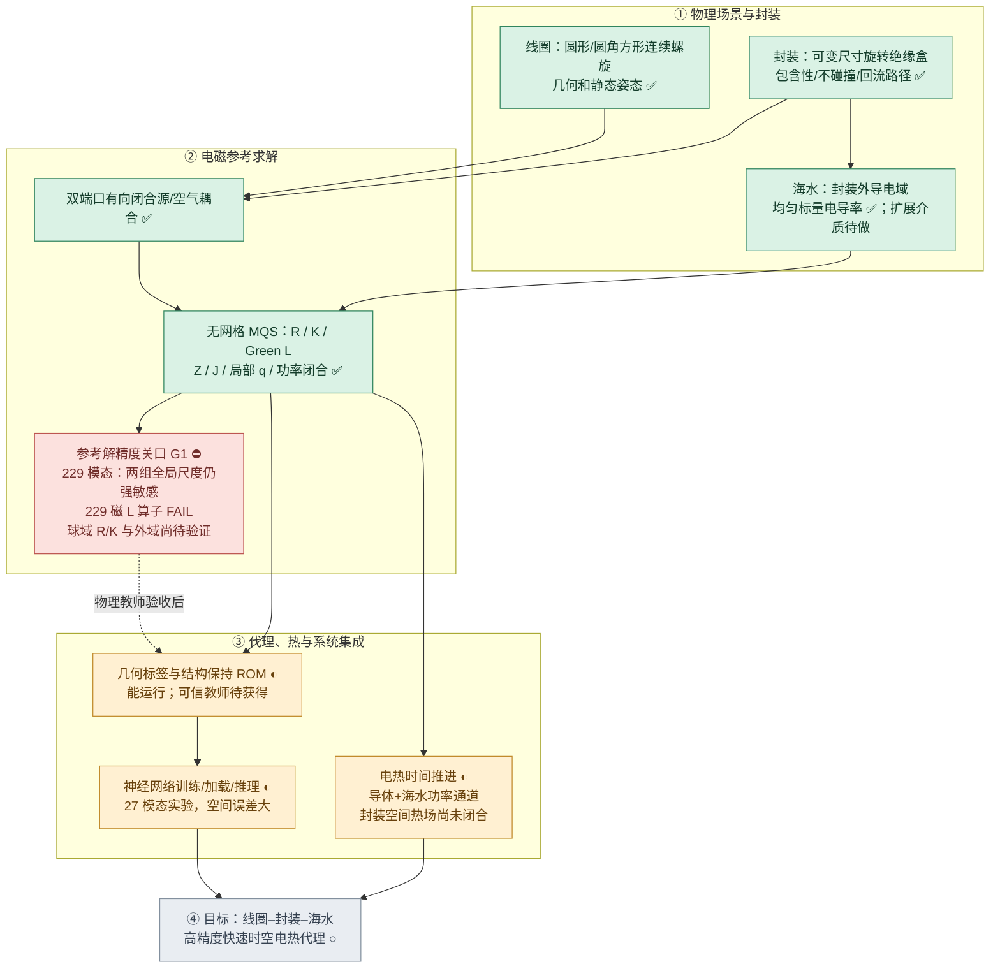

# BFZI 电磁热神经代理｜总体进度与验收看板

> **持续更新的项目进度入口** · 最近核对：2026-11-04 UTC · 工作分支：`research/bfzi-uwpt-electrothermal-surrogate`
>
> **当前阶段：G1 连续海水电磁参考解理论重核 + 可信离散方法重构。** 基础电磁弱式、互易/被动/端口耗散定理在其限定条件下正确；但 **229 模态、人工外边界、uniform-ball 磁核的连续精度未经认证**。已发现理论有限域测试空间漏写外球边界条件、实际外球截断将 J 的切向分量也置零、跨半径基函数并非严格嵌套，以及磁积分云球替代缺乏一致性证书。详见 [G1 理论重核 TeX](../../../theory/sections/11_g1_foundation_recheck.tex)。禁止将程序测试、能量闭合或 ROM 重建视为参考真解误差界。
>
> **最新本地实测：** 2026-11-04 UTC，本机代码基线 `19c2c52`，**60 passed**，229 模态、三阶精细 R/K、相同物理高斯方向的外域扩展 `0.85→1.05→1.30 m` 已运行：[自动上传摘要](runs/latest_summary.md) · [完整日志](runs/latest_full.log)。0.85→1.05m：`dZ=0.370%`、固定 0.52m 共域 `dJ=0.992%`、半径 0.35m 近区 `dJ=0.836%` / `dq=1.013%`，**FAIL**；1.05→1.30m：`dZ=0.951%`、共域 `dJ=2.297%`、近区 `dJ=1.392%` / `dq=0.504%`，**FAIL**。误差随外域放大**并非单调减小**，不能靠简单外推宣称收敛。本轮新增 `1.05→1.30→1.60m` 的外域续测及同一物理模态坐标系中**仅变 R/K 与仅变磁 L 的受控响应拆分**，代码已提交但**尚待本机实测**。Green L 独立磁算子此前 `dL=13.20%` FAIL，G1 仍阻塞，禁止使用 229 模态生成正式教师标签。

## 0. 项目范围（防止与旧 vNext 项目混淆）

**本项目：** 圆角方形／圆形**单根连续螺旋线圈族**，两套独立、可变尺寸与任意合法静态 SE(3) 位姿的**密封绝缘封装**，完整端口馈回流，封装外海水的双端口 MQS 电磁反作用、空间电流与焦耳热，导体损耗、封装／线圈／海水电热时间演化，以及跨几何快速神经代理。

- 几何主类型是 `BFZICoil`，**不是**历史 `SuperellipseSpiral`；不要把旧“双阶数超椭圆线圈”写成本项目目标或进度。
- 目前封装是旋转长方体 `InsulatingBox`，**非导电、非磁性**，通过 `BFZIAssembly` 与线圈、材料、显式回流路径绑定。尺寸和完整姿态可变。
- 目前海水是**均匀、各向同性、正标量电导率** `Seawater`；任意空间分布的复杂介质与完整多层封装材料尚不在当前已实现能力内。
- 旧 `sdfmpneo_vnext` 的 superellipse 能力属于另一条历史代码线；只在必要时复用基础材料／热模型能力，不列入 BFZI 已完成成果。

## 1. 一张图看整个项目



**当前位置：第②层的 G1 验收关口。** 第③层已有可运行原型，但未达到最后要求。图中 ✅ 表示功能及针对性测试已存在，**不是**该模块所有物理精度已认证。

## 2. 分模块进度看板

状态口径：**已实现**＝实际代码存在；**部分验证**＝有单元测试/局部实验但尚欠全面物理收敛；**未通过**＝明确观察到现有准确度/验收条件不满足；**待做**＝缺少完整实现或独立实验。避免使用主观百分比。

| 工作包 | 实现状态 | 数值/物理验收 | 具体结果与尚缺事项 |
|---|---|---|---|
| A1 圆形—圆角方形连续螺旋 | ✅ 已实现 | ◐ 基础测试 | `geometry.py`：圈数、形状参数、绕向、分段曲线与线元；未扩展成旧超椭圆项目 |
| A2 **双封装几何** | ✅ 已实现 | ◐ 基础测试 | `scene.py`：两套长宽厚、旋转/平移、线圈容纳、独立盒 OBB 不重叠、回流始终在盒内 |
| A3 **封装—海水电磁边界** | ✅ 已实现 | ◐ 尚需跨场景收敛 | 海水排除盒内；绝缘壁零法向电流；跟随盒体位姿的 curl 基；盒壁/角部/边缘局部求积 |
| A4 两端口物理源与铜内部损耗 | ✅ 已实现 | ◐ 特定假设 | 闭合回流、有向积分、空气耦合；圆线截面集肤近似，不含充分校验的完整邻近/联合铜海水导电求解 |
| B1 无网格 MQS R/L/K 求解 | ✅ 已实现 | ◐ 局部积分稳定 | 单频线性电磁、两端口阻抗、空间复电流、海水焦耳热、功率恒等式；有限人工外域 |
| B2 **空间参考解收敛** | ◐ 固定 229 物理模态外域已测至 1.30 m | ⛔ **外域未呈单调收敛，空间基尚未认证** | 0.85→1.05m 共域 J 0.992%，1.05→1.30m 反增至 2.297%；0.35m 近区 J 后者为 1.392%。下一轮拆分 R/K 和 Green L 对外域漂移的贡献 |
| B3 积分与磁核独立验证 | ◐ 角向/径向 R/K 局部稳定，外域 1.30m 已测 | ⛔ Green L 独立算子 FAIL；外域响应持续 FAIL | 方位角 3→4 和径向 0.06→0.04m 的局部 R/K 对照 PASS；但 1.05→1.30m 的空间 J 差异较前一步增大。新增共模态坐标的 R/K-only / L-only 诊断待测 |
| B4 残差估计与稀疏方向筛选 | ✅ 已实现 | ◐ **229 模态自适应已运行；60 tests passed** | 207 模态留一和误差上界已测；229 父空间严格筛选仍要求 229/229。上界只对固定父空间成立，不是连续物理误差保证 |
| C1 跨几何数据记录与固定场景 ROM | ✅ 已实现 | ◐ 父空间未收敛 | 几何、封装、位姿、材料和端口标签；固定场景 rank-4 实响应重建只对当前父空间精确 |
| C2 神经网络训练、加载、推理 | ✅ 实验版 | ⛔ 空间精度不足 | 6 训练/2 留出；27 模态不可靠标签；物理场监督改善 J/q，但数值仍大 |
| D1 电热时间推进和导体温度反馈 | ✅ 基础接口 | ◐ 未完成空间验收 | 两路导体加可选总海水热通道，电流/电压驱动、温度轨迹；海水电磁电导率目前不随温度更新 |
| D2 **封装内部/界面热场** | ◐ 外部 ROM 可配置温度节点 | ○ 真实空间验证待做 | 尚无从可变封装几何自动生成并验证的完整温度场、封装导热/海水扩散与边界热交换 |
| E 最终高精度快速时空代理 | ◐ 部分链路接通 | ○ 未完成 | 待可信教师、跨几何数据、联合热场与误差/速度基准 |

## 3. 封装专项路线图（不能从总进度中省略）


### 当前封装具体能力

- **已落地：** 两个尺寸独立的密封矩形非导电/非磁性封装；任意合法静态姿态；线圈与封装装配合法性；线圈馈回流始终在封装内；封装外海水裁剪；盒壁附近各向异性电流基与积分节点。
- **已作为数据输入：** 两个封装半尺寸与 3×3 旋转矩阵、位置、线圈/回流路径共同被编码到几何特征。
- **只具基础接口：** 可在外部降阶热模型中设置额外封装温度状态，但这**不是**由封装厚度、热导率及边界条件自动生成的高精度封装热场。
- **待完成：** 封装本体的空间导热和海水对流/扩散边界；不同尺寸/摆放下的局部温度与稳态/瞬态验证。当前不应声称已完成完整封装电热耦合。

## 4. 关键可复核的数值证据

### 4.1 207 模态电磁实验

| 同一场景中的比较 | Z 相对变化 | 全海水 `dJ_volume` | 局部热或说明 |
|---|---:|---:|---|
| 159→167：源面引导 | 0.0968% | 3.22% | 固定探针总 `dq=1.66%` |
| 167→199：边缘补丁 | 0.2926% | 5.47% | 固定探针总 `dq=9.82%` |
| 199→207：旋转各向异性 | 0.1492% | **3.96%** | 固定探针总 `dq=3.01%`；法向剖面最大峰值归一化变化 6.24% |
| 207：近壁法向 R/K 5→6 | **0.01335%** | **0.02016%** | `dq=0.01165%`，`response_gate=PASS` |
| 207：独立 uniform-ball 磁 L B/A | **0.02960%** | **0.08758%** | `dL=12.64%`，算子 FAIL、受迫响应 PASS；`dImZ=1.28%` |
| 207→210：新增 0.75× 全局尺度 curl | **179.01%** | **89.21%** | 两端口 J 变化 113.07%；封装法向热源峰值归一化变化 66.44% |
| 210→213：新增 2.4× 全局尺度 curl | **6.15%** | **20.10%** | 两端口 J 变化 22.64%；封装法向热源峰值归一化变化 4.84% |
| 213→229：封装角部源引导 curl | **0.00275%** | **0.7067%** | 两端口 J 变化 0.5617%；封装法向热剖面峰值归一化变化 0.3061% |
| 229：独立 uniform-ball 磁 L B/A | **0.07356%** | **0.15304%** | `dL=13.20%`、`dImZ=2.22%`，算子 FAIL、受迫响应 PASS、综合 FAIL |
| 229：球域极角 R/K 8→10 | **0.00429%** | **0.01378%** | `dq=0.02412%`，`response_gate=PASS` |
| 229：球域方位角 R/K 2→3 | **0.01287%** | **0.28451%** | `dq=0.57272%`，**response_gate=FAIL**；封装法向峰值归一化差 0.62110% |
| 229：球域方位角 R/K 3→4 | **0.00509%** | **0.02326%** | `dq=0.04228%`，**response_gate=PASS**；同一父空间两高阶规则已趋稳定 |
| 229：球域径向 0.06→0.04m | **7.25×10⁻⁷%** | **1.90×10⁻⁶%** | `dq=1.45e-9`（相对量），**response_gate=PASS**；仅此径向分片轴 |
| 229：外域 0.52→0.70m（三阶精细 R/K） | **3.7509%** | **13.1712%**（共同 0.52m 湿区） | 原有四个体积探针 `dq=18.3645%`、海水功率变化 2.5141%，**FAIL** |
| 229：外域 0.70→0.85m（三阶精细 R/K） | **0.6484%** | **1.9287%**（共同 0.52m 湿区） | 原有四个体积探针 `dq=4.0557%`、海水功率变化 0.4269%，**FAIL** |
| 229：外域 0.85→1.05m（三阶精细 R/K） | **0.3700%** | **0.9924%**（共同 0.52m 湿区） | 设备近区 `dJ=0.8356%`、`dq=1.0132%`，探针 q 0.2083%，**FAIL** |
| 229：外域 1.05→1.30m（三阶精细 R/K） | **0.9506%** | **2.2970%**（共同 0.52m 湿区） | 设备近区 `dJ=1.3923%`、`dq=0.5037%`，探针 q 0.5941%，**FAIL**，差异反增 |

这里的“全海水 J”是相同细积分 `R` 下的 `sqrt(Δuᴴ R Δu / u_refᴴ R u_ref)`，不是以有限探针代替整个积分域。表中连续层级的变化只能证明**新方向仍重要**，不能证明新结果比旧结果更接近连续真解。

- **法向 R/K 已有数值证据：** 当前 207 基内 `dR=9.821e-5`、`dK=1.23374e-5`、`dJ_ports_volume=0.000226541`，5→6 阶比较通过。这**不等于**所有积分轴或 Green 磁算子都已收敛。
- **207 模态独立磁 Green L 对照已运行：** B 规则含 **15,154** 个节点，固定同一 207 模态、细 R/K、端口源及空间探针；A/B 得 `dL=0.126388`、`dZ=0.000295995`、`dReZ=5.3489e-5`、`dImZ=0.0128088`、`dJ_volume=0.000875828`、`dJ_ports_volume=0.000953918`、`dq=4.45415e-5`、`max_probe_dq=0.00117331`、`B_on_A_Rinv_residual=0.000954538`，`operator_gate=FAIL`、`response_gate=PASS`。受迫场的差异低于 0.1%，但**磁算子整体仍相差 12.64%，而阻抗虚部相差 1.28%**。这说明当前激励对部分算子差异不敏感；不能把一次 B/A 响应 PASS 外推到不同线圈、封装与介质几何，更不能宣称 L 已收敛。与早先 167 模态的 `dL=0.103331` 一样，算子精度问题依然存在。
- **229 模态外域续测 0.85→1.05→1.30m（最新，2026-11-04 UTC，60 passed）：** 同一套 229 物理高斯方向与三阶精细 R/K。海水功率依次为 `0.0011821263/0.0011842132/0.0011886402 W`。第一步 `dZ=0.00369954`、`dJ_common=0.00992417`、`dJ_near035=0.00835574`、`dq_near035=0.0101324`，**FAIL**。第二步 `dZ=0.00950606`、`dJ_common=0.0229696`、`dJ_near035=0.013923`、`dq_near035=0.00503747`，**FAIL**；其中端口和 J 变化反而增大，可能混合了外域/边界 taper 对真实离散空间的影响，以及各半径独立 R/K、Green L 的求积偏差。已新增统一白化坐标下仅换 R/K、仅换 L 的受控敏感性对照，但尚未实测，不能断言根源。证据：[最新摘要](runs/latest_summary.md)。
- **229 模态固定物理基外域实验（最新，2026-11-04 UTC，60 passed）：** 不随半径缩减模态，三阶精细 R/K 节点分别为 `563728 / 625936 / 667408`；外径 `0.52/0.70/0.85 m` 时海水功率 `0.0012178112/0.0011871948/0.0011821263 W`。第一步 `dZ=0.0375088`、`dJ_common=0.131712`、`dJ_ports_common=0.145801`、`dq=0.183645`、`dP=0.0251406`，**FAIL**；第二步 `dZ=0.00648359`、`dJ_common=0.0192869`、`dJ_ports_common=0.0214407`、`dq=0.0405572`、`dP=0.00426931`，仍 **FAIL**。其中共域指标采样固定半径 0.52m 的海水，包含原人工边界附近，可能高估封装近区的直接影响；已经新增半径 0.35m 近区指标来分别检查。**尚无外域收敛平台，也无法将磁核求积误差与域截断误差完全解耦。**
- **229 模态角向高阶和径向 R/K 收敛（最新，2026-11-04 UTC，60 passed）：** 方位角 2→3 `dJ_volume=0.00284505`、`dq=0.00572717`，q 仍 FAIL；但进一步 3→4 得 `dR=0.000293162`、`dK=0.000118234`、`dJ_volume=0.000232565`、`dq=0.000422756`、封装法向峰值归一化 `0.00045455`，**PASS**。同场景径向分片最大宽度 0.06→0.04m `dJ_volume=1.89663e-8`、`dq=1.45338e-9`，**PASS**。因而细 R/K 方位角最小可靠试验阶数暂取 3；不能把此结论外推至任意封装场景，更不能覆盖 229 磁 L 算子失败。证据：[最新日志摘要](runs/latest_summary.md)。
- **最新独立球域角度 R/K 验证（2026-11-04 UTC，60 passed）：** 固定 229 模态、相同 Green L、同一封装与端口，极角 8→10 对照 `dR=0.000438292`、`dK=0.00020224`、`dJ_volume=0.000137776`、`dq=0.000241242`，**PASS**。方位角复合 Gauss 2→3 得 `dR=0.00340629`、`dK=0.000925737`、`dJ_volume=0.00284505`、`dq=0.00572717`、`max_probe_dq=0.00621096`、`normal_peak_scaled_dq=0.00621096`，整体 q 变化 **0.5727% 超过 0.5% 门槛**，故 **FAIL**；阻抗虚部差 `dImZ=5.49805e-05`，其他单项偏差相对小。该失败还不足以断言当前物理电流基有大错，需检验 3→4 是否稳定和球域径向误差。原始证据：[最新摘要](runs/latest_summary.md)。
- **最新 207→210→213→229 尺度分解（2026-11-03，60 passed）：** 0.75× 全局长度尺度（新增 3 个方向）造成 `dZ=1.79013`、`dJ_volume=0.892147`、`dJ_ports_volume=1.13071`，对应 `min_R_independent_fraction=0.177163`；再加入 2.4× 尺度（新增 3 方向）产生 `dZ=0.0614532`、`dJ_volume=0.201029`、`dJ_ports_volume=0.226387`，对应独立比例 `0.117633`。两个全局尺度都不是可以忽略的装饰基；但条件数 `1.57×10⁵`（归一化 R Gram）并不单独证明其物理准确度。**最新 229 模态磁 L B/A**：`dL=0.131987`、`dImZ=0.0222468`、`dJ_volume=0.00153044`、`dJ_ports_volume=0.00167289`、`operator_gate=FAIL`、`response_gate=PASS`、`combined_gate=FAIL`。此处响应 PASS 是目前已有筛选指标的判定，**并未将 2.22% 的虚部阻抗变化视为已达高精度**；仍须继续独立积分和外域验证。数据来源：[最新自动上传摘要](runs/latest_summary.md)。
- **229 模态定向实验已运行（59 passed）：** 207→213（加六个不同径向尺度的全局电流方向）得到 `dZ=1.95291`、`dJ_volume=0.931925`、`dJ_ports_volume=1.18121`、`dq=0.668683`、`dP=0.868147`，是**严重的父空间敏感性**，不是已被证实的精度提升。新解的端口损耗、全局电流和离封装较远处的 Joule 热都发生显著变化；既可能涉及缺失的长尺度电流方向，也须排除新方向的 Gram 条件数、磁积分与 R/K 求积误差放大。213→229 进一步的角部源引导模式带来 `dJ_volume=0.00706703`、`dJ_ports_volume=0.00561699`，法向热源峰值归一化变化 `0.00306073`。自适应筛选仍是 `FULL_PARENT_ONLY 229/229`，不是连续误差证书。**不能把 229 称为收敛参考解，更不能据此训练正式标签。**
- **固定参考父空间自适应筛选（旧 58 passed、207 父空间）：** 引入组合激励和双端口 `dJ_volume ≤1%` 门槛后，仍仅在 **207/207** 达成 `FULL_PARENT_ONLY`。自适应 199/207 子集虽有 `dZ=0.000169121`，但相对完整 207 父解 `dJ_volume=0.0137221`、`dJ_ports_volume=0.0111407`、`max_probe_dq=1.01893`，因此不能宣称已充分压缩。**注意此自适应 199 模态子集并非前述严格嵌套的原始 199 模态**；两种 199→207 指标不可相互替代。
- **父空间能量残差上界已经运行：** 固定 207 模态父空间的单位端口复解，159/167/199 嵌套层级的 `parent_dJ_energy_upper` 分别为 `0.0795815`、`0.0714843`、`0.0403659`；207 模态自身约 `2.79e-13`。早期 15/27 模态为 `inf`，表示该保守界无法给出有意义的相对上界，并非求解发散。**上界的分子/分母是双端口单位场的总 R 能量**，需与 `dJ_ports_volume` 对比，而不是混同于指定组合电流下的 `dJ_volume`。该界只对应固定积分、固定父空间。
- **完整父空间留一模态实验（最新）：** `mode=186` 是位于海水域中心、宽度约 `0.408322 m` 的长尺度**全局电流模态**，删除时相对完整父解 `dJ_volume=0.301786`、双端口 `0.382202`，提示全局海水环流不可忽略。封装面角部的 `mode=16`、`58`、`56` 删除后，40 点法向热剖面峰值归一化最大变化分别约 `53.60%`、`50.39%`、`50.00%`，说明封装**角部**热源对局部电流方向敏感。它们只是当前父空间内**已有模态的留一影响**，无法定位父空间外尚缺的真实连续电流方向。
- **固定场景 snapshot rank-4：** 在同一频率/几何上对已经求得的有限父空间响应接近机器精度；不能替代父空间精度认证或跨几何神经泛化。

### 4.2 现有神经实验（暂不视为最终性能）

仅有 8 个初步几何样本（6 训练 / 2 留出），来源为尚未通过物理收敛的 **27 模态**教师：

| 留出误差 | 早期网络 | 加入电流及热源损失后的网络 |
|---|---:|---:|
| 双端口阻抗 Z | 9.04% | 9.36% |
| 驱动电流场 J | 79.60% | 70.33% |
| 局部焦耳热 q | 92.71% | 81.20% |

网络的训练、保存、加载与查询功能存在，但**“可以跑”≠“可信高精度”**。优先解决参考标签的空间准确度，再考虑大规模新数据集。

## 5. 待跨越的验收关口（按依赖顺序）

### G1 理论重核结论（2026-11-04 UTC）

已将 [G1 理论重核](../../../theory/sections/11_g1_foundation_recheck.tex) 纳入 `theory/main.tex`，并修正 `03a` 中有限域测试空间的全边界零法向条件及 `03b` 中把多边界分支误同于非平凡拓扑环流的含混表述。

| 理论层级 | 审查结论 | 对当前 G1 的含义 |
|---|---|---|
| 线性 MQS 的 A–φ 与电流弱式 | **条件正确；已修正边界项前提** | 有限域必须处理整个边界的 `φ J·n` 项；人工绝缘截断仅是一种近似 |
| 端口 `Zsw = ω² Kᵀ(R+jωL)⁻¹K` 与功率等式 | **数学上正确**（实闭合端口、R 正定、L 半正定、同源积分） | 证明离散互易/被动，不证明 J/q 真值精度 |
| 当前 curl 高斯空间 | **合规，但未证明稠密/完备** | 229 不自动成为物理真解；边界层将外球切向 J 也压为 0 |
| uniform-ball Coulomb Green | **能保证离散磁能结构，但未证明积分一致性** | 13.20% 的独立 L 算子差异仍需解决；球云不是实际体积分单元 |
| 有限外域与无穷海水 | **尚未收敛** | 默认 `f=200 kHz, σ=5 S/m` 时皮肤深度约 0.503 m；旧 0.52～1.30m 外域缺充分远场依据 |
| 229 父空间残差上界 | **仅固定父空间内部有效** | 不等于连续函数空间残差的上界；热点需独立局部验证 |

**研发策略已调整：** 不再把“再加三个高斯模态、再扩大一段外域、继续重复经验阈值”当作推进 G1 的默认方法。优先在**固定物理场景与固定外域**完成 Green L 的连续双积分一致性及其作用于实际驱动子空间的验证，再构造具系统加密参数和可解释残差的 curl/Piola 近盒、间隙、远场空间；随后用可靠的无限域截断/透明边界或独立高精度参考控制域误差。外域 `--basis-domain-far` 的 R/K-only/L-only 可作为辅助定位实验，但**不是 G1 验收的主路径**。


**G1 下一个具体行动（按新证据更新）：**

1. ✅ **已完成：** 207 模态的残差上界和物理模态留一分析已本地运行，识别到一个显著的长尺度全局模式及一组封装角部高影响模式；不再重复这项昂贵计算。
2. ✅ **已完成：** 独立 207 模态 uniform-ball Green L B/A 对照，`operator_gate=FAIL`，`response_gate=PASS`，`dImZ=1.28088%`；后续不得把当前受迫响应稳定误读为整体算子收敛。
3. ✅ **已完成 60 passed 实测：** 207→213→229 定向嵌套实验（新 GitHub 日志复现）。发现大尺度新方向引发 **93.19% 全海水 J** 与 **195.29% Z** 变化，原始 207 父空间明显不完整；新增 16 个封装角部源引导方向产生的较小变化，不能掩盖这个全局问题。**先不扩充训练样本。**
4. ✅ **已完成：** 207→210→213→229 双全局尺度分解；0.75× 组造成最大变化，2.4× 组仍显著；229 Green L B/A 算子 FAIL，受迫 J 约 0.15% 相对差异，但 ImZ 约 2.22%。
5. ✅ **已完成：** 球域极角 8→10 PASS；方位角 2→3 的 `dq` 门槛 FAIL（0.5727%＞0.5%），没有隐藏该 FAIL，也没有擅自放宽阈值。
6. ✅ **已完成：** 229 模态方位角 3→4、径向 0.06→0.04m 均 PASS；旧 2→3 q FAIL 保留在证据表。精细 R/K 方位角基准升级到 3（**代码已提交，尚未重跑**），不修改一般 `SeaMQSConfig` 默认值。
7. ✅ **已完成：** 229 个物理模态方向固定的外域 0.52→0.70→0.85 m 三阶精细 R/K 实测，两个步长**全部 FAIL**。尤其 0.70→0.85 m 的 J 共域差 1.93%，探针 q 差 4.06%。不把 0.85m 冒充为已收敛的参考域。
8. ✅ **已完成：** `0.85→1.05→1.30m` 的固定 229 模态外域实测，**两步皆 FAIL**。特别是 `1.05→1.30m` 的 `dZ=0.9506%`、共域 J 2.297%、近区 J 1.392%，并未单调收敛。
9. ✅ **理论重核已完成并入库（不等于 G1 已通过）：** 校正有限域弱式的全边界条件，区分普通远场电流与真正拓扑谐和模态，明确同源被动定理只是离散正确性；审查外球切向 J 过强截断、均体积球核及跨半径基函数非嵌套。详细证明见 `theory/sections/11_g1_foundation_recheck.tex`。
10. **真正优先的下一项实现：** 固定一个外域和几何，将 `uniform_ball` Green L 与可系统加密的原始 Coulomb 体积分（近对角单元奇异处理、真实面片支撑、远场核加速）独立比较，并核对无量纲 `ω‖R⁻¹ᐟ² ΔL R⁻¹ᐟ²‖` 及双端口 J/q；没有固定域下的可信磁核就不再盲目拉大 R。
11. **之后实现：** 局部/间隙/远场可系统 h/阶次加密的合规 curl/Piola 基；再研究与磁扩散尺度匹配的人工外边界或透明边界。必要时采用一小组不同离散原则的独立参考核对。**所有证据成立前不得正式训练。**
12. `--basis-domain-far` 已提交的 R/K-only/L-only 敏感性拆分可自愿运行，它只帮助归因旧日志中的非单调性，不能直接作为 G1 精度结论。

当前可复现命令（在本地工作树执行，非 GitHub Actions）：

```powershell
git pull --ff-only
# 可选诊断：固定229方向，分离不同外域的R/K与磁L敏感性
# 注意：这不是G1的连续真解验收，默认不再以扩大外域作为主推进策略
python run.py --mode bfzi-convergence --basis-domain-ball --basis-ball-targeted --basis-domain-far --with-tests
# 可选：--verbose-log 恢复终端详细输出；--no-publish-log 只保存在本地
# 已完成并保留的对照重现（可选，均比较昂贵）：
python run.py --mode bfzi-convergence --basis-ball-aniso --basis-ball-check-l
python run.py --mode bfzi-convergence --basis-ball-aniso --basis-ball-ablate
```

## 6. 维护规约：怎样保持“及时更新”

本文件是**当前进度的单一权威来源**，`README.md` 和本研究目录的索引只链接到它；历史 `validation_roadmap.md` 与阶段研究日志是当时的计划快照。

- **发生实质代码变更时：** 同一轮提交或紧随其后的提交，更新第 2 节模块状态、第 5 节下一关口；尚未运行的测试必须标明“待验证”。
- **收到新的本地 pytest/数值日志时：** 在更新实现的同时维护第 4 节证据，写清**测试运行日期、模态数、对照条件、指标与 PASS/FAIL**。保留关键失败结果，不以最新实验覆盖历史重要问题。
- **封装、电磁、网络、热进展改变时：** 同步修改第 1/3/5 节图节点；不要只改文字而忘记 Mermaid 图和验收状态。
- **状态规则：** 数值可运行 ≠ 物理场收敛；一条轴的积分通过 ≠ 全域通过；固定场景重建 ≠ 跨场景泛化；未运行的测试不得写成 PASS。
- **执行方式：** 随日常代码/实验更新直接修改 Markdown，无 GitHub Actions、无后台定时提交、无新增审计体系。若没有新证据，保留原状态，不人为推进进度百分比。

### 更新记录

| 日期 | 进度变化 | 依据 |
|---|---|---|
| 2026-11-01～02 | 理论和物理原型已落地；海水试探基从 27 扩展至 199 模态 | 仓库主代码、用户数值日志 |
| 2026-11-03 | 207 模态试验完成；法向 R/K 5→6 响应门槛 PASS，**空间参考解仍未收敛** | 57 个测试通过；207 模态与法向积分本地日志 |
| 2026-11-03 | 新增父空间误差上界、模态消融、全域电流筛选门槛；尚待重新运行 | 代码基线 `cb33df6` |
| 2026-11-03 | 建立本总体 Mermaid 路线图、封装专项图、验收看板及维护规则 | 本进度文档 |
| 2026-11-03 | **58 passed；207 模态父空间误差上界和留一模态实验完成，199/207 自适应仍不满足全域 J 与局部 q 严格门槛；G1 未通过** | 用户本地 `cb33df6` 日志；全局 mode 186、封装角部 mode 16/58/56 |
| 2026-11-03 | **207 模态独立磁 A/B：L 算子门槛 FAIL、受迫响应 PASS，Im(Z) 差 1.28%** | 本次用户本地 `ef9c524` 工作树日志；B 节点 15154 |
| 2026-11-03 | **59 passed；207→213→229 定向实验完成**；全局尺度扩充引起 93.19% 全海水 J 与 195.29% 阻抗变化；229/229 才匹配固定父空间 | 用户本地 `908f59b` 代码日志 |
| 2026-11-03 | 增加默认精简终端显示、最新运行摘要和完整日志文件、退出后本地 Git 自动提交推送；**已在用户 Windows 环境验证** | 最新本地 `e95a377` 运行；[自动上传的 60 passed 摘要](runs/latest_summary.md) |
| 2026-11-03 | **60 passed；207→210→213→229 双全局尺度拆分完成**；0.75× 组 dJ 89.21%，2.4× 组 dJ 20.10%；229 磁 B/A 算子 FAIL，ImZ 变化 2.22% | 基线 `8193aa8` 的 [自动上传完整日志](runs/latest_full.log) |
| 2026-11-03 | 新增固定 229 模态的独立球域极角、方位角 R/K 积分诊断及日志摘要支持；已运行：**极角 PASS、方位角 q FAIL** | [2026-11-04 UTC 自动归档摘要](runs/latest_summary.md)；60 passed |
| 2026-11-04 UTC | **60 passed，229 方位角 3→4 `dq=0.0423%` PASS、径向 0.06→0.04m PASS**；旧 2→3 q FAIL 保留 | 基线 `7982bfa`、[自动上传最新摘要](runs/latest_summary.md) |
| 2026-11-04 UTC | 将 BFZI 实验精细 R/K 方位角基准升级为 3；同族 229 模态外域 0.52/0.70/0.85m **60 passed，外域两个步长均 FAIL** | 本地 `60a3ba7` 的 [自动上传摘要](runs/latest_summary.md) |
| 2026-11-04 UTC | **60 passed**：已实测固定 229 模态 `0.85→1.05→1.30m`，近区/共域 J 与阻抗误差未单调收敛，两步均 FAIL | 基线 `19c2c52`，[最新自动上传日志](runs/latest_summary.md) |
| 2026-11-04 UTC | 新增 `1.05→1.30→1.60m` 外域续测及同一白化模态坐标下独立 R/K-only、L-only 误差归因表格；**待本机运行** | `--basis-domain-far`，修改物理求解和日志汇总，不使用 GitHub Actions |
| 2026-11-04 UTC | **G1 理论重核**：修正有限域外边界弱式定义，确认 R/L/K 被动功率定理的适用范围，指出外球强约束、非嵌套空间及磁 Green 球云一致性缺口；重新确定先修固定域 Green L、系统基空间，再验证外域 | `theory/sections/11_g1_foundation_recheck.tex`，G1 保持阻塞，未冒称新数值通过 |

---
[研究目录索引](README.md) · [验证计划历史快照](validation_roadmap.md) · [代码入口](CODE_ENTRY.md) · [仓库根目录](../../../README.md)
