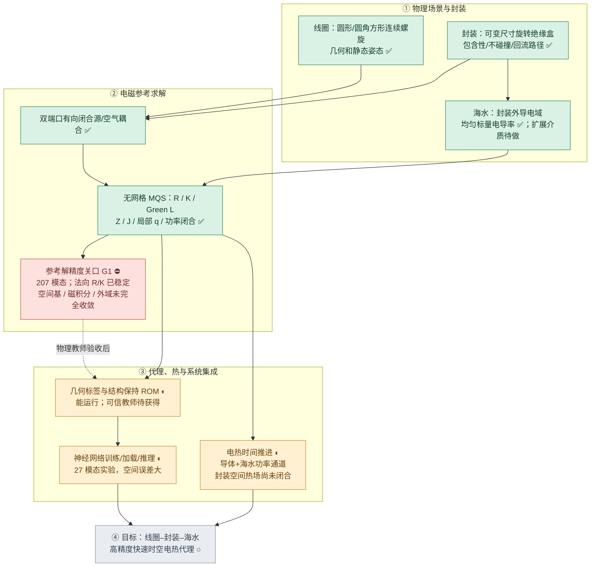

# BFZI 电磁热神经代理｜总体进度与验收看板

> **持续更新的项目进度入口** · 最近核对：2026-11-03 · 工作分支：`research/bfzi-uwpt-electrothermal-surrogate`
>
> **当前阶段：电磁参考解的空间收敛（关口 G1）。** 核心物理原型、数据/ROM、实验神经代理和基础电热时间推进已经接通；但 **207 模态不是已认证的高精度参考解**。禁止把“测试通过、端口功率闭合、固定场景 ROM 精确重建”混同于真实空间电流/热源收敛。
>
> **证据截至：** 用户本地 2026-11-03 日志在代码基线 `0ff0d24` 上实测 **57 passed**，207 模态及法向 R/K 5→6 积分对照完成。之后到 `cb33df6` 新增的残差上界、单模态消融和筛选门槛**尚待本地重新运行**。若后续提交只修改文档，切勿把文档提交 SHA 写成“已经测试的代码 SHA”。

## 0. 项目范围（防止与旧 vNext 项目混淆）

**本项目：** 圆角方形／圆形**单根连续螺旋线圈族**，两套独立、可变尺寸与任意合法静态 SE(3) 位姿的**密封绝缘封装**，完整端口馈回流，封装外海水的双端口 MQS 电磁反作用、空间电流与焦耳热，导体损耗、封装／线圈／海水电热时间演化，以及跨几何快速神经代理。

- 几何主类型是 `BFZICoil`，**不是**历史 `SuperellipseSpiral`；不要把旧“双阶数超椭圆线圈”写成本项目目标或进度。
- 目前封装是旋转长方体 `InsulatingBox`，**非导电、非磁性**，通过 `BFZIAssembly` 与线圈、材料、显式回流路径绑定。尺寸和完整姿态可变。
- 目前海水是**均匀、各向同性、正标量电导率** `Seawater`；任意空间分布的复杂介质与完整多层封装材料尚不在当前已实现能力内。
- 旧 `sdfmpneo_vnext` 的 superellipse 能力属于另一条历史代码线；只在必要时复用基础材料／热模型能力，不列入 BFZI 已完成成果。

## 1. 一张图看整个项目



**当前位置：第②层的 G1 验收关口。** 第③层已有可运行原型，但未达到最后要求。图中 ✅ 表示功能及针对性测试已存在，**不是**该模块所有物理精度已认证。

## 2. 分模块进度看板

状态口径：**已实现**＝实际代码存在；**部分验证**＝有单元测试/局部实验但尚欠全面物理收敛；**未通过**＝明确观察到现有准确度/验收条件不满足；**待做**＝缺少完整实现或独立实验。避免使用主观百分比。

| 工作包 | 实现状态 | 数值/物理验收 | 具体结果与尚缺事项 |
|---|---|---|---|
| A1 圆形—圆角方形连续螺旋 | ✅ 已实现 | ◐ 基础测试 | `geometry.py`：圈数、形状参数、绕向、分段曲线与线元；未扩展成旧超椭圆项目 |
| A2 **双封装几何** | ✅ 已实现 | ◐ 基础测试 | `scene.py`：两套长宽厚、旋转/平移、线圈容纳、独立盒 OBB 不重叠、回流始终在盒内 |
| A3 **封装—海水电磁边界** | ✅ 已实现 | ◐ 尚需跨场景收敛 | 海水排除盒内；绝缘壁零法向电流；跟随盒体位姿的 curl 基；盒壁/角部/边缘局部求积 |
| A4 两端口物理源与铜内部损耗 | ✅ 已实现 | ◐ 特定假设 | 闭合回流、有向积分、空气耦合；圆线截面集肤近似，不含充分校验的完整邻近/联合铜海水导电求解 |
| B1 无网格 MQS R/L/K 求解 | ✅ 已实现 | ◐ 局部积分稳定 | 单频线性电磁、两端口阻抗、空间复电流、海水焦耳热、功率恒等式；有限人工外域 |
| B2 **空间参考解收敛** | ◐ 207 模态试验 | ⛔ 当前主瓶颈 | 199→207 的全域电流变化仍约 3.96%，缺少可靠参考解精度认证 |
| B3 积分与磁核独立验证 | ◐ 分轴诊断已接通 | ⛔ 尚不完整 | 207 模态法向 R/K 5→6 通过；167 模态磁 A/B **算子门槛失败**；207 磁 A/B 未运行 |
| B4 残差估计与稀疏方向筛选 | ✅ 代码已提交 | ○ 新代码待运行 | 固定父空间电流能量上界、删一模态敏感性排序、全域 J 接受门槛；不等于连续物理误差上界 |
| C1 跨几何数据记录与固定场景 ROM | ✅ 已实现 | ◐ 父空间未收敛 | 几何、封装、位姿、材料和端口标签；固定场景 rank-4 实响应重建只对当前父空间精确 |
| C2 神经网络训练、加载、推理 | ✅ 实验版 | ⛔ 空间精度不足 | 6 训练/2 留出；27 模态不可靠标签；物理场监督改善 J/q，但数值仍大 |
| D1 电热时间推进和导体温度反馈 | ✅ 基础接口 | ◐ 未完成空间验收 | 两路导体加可选总海水热通道，电流/电压驱动、温度轨迹；海水电磁电导率目前不随温度更新 |
| D2 **封装内部/界面热场** | ◐ 外部 ROM 可配置温度节点 | ○ 真实空间验证待做 | 尚无从可变封装几何自动生成并验证的完整温度场、封装导热/海水扩散与边界热交换 |
| E 最终高精度快速时空代理 | ◐ 部分链路接通 | ○ 未完成 | 待可信教师、跨几何数据、联合热场与误差/速度基准 |

## 3. 封装专项路线图（不能从总进度中省略）


### 当前封装具体能力

- **已落地：** 两个尺寸独立的密封矩形非导电/非磁性封装；任意合法静态姿态；线圈与封装装配合法性；线圈馈回流始终在封装内；封装外海水裁剪；盒壁附近各向异性电流基与积分节点。
- **已作为数据输入：** 两个封装半尺寸与 3×3 旋转矩阵、位置、线圈/回流路径共同被编码到几何特征。
- **只具基础接口：** 可在外部降阶热模型中设置额外封装温度状态，但这**不是**由封装厚度、热导率及边界条件自动生成的高精度封装热场。
- **待完成：** 封装本体的空间导热和海水对流/扩散边界；不同尺寸/摆放下的局部温度与稳态/瞬态验证。当前不应声称已完成完整封装电热耦合。

## 4. 关键可复核的数值证据

### 4.1 207 模态电磁实验

| 同一场景中的比较 | Z 相对变化 | 全海水 `dJ_volume` | 局部热或说明 |
|---|---:|---:|---|
| 159→167：源面引导 | 0.0968% | 3.22% | 固定探针总 `dq=1.66%` |
| 167→199：边缘补丁 | 0.2926% | 5.47% | 固定探针总 `dq=9.82%` |
| 199→207：旋转各向异性 | 0.1492% | **3.96%** | 固定探针总 `dq=3.01%`；法向剖面最大峰值归一化变化 6.24% |
| 207：近壁法向 R/K 5→6 | **0.01335%** | **0.02016%** | `dq=0.01165%`，`response_gate=PASS` |

这里的“全海水 J”是相同细积分 `R` 下的 `sqrt(Δuᴴ R Δu / u_refᴴ R u_ref)`，不是以有限探针代替整个积分域。表中连续层级的变化只能证明**新方向仍重要**，不能证明新结果比旧结果更接近连续真解。

- **法向 R/K 已有数值证据：** 当前 207 基内 `dR=9.821e-5`、`dK=1.23374e-5`、`dJ_ports_volume=0.000226541`，5→6 阶比较通过。这**不等于**所有积分轴或 Green 磁算子都已收敛。
- **磁积分仍有关键风险：** 167 模态独立 uniform-ball L B/A `dL=0.103331`，算子门槛 FAIL，受迫响应门槛 PASS。207 模态独立磁 B/A 尚无实测结果。
- **固定参考父空间自适应筛选：** 最近已运行的 207 模态筛选仅在 207/207 时达到全部严格固定探针匹配。随后代码新增更严格的全域 J ≤1% 门槛，尚未获取其新运行日志。
- **固定场景 snapshot rank-4：** 在同一频率/几何上对已经求得的有限父空间响应接近机器精度；不能替代父空间精度认证或跨几何神经泛化。

### 4.2 现有神经实验（暂不视为最终性能）

仅有 8 个初步几何样本（6 训练 / 2 留出），来源为尚未通过物理收敛的 **27 模态**教师：

| 留出误差 | 早期网络 | 加入电流及热源损失后的网络 |
|---|---:|---:|
| 双端口阻抗 Z | 9.04% | 9.36% |
| 驱动电流场 J | 79.60% | 70.33% |
| 局部焦耳热 q | 92.71% | 81.20% |

网络的训练、保存、加载与查询功能存在，但**“可以跑”≠“可信高精度”**。优先解决参考标签的空间准确度，再考虑大规模新数据集。

## 5. 待跨越的验收关口（按依赖顺序）


**G1 下一个具体行动：**

1. 运行新增的残差能量上界、物理模态删一敏感性实验，辨识对全域 J 和封装法向热源影响最大的方向；先避免无限制地堆叠模态。
2. 在 **207 模态不变** 前提下执行独立 Green L B/A 检查，区分算子/受迫响应误差。
3. 根据前两项证据决定下一组物理电流方向；再检验基底、其他 R/K 积分轴和人工外域的稳定性。
4. 只有参考 J 与 q 达到明确的跨场景容差，才进入正式跨封装尺寸/姿态的标签生成与网络训练。

当前可复现命令（在本地工作树执行，非 GitHub Actions）：

```powershell
git pull --ff-only
python -m pytest tests/test_bfzi_geometry_v1.py tests/test_bfzi_mqs_v1.py tests/test_bfzi_neural_v1.py -q
python run.py --mode bfzi-convergence --basis-ball-aniso --basis-ball-ablate
# 磁积分独立 B/A，额外昂贵，按需要单独执行：
python run.py --mode bfzi-convergence --basis-ball-aniso --basis-ball-check-l
```

## 6. 维护规约：怎样保持“及时更新”

本文件是**当前进度的单一权威来源**，`README.md` 和本研究目录的索引只链接到它；历史 `validation_roadmap.md` 与阶段研究日志是当时的计划快照。

- **发生实质代码变更时：** 同一轮提交或紧随其后的提交，更新第 2 节模块状态、第 5 节下一关口；尚未运行的测试必须标明“待验证”。
- **收到新的本地 pytest/数值日志时：** 在更新实现的同时维护第 4 节证据，写清**测试运行日期、模态数、对照条件、指标与 PASS/FAIL**。保留关键失败结果，不以最新实验覆盖历史重要问题。
- **封装、电磁、网络、热进展改变时：** 同步修改第 1/3/5 节图节点；不要只改文字而忘记 Mermaid 图和验收状态。
- **状态规则：** 数值可运行 ≠ 物理场收敛；一条轴的积分通过 ≠ 全域通过；固定场景重建 ≠ 跨场景泛化；未运行的测试不得写成 PASS。
- **执行方式：** 随日常代码/实验更新直接修改 Markdown，无 GitHub Actions、无后台定时提交、无新增审计体系。若没有新证据，保留原状态，不人为推进进度百分比。

### 更新记录

| 日期 | 进度变化 | 依据 |
|---|---|---|
| 2026-11-01～02 | 理论和物理原型已落地；海水试探基从 27 扩展至 199 模态 | 仓库主代码、用户数值日志 |
| 2026-11-03 | 207 模态试验完成；法向 R/K 5→6 响应门槛 PASS，**空间参考解仍未收敛** | 57 个测试通过；207 模态与法向积分本地日志 |
| 2026-11-03 | 新增父空间误差上界、模态消融、全域电流筛选门槛；尚待重新运行 | 代码基线 `cb33df6` |
| 2026-11-03 | 建立本总体 Mermaid 路线图、封装专项图、验收看板及维护规则 | 本进度文档 |

---
[研究目录索引](README.md) · [验证计划历史快照](validation_roadmap.md) · [代码入口](CODE_ENTRY.md) · [仓库根目录](../../../README.md)
