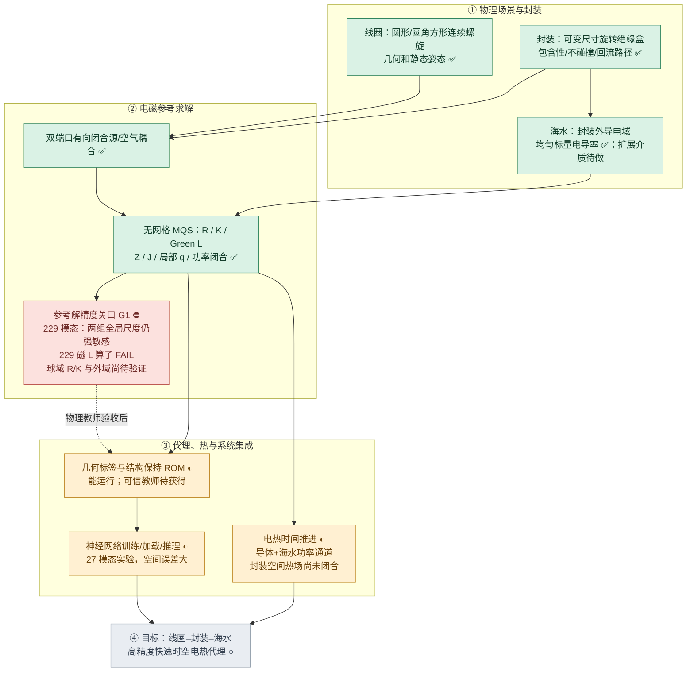

> **2026-11-14｜F14 完整电磁热物理直接法实机复核阶段结果（XEnergy）**：已按 `BFZI_MAINLINE_CLOSURE_V1.md` 在 XEnergy 用原 BFZI V150 依赖和 SDFMPNEO 修复后物理直接法复算 F12/F14/F16；全部固定 2 mm 海水热层，medium/extra 空间对照，F14 额外细化至 7.5 s。原湿 FV 局部容量超配已按每单元上限 99% 保守分配到 shell/bulk，**总体海水热容严格守恒**；铜—封装采用原导线绝缘半径几何导热，外部引线损耗从封装内绕组热源分离。原 `tests/test_bfzi_sea_layer.py` 与 `tests/test_bfzi_v148_et.py` **20 passed**。F12（45 V）600 s 完整满足材料范围、热节点残差≤`2.23e-7 W`，铜最高约 `300.80 K`；其 ΔZ 时间 30/15 s 差 **2.787%**（目标≤1%）、空间 medium/extra 差 **3.518%**（目标≤2%），**最终物理空间/时间验收 OPEN**。F14（110 V）在固定 2 mm、extra、7.5 s 时间步 **277.5 s** 首次海水越界，270 s 最后有效状态铜最高 `569.18 K`；F16（95 V）在 30 s 步长 **420 s** 首次海水越界，二者 600 s 单相真值不可验收。F14 30/15 s ΔZ 差5.336%，15/7.5 s 差2.944%，空间 30 s 差2.652%；所有已接受热步最高节点残差约 `1.12e-5 W`，电路相对功率收支约 `3e-15`。**实机完整记录已提交**：[`runs/bfzi_physical_recheck_20261114.json`](../../../runs/bfzi_physical_recheck_20261114.json)；分析及下一步：[物理复核报告](evidence/physical_reaudit_v1.md)。新物理真值关口保持 OPEN，代理广域验收保持暂停；下一优先级仅解决 F12 动态阻抗时空收敛，针对 F14/F16 则应先满足真实材料模型有效域。已获用户许可使用 XEnergy；本轮未使用 GitHub Actions。

> **2026-11-14 F14P 高功率波形新样本复核结果：** 在原 F14 未见几何上设计 110 V 峰值、600 s 总时程、三次各30 s 通电（0–30、180–210、360–390 s），使原 110 V 长通电导致的单相海水越界样本转为材料适用范围内的动态热记忆验证。初次三次各60 s 的脉冲在540 s 因后续热扩散导致海水越界，已根据实机原因将脉冲宽度设为30 s。固定2 mm 热层的 F14P `fine=1839`、`ultra=2668` 两级湿 FV 与30/15 s共四组计算**全部完成600 s**，在海水/铜材料有效域内，最高铜 **421.55 K**、封装 **377.59 K**、海水 **324.83 K**，节点热残差≤`9.94e-6 W`，电路功率相对差≤`2.1e-15`。**最终 `accepted=false`**，原因明确：ultra 时间动态ΔZ差 **1.306%**（要求≤1%）、铜 **2.115 K**（≤0.5 K）、封装 **0.713 K**（≤0.5 K）；15 s 空间动态ΔZ差 **2.386%**（≤2%），铜/封装空间差 **0.428/0.547 K**（通过）。高功率参考现在是完整、材料有效、能量守恒的候选，下一轮只需对高功率时间离散与高梯度空间电磁灵敏度进一步精化；已存 [F14P 完整数值](../../../runs/bfzi_physical_F14P_fine.json) 及 [F14P 激励定义](../../../runs/bfzi_physical_cases.json)。低功率 F12 正式物理验收已关闭，广域代理最终验收仍开放。


> **2026-11-14 F12 物理直接法时空收敛已闭合。** 找出 `BFZIV148ET.trajectory` 和 `bfzi_physics_recheck.march` 使用时间步右端启停电压推进左侧整个区间的错误；已修成左端驱动推进、右端电磁采样，并以同一区间热源计算离散能量预算。相关测试 **21 passed**。F12 原 572/1314 湿 FV 的冷态海水焦耳热相差约 3.2%，属于空间解析度不足；新增 BFZI 原生 `fine=(0.06,0.05)m` / `ultra=(0.05,0.04)m`，分别 **1839/2668 湿 FV**，固定 2 mm 热层。四组 600 s 完整直接解均为 `candidate`，`runs/bfzi_physical_F12_fine.json` 中 `accepted=true`：**时间 ΔZ：fine 0.4751%、ultra 0.4754%；空间 ΔZ：30 s 1.2409%、15 s 1.2329%；铜时间最大差 0.0512 K、空间 0.0231 K，封装时间 0.0390 K、空间 0.0311 K；最大节点热残差 ≤2.23e-7 W、端口电功率相对差 ≤3.6e-15；全时程海水最高 295.86 K、铜最高 300.74 K、封装最高 300.12 K**。**F12 单相电磁热物理直接参考验收正式通过**，原 coarse medium/extra 失败数据保留作数值收敛过程证据。复跑 F14/F16 启停修正后的高功率物理法：F14 extra 7.5 s 于 **277.5 s** 海水首次越界，270 s 铜最高 **568.33 K**；F16 extra 30 s 于 **420 s** 首次越界，390 s 铜最高 **505.25 K**，故二者原 600 s 工况不进入可信真值。证据：[`F12 细网格 JSON`](../../../runs/bfzi_physical_F12_fine.json)、[`F14 JSON`](../../../runs/bfzi_physical_F14_events.json)、[`F16 JSON`](../../../runs/bfzi_physical_F16_events.json)。物理验收下一步转向材料有效的高功率新时序与多工况覆盖；代理综合验收仍依赖更多有效参考集。


> **2026-11-14 物理铜耗分离闭环更新：** 原 BFZI V150 端口绕组/外部 +Z 引线的铜阻抗已分开按温度求值，`BFZIV148Adapter` 与其热/电磁 ROM `BFZIV148ROM` 使用一致的 `Z_cu,winding(T_cu)+Z_cu,lead(T_amb)`；仅封装内绕组铜耗与热容进入铜—封装热方程，外部引线耗电 `Plead_W` 单列计入电路功率核算。旧 `examples/bfzi_v148_dynamic.py` 与新 `examples/bfzi_physics_recheck.py` 均已按此修正输入电功率分配。直接法最终验收增加物理热节点/全局热收支门槛，单元测试补充引线损耗分配与热迭代守恒失败判据。沙箱已用原 BFZI M4 导线参数执行 Bessel 铜阻抗解析分解（冷态复阻抗保持一致）、两节点 RC 能量对照，结果归档 `runs/bfzi_rc_check.json`。**F14 完整 BFZI V150 重算及收敛验收仍 OPEN**，不将示意 RC 温升当作 F14 新温度。详见 [物理复核报告](evidence/physical_reaudit_v1.md)。

> **2026-11-14 F14 物理复核继续：新增外部端口引线铜耗归因与实装修复。** 核验独立 `AliceThunder/BFZI` 的 `bfzi-v150-turn-scan` 发现旧适配器把封装内绕组和延伸至 +Z 区域边界的端口引线合成同温度、同铜热容、同封装内焦耳热，导致外部引线铜耗错误加热封装铜节点。现拆为 `Z_cu,winding(T_cu)+Z_cu,lead(T_amb)`，在总电路复阻抗与电损守恒前提下仅将绕组铜耗注入封装热网，外部引线损耗作为独立电路散热项；热容/热导使用封装内原 BFZI 绕组长度。BFZI 原 M4 裸铜半径 **0.790569 mm**、绝缘后半径 **1.15 mm**，默认热导绝缘厚度自动推得 **0.359431 mm**，取试算 k=0.25 W/(m K) 时 10 圈圆形绕组估计总热导 **17.47 W/K**，旧固定值 0.8 W/K。沙箱已执行独立 Bessel 铜阻抗拼接同温回归与简化两节点 RC 能量守恒计算（可复核数据 `runs/bfzi_rc_check.json`），非 F14 新时程。冻结 JSON 的物理全局热残差超 1e-4 W 工况为 **F13/F14/F16/F23/F25（5/24）**，旧最终验收程序已补入直接法节点/全局热残差门槛；原24组历史数据未覆盖。原 BFZI 依赖与 F14 NPZ 尚无法传入当前沙箱执行完整 V150，**新物理 F14 全时程/时空收敛及神经代理重新验收仍 OPEN**。[逐项根因与复算入口](evidence/physical_reaudit_v1.md)。未使用 XEnergy、GitHub Actions。

> **2026-11-14 物理直接法复核续进（F14 3440.86 K，物理可信度关口保持 OPEN）。** 新发现原最终验收 `energy=metrics(full)` 是代理侧守恒，未把 `truth["max_total_budget_W"]` 放进通过条件；F14/F16 存档物理全局热残差分别为 **0.0092383/0.0112513 W**，不得由代理的较小相对残差代替。原 `BFZIV148ET.advance` 也曾仅以温度变化 1e-5 K 提前停止，现要求候选状态重新计算原电磁热源并同时满足**节点/全局热收支残差 ≤1e-4 W**，16 次上限未收敛直接失败。几何导热铜—封装通路已只取封装内绕组有效长度，新增实际电磁温变求积点的海水物性范围检查，物理复算程序记录电路输入、海水/铜损、热容量、储热和环境热流。沙箱已实际运行独立两节点铜—封装 RC 计算，旧/新导热温升 **312.12/83.16 K**，最大能量残差 **1.23e-12 W**，原始结果 `runs/bfzi_rc_check.json`。原 BFZI V150 与冻结 F14 NPZ 无法在当前沙箱获取并运行，故**新 F12/F14/F16 的实物理时程、30/15s 与 medium/extra 收敛、代理重评均未完成**。复核细节 [physical_reaudit_v1.md](evidence/physical_reaudit_v1.md)，未使用 XEnergy/GitHub Actions。

> **2026-11-14 BFZI V150 物理直接法可信度复核已重开（最高优先级，神经优化暂停）。** 追踪 F14 原物理最高 3440.86 K：原铜—封装热导被固定为 0.8 W/K，缺少绕组几何与绝缘层传热定义；海水与铜常温材料律在超高温时仍继续外推。已将三维铜—封装通路改为由导线长度/半径和绝缘层导热解析式计算；原 V150 单相海水/固态铜物性域新增失效检查。冻结的 24 组结果不覆盖，新增离线功率/温度审计 `examples/bfzi_physics_audit.py` 与固定 2 mm 热层、30/15 s×medium/extra 网格直接法复算 `examples/bfzi_physics_recheck.py`。针对热导公式的沙箱简化 RC 能量守恒验证完成；沙箱缺少原 BFZI V150 及冻结大体积 NPZ，真实 F14 物理复算尚未执行，**A 新物理参考验收 OPEN，原高温真值暂不可作神经代理标签**。闭合准则、证据和命令见 [物理可信度复核 V1](evidence/physical_reaudit_v1.md)。

> **2026-11-14 新几何电磁温度切线根因已定位并实现热场方向校准。** 11 个冻结低温新工况的动态 ΔZ ≤3% 通过数从 **1/11 提升至 9/11**，仅需额外 2 次 original BFZI V150 静态探针、无需新几何动态真值或重新训练。F44 6.153%→2.598%，F26 5.053%→1.782%，F33 6.008%→1.995%；F11 3.465%→4.660%（退化），F35 6.839%→3.029%（仍超限）。温度误差未变，广域完整验收尚未通过。参见 [热场方向校准证据](evidence/tangent_profile_calibration.md)。

> **2026-11-14 最终 24 组全新样本独立验收已完成：整体未通过。** 原 BFZI V150 600 s 完整非线性物理真值与冻结的 G1/G2 分数阶 SOE 共享 32 ROM 在 4 类几何×6 组新工况上对照：**1/24 通过、23/24 失败**，最大动态 ΔZ 误差 **60.898%**，最大铜/封装温度误差 **793.38/308.46 K**，最小在线加速 **388.5×**，最大热收支相对残差 **6.43e-6**。在物理参考最高温度 <400 K 的 11 组中也仅 **1/11 通过**，因此需优先改进跨几何热源/热算子共享与空间电磁切线；高功率极端工况还需处理非线性与物理参数有效范围。24 组独立真值固定不重采样，详见 [最终验收报告](evidence/final_unseen_acceptance.md)、`runs/bfzi_final_accept.json`、`runs/bfzi_final_Fij.npz`。此前 A/A2/B/C/D 验收维持已闭合；E 最终广域泛化验收仍需推进。

> **2026-11-14 D 跨几何共享与新几何离线降本已通过并关闭。** 使用 A2 的 G1/G2 作为训练供体，复用五材料 32 阶热 ROM、原 BFZI 温度切线和冷源损耗校正；目标新几何只计算一次 `legacy` 原生 BFZI 冷态，无新几何热算子/电磁方向求解/动态重训练。独立整几何留出 P03、P07、G3（圆形—圆角方形参数、姿态、封装变化）在完整 V150 source-skin 600 s 物理真值上的动态 ΔZ 相对 L2 分别 **1.3093%/0.9173%/0.8258%**；封装最大误差 **0.1415/0.6421/0.3403 K**，铜 **0.0590/0.1320/0.0561 K**；新几何离线耗时 **2.236/2.506/2.236 s**，相同硬件原冷场+热算子+8 电磁方向基线 **5.676/5.954/6.062 s**，降本 **60.60%/57.92%/63.12%**。供体预构建 G1/G2 分别 10.57/11.33 s 单独记录；完整留出统计 `runs/bfzi_d_shared.json`，真实 G3 物理时程 `runs/bfzi_d_g3_truth.npz`；[D 验收报告](evidence/d_shared_geometry_rom.md)。**5 项局部测试通过**。后续转 E 完成新几何端口海水 q/J 空间查询、目标温度场与能量守恒、效率及端到端命令行验收。

> **2026-11-14 C阶段已完成独立激励自主闭环验收并关闭。** 新增 `sdfmpneo_bfzi/frac_rom.py`、`examples/bfzi_frac_rom_eval.py`、`examples/bfzi_frac_rom_infer.py`，将原 BFZI V150 冷态 32 方向复阻抗温度切线、非线性铜阻抗温度曲线、32 维守恒热 ROM、双端口电路与 SOE 分数阶/指数记忆残差联合在线推理；600s 时程不调用动态 BFZI Green/GMRES。P03/P07 各两条独立激励原 BFZI 直接时程重新验证，H1 选定 P03 分数阶/P07 指数，H2 动态 ΔZ 相对误差 **0.01531%/0.04639%**，封装最大误差 **0.00907/0.07866 K**，铜最大误差 **0.00530/0.04517 K**，加速 **1135/1317 倍**；分数阶/指数两类模型各四条留出结果均通过 2%/1K/20× 标准。热收支绝对残差 ≤1.49e-8 W，独立长时程推理及保存加载已运行，**4 项 C+B 测试通过**。实算与消融 `runs/bfzi_frac_rom_eval.json`、切线 NPZ、模型 PT 已归档；[C 阶段完整验收证据](evidence/c_frac_rom_causal.md)。下一步 **D 整几何留出共享与新几何离线成本下降至少 50%**，按主线闭合准则执行。

> **2026-11-14 B阶段五材料32阶热ROM真实独立激励验收通过。** 基于原BFZI V150八层source-skin热算子，P03/P07均构建2402→32阶热ROM，P03短快照使用热扩散Krylov方向补足。独立65%电压及240–330s关断时程的动态ΔZ相对L2分别为9.4754e-7/2.7039e-6，封装最大误差0.000240/0.002047 K，铜0.0000317/0.000177 K，海水均温1.23e-8/2.01e-6 K。ROM在线18.824/46.222s，物理直接法18.880/46.736s；速度瓶颈为每步仍调用原BFZI电磁求解。代码：`sdfmpneo_bfzi/heat_rom.py`、`examples/bfzi_heat_rom.py`，结果：`runs/bfzi_heat_rom.json`、两份ROM NPZ；实算提交`6338826d`。下一步C阶段以神经/物理切线代理替换在线BFZI电磁求解并接入SOE分数阶记忆，保留本B结果作为闭环参考。

> **2026-11-14 A2独立物理样本验收闭合。** G1/G2六条600s时程及一次G2高温局部调整已完成，G1/G2动态ΔZ跨网格差0.3898%/1.4504%，封装0.6330/0.7684 K，铜0.3099/0.6288 K，全部功率/热收支验收通过；见`runs/bfzi_a2.json`及`evidence/a2_independent_samples.md`。

> **2026-11-14 主线A–E闭合准则正式锁定。** 新增[BFZI主线任务闭合与验收计划V1](BFZI_MAINLINE_CLOSURE_V1.md)：A物理直接法、B五材料32阶热ROM、C分数阶神经代理、D跨几何共享/离线降本、E端到端系统验收，逐项明确数值门槛、最小留出集、交付文件、一次主要修复上限和停止条件。**A的现有P03/P07四条600s数据已满足全部数值验收门槛**（ΔZ 1.1116%/0.2106%、封装0.277/1.129K、铜0.082/0.662K、端口功率与热残差守恒），只保留最后一次面片热源跨网格一致性对照，随后锁定物理参考法并立即进入B，禁止无期限延长物理求解器优化。

> **2026-11-14 V2.1 八层海水温变近源J(q,t)与非均匀弱式热沉积已接入真实600s电磁热闭环，P03/P07 两级网格四条直接法时程完成。** 新增可选 `skin_heat="source"`：原BFZI各湿FV高斯点/八层真实旋转棱柱点同步使用T(q,t)、sigma(q,t)，逐FV保持原平均J，按近源|J(q)|²/sigma(q)将原弱式q_i V_i守恒分给体水和热层。保留原 `skin_heat="volume"` 默认。P03动态ΔZ跨网格差 **1.1729%→1.1116%**，P07 **0.2898%→0.2106%**；原海水端口/弱式功率相对差≤5.8e−16，节点热方程最大残差≤2.0e−6W。八层获得海水电损约P03 7.00%～7.11%、P07 8.87%～9.31%。**封装温度跨网格最大差P03 0.1694→0.2770K、P07 0.7153→1.1290K，下一主线是提高面片热源沉积的跨网格一致性，再推进神经代理。** 14项相关局部测试通过；关键实算指标与四条新物理时程分别提交于 `runs/bfzi_obb_skin_source.json` 及 `runs/bfzi_pose_{p03,p07}_skin_source_subcell_{medium,extra}.npz`；[完整技术报告](evidence/v2_1_source_resolved_skin_heat.md)。

> **2026-11-14 原 BFZI V150 湿FV近源三维J(q,t)和同源守恒q(q,t)已实装，并在P03/P07真实600s电磁热时程验证。** 在原source_mask=subcell近源高斯积分中保留双端口C(q)，将源场相对真实湿FV均值的变化叠加到原BFZI端口电流形成J(q)，使每湿FV平均J保留到约3e−16。再把局部正焦耳热按原弱式每FV端口电损定额重分配，积分功率相对差≤3.5e−16。572→1312原湿FV共同真实高斯点冷态J跨网格差P03 **51.33%→10.25%**、P07 **51.95%→10.72%**；局部q跨网格差P03 **45.04%→3.91%**、P07 **49.14%→4.39%**，600s内温变结果保持改善。无新增原BFZI温变Green/GMRES和电磁FV节点，13项相关测试通过。实算记录在`runs/bfzi_obb_source_field.json`，详细公式和局部守恒见[近源J/q高阶重建报告](evidence/v2_1_near_source_Jq_reconstruction.md)。下一项将八层热状态T(q,t)与sigma(q,t)纳入J/q恢复，并把非均匀热源保守分配到各热层，之后重新运行完整物理动态验证与神经代理精度/降本研究。

> **2026-11-14 V2.1 原 BFZI 三维 J/q 精确湿 FV 交集积分与守恒粗网格投影已完成 P03/P07 真实600s空间场验证。** 使用原572/1312湿FV及双旋转封装OBB，复用原 sea_obb._wet 建立每几何2656个真实湿体积交集，交集体积相对残差P03≤9.59e−7、P07≤3.68e−15。subcell模式冷态空间场跨网格精确相对L2为P03 J **51.5226%**、q **48.0688%**，P07 J **52.3368%**、q **50.9094%**；将细网格场精确保守平均到粗FV后分别降至P03 J **15.9702%**、q **17.6480%**，P07 J **15.2843%**、q **16.3908%**。又将归一化热时程的空间场形状变化与冷态误差分开量化。下一核心物理工作确定为原BFZI近源J(q,t)求积点空间重建及同源q(q,t)，再实现五材料ROM及神经代理跨几何外推。16项相关测试通过。原始真实指标见 runs/bfzi_obb_common_field.json，分析与公式见[精确湿FV三维场对照](evidence/v2_1_common_fv_Jq_resolution.md)。保留原高精度物理和完整12条600s时程数据。

> **2026-11-14 V2.1 原 BFZI V150 八层海水热状态→真实湿FV求积点温度的连续电磁热反馈已实现，P03/P07完整600s直接法多网格实算完成。** 新`subcell`从真实OBB八层热状态重建原电磁求积点温度，并将Green湿FV均温与守恒热FV一致化；同时修正复阻抗与空间弱式焦耳热。572→1312湿FV完整动态ΔZ差P03 **1.225722%→1.172898%**，P07 **1.054995%→0.289792%**，原BFZI 12条完整时程全部执行，端口—弱式电损最大相对差6.83e-16、海水热容量残差≤5.82e-11 J/K。空间J/q跨网格采样差仍较大，保留原`legacy`默认；详细指标、计算方法与可复算数据见[八层海水热层—亚网格动态实算](evidence/v2_1_skin_subcell_dynamic.md)、`runs/bfzi_obb_subcell_study.json`及12个NPZ。

> **2026-11-14 已实装原 BFZI V150 温度—近源场一致亚网格积分。** 新增 source_mask="subcell"，对原湿FV高斯点计算T(q)和源投影C(q)协方差，原Green使用湿FV体积平均电导率，新增局部端口复阻抗与弱式焦耳热的同源积分修正，不增加电磁FV节点与方向求解。P03/P07真实非相交OBB下572→1312单元、5K解析温度场独立直接计算：3mm局部热场温变ΔZ跨网格差由 **19.31%→8.66% / 14.72%→7.08%**，10mm由**21.18%→11.57% / 20.52%→11.37%**，30mm由**9.12%→2.42% / 9.79%→3.08%**，80mm由**3.56%→1.34% / 3.89%→1.84%**。原海水弱式损耗积分与BFZI海水端口损耗一致到约2e−15；局部9项测试通过。**下一步重点接通八层物理海水热层到真实求积点T(q,t)，使Green平均温度与原守恒热FV严格一致，然后运行P03/P07完整600s原BFZI物理直接法及6方向神经代理对照。** 新积分尚未作为默认物理模型。实验与公式见 [亚网格温度源协方差报告](evidence/v2_1_subcell_temperature_mass.md)。

> **2026-11-14 V2.1 真实5mm双封装热桥与原BFZI电磁温变空间收敛归因。** 新增真实旋转面片—面片被动热桥，在2mm×8层海水热网络上按面对面积分连接、相应扣除原热层—湿FV并联覆盖面积。P03/P07的572→1312完整动态热ΔZ差从 **1.2257%/1.0550%** 仅降至 **1.2207%/1.0544%**；相对封装面积窄间隙热桥热导仅0.129/0.086 W/K，故非主因。进一步对两套原BFZI V150电磁网格施加同一解析温度场、完全去除热求解器影响：均匀+5K的温变海水ΔZ跨网格差 **2.943%/3.773%**，3mm近表面温场差 **66.64%/89.52%**。精确代数分离 `Z_Green` 与局部源质量积分，发现原 `_mass` 整单元二元截断与Green存在强抵消。新增可选 `--sea-source-mask all`，对**全部真实湿FV**使用原BFZI近源二阶矩体积积分，均匀+5K误差降至 **0.953%/1.456%**；完整600s动态热ΔZ网格差为 **0.8273%/0.7019%**（原0.8008%/0.7283%），因此保留为可选物理算法。新 `--integrate-temp` 将解析温度按原真实湿FV体积积分，3mm局部温场ΔZ差降至 **19.31%/14.72%**，10～80mm尺度仍不稳定。**下一主线：原BFZI温变电磁近源/Green与局部热层 `sigma(T)` 的一致亚网格积分；真实跨网格动态复阻抗、空间J/q和能量守恒同时验收。** 原始实验与推导见 [双封装热桥和电磁温变网格归因](evidence/v2_1_gap_bridge_em_mass_probe.md)。

> **2026-11-14 已实现真实 OBB 近表面有限深度被动热层（新物理选项）。** 在原BFZI V150海水GF/GMRES/弱式q与双旋转封装上新增每个物理表面面片8层RC热梯形网络（总1024热状态，原572/1312个海水电磁FV节点保持不变），从原湿FV扣除等量海水体积与热容，等功率地分配原弱式q，并使用水体体积加权温度反馈给BFZI电磁求解。进一步实现8点空间保守体积映射。真实P03/P07完整600s直接法、2W铜/1W海水单位热源都已实算，2mm层使572→1312网格的封装温度差由 **约1.20/5.14K** 降至 **0.177/0.793K**，单位铜功率差由 **0.0465/0.0462K** 降至 **0.00806/0.00636K**；总体水体热容残差≤1e−10J/K、热节点残差~1e−6W，专项测试含半阶短时导热响应。动态热ΔZ网格差仍有 **1.226%/1.055%**，**不切换默认方案**。接下来优先模拟两封装5mm窄海水间隙中的直接热桥及近表面热层—远场水体匹配，再统一训练/推理对应的物理ROM。完整对照、代码与原始数据见 [有限深度海水热层实算报告](evidence/v2_1_finite_sea_skin_rc.md)。

> **2026-11-14 亚厘米海水半阶热边界层 SOE 算子已落地。** 新增 `sdfmpneo_bfzi/sea_skin.py`，32个正权重指数记忆状态与被动端点项可对每个封装表面面片进行因果 `t^{-1/2}` 海水导热响应及隐式封装热流计算；沙箱3项测试通过，0.5～600s恒热流解析温升最大相对误差低于0.012%。本轮实算数据及铜/海水单位功率误差归因已归档；**下一步是被动有限深度层与原三维FV水体能量守恒耦合，随后用P03/P07真实BFZI直接法闭环验收**。详见 [热网格误差报告第6节](evidence/v2_1_obb_heat_grid_root_cause.md)。

> **2026-11-14 V2.1 真实OBB温变物理网格主误差归因完成。** 同一 P03/P07 真旋转封装在572/1312湿FV上，独立两铜节点各1W恒功率 vs 海水弱式分布总1W恒功率后，封装温度网格差分别为铜驱动 **0.04649/0.04624K**、海水驱动 **0.00321/0.00306K**，且真实冷态铜耗 P03/P07 **45.52/133.34W** 与海水损耗 **40.53/118.64W**；当前K量级网格温差主要来自铜→封装→海水近表面热传递。原海水热扩散率1.5e−7 m²/s，600s扩散长度9.49mm，显著小于现有数十毫米海水FV尺寸。新增线圈局部旋转弱式源支持（`--sea-source-mask oriented|physical`）及封装外法向传热间距（`--pkg-sea-model face-normal`）；均经P03/P07四条完整BFZI直接时程比较，572→1312动态热ΔZ差未改善：原精确湿面基线 **0.8008%/0.7283%**，局部旋转源 **1.0469%/0.9385%**，固定6cm源 **0.9963%/0.7901%**，法向传热 **0.9452%/0.8186%**。保持默认 `legacy + face-resistance`，本轮可选模式与真实数据均已存证。**下一阶段优先建立亚厘米海水近封装热边界层及被动分数阶/SOE导热记忆，避免全域增加BFZI电磁计算网格，同时验收跨网格复Z、铜/封装/海水温度与守恒。** 见 [热网格误差归因与物理边界层报告](evidence/v2_1_obb_heat_grid_root_cause.md)。

> **2026-11-13 原 BFZI V150 真实 OBB 海水网格已推进到1312湿 FV 单元，物理收敛仍未闭合。** 在不相交 P03/P07 原旋转封装及原BFZI热程序上完成 572→712→988/768→1312 单元完整温变直接法，无网格抽样、OBB排水体积守恒。572→1312动态完整复阻抗温升增量相对差 P03 **0.7979%**、P07 **0.7253%**，呈非单调收敛。新增原创物理面片直连湿FV界面 `face-adjacent`，相同网格差升为 **1.0570%/0.8708%**，因此保留旧 `face-resistance` 默认。追溯原BFZI发现 FV 公共面面积由相邻湿体积分数几何平均近似，现新增 `obb_faces.py`，计算真实旋转封装截切的**多边形公共湿面面积**，共用于原BFZI电势投影与海水热传导；572/1312两级分别修正 P03 172/219、P07 186/271 条连接，7项专项测试通过。精确湿面积下572→1312残差 P03 **0.8008%**、P07 **0.7283%**；1312单元精确湿面6方向神经闭环对对应原BFZI直接法误差 P03 **0.00543%**、P07 **0.01796%**，仍须以独立空间收敛为主。附加1～6次大温幅二阶灵敏度并未改善闭环，原6方向线性和弱式q暂保留，三维J继续用已验证的FV温变电势修正。**下一重点集中保守跨网格热通量、弱式焦耳热空间源及封装表面—湿FV热阻的空间收敛，不重复既有8/16方向比较。** 完整真实原始数据与方法见 [OBB 1312 单元空间收敛报告](evidence/v2_1_obb_grid_convergence_1312.md)。

> **2026-11-13 原 BFZI V150 真实 OBB 排水与跨几何空间 J 校正实算完成。** 发现P03/P07原倾斜姿态实际双封装实体相交且电磁排水用世界AABB、热模型用真实OBB；已实现原生BFZI FV网格上的真实旋转长方体多面体排水裁剪 `--sea-void oriented`，并在完全不相交的新姿态下（P03/P07接收端沿y额外+16.813/+30.602mm）重建并运行原V150完整电磁热直接法。P03/P07等分辨率 AABB→OBB 的温升复阻抗增量相对L2误差分别 **1.2301%/3.2138%**；同一OBB网格从384单元到572单元仍有 **2.5553%/0.6730%** 空间差异，继续细化是关键。新572单元6方向物理切线闭环完整ΔZ误差 **0.00803%/0.01542%**；8方向 **0.00554%/0.01432%**，16次双侧相近，完整FV与32阶ROM的Z误差也相近，已将后续精度攻关转向温变海水场与弱式q。新增保存原BFZI FV投影信息、可选 `rom.rollout(...,correct_J=True)` 的温度相关**电势增量守恒校正**：P03/P07实际自主代理三维J相对误差 **0.06477%→0.01231%**、**0.25552%→0.05250%**，端口Z和能量归一化q完全不变，推理用时约0.198/0.493秒，仍比原直接法快20倍以上。相关12项测试通过；详细物理差异、源码与原始数据见 [真实OBB与空间J报告](evidence/v2_1_oriented_obb_spatial_J.md)。保持原8方向/旧物理路径可选，后续在OBB下实现原海水FV收敛、温变空间q与非线性残差改进，并扩大几何/功率/时间/介质训练域。

> **2026-11-13 V2.1 原 BFZI 原生海水FV与空间真实几何收敛验证取得关键实算结果：** 已将原V150湿FV物理网格面细化接入 `examples/bfzi_param.py` 并拒绝自动降采样，真实P03 384→552单元、P07 384→536单元完整600s原电磁热重算。原BFZI海水排除采用旋转封装的世界AABB，而热模型是真实旋转双盒；P03/P07双盒实际相交，原BFZI盒排水体积分别是真实旋转盒总体积的**6.503/8.917倍**；已实现15轴OBB相交判定及生成无碰撞所需追加Y位移（P03 **16.81mm**，P07 **30.60mm**，含额外5mm平移）。构建原BFZI排水体积与真实封装一致、双盒无碰撞的独立轴对齐控制AX0，150V/600s、15s时间步，完整物理原生湿FV **384/272/312/400/612/848/1256** 单元原V150直接法重算，验证**1256单元内仍未实现网格收敛**：384/612/848与1256单元的热致动态ΔZ差分别**1.0685%/0.6774%/0.7988%**，封装最大温差分别**1.862/1.205/0.662K**。又实算原BFZI原8方向切线并分离真实温度oracle、全FV与32阶ROM误差：1256单元**k6神经物理闭环0.042467%**，**k8回到0.002595%**，全FV与32阶ROM近乎相同，确定k6截断为失准根因。后续物理真实性优先级：**原BFZI真实旋转封装/独立盒尺寸的海水排除切割、完整FV界面与体积网格收敛、无碰撞大倾角独立留出**，之后持续推进物理切线残差学习及冷场/热算子跨几何共享。实验过程、含冷态与热增量分别计误差的表格及数据详见[原BFZI海水FV空间收敛研究报告](evidence/v2_1_native_sea_fv_convergence.md)。

> **2026-11-13 V2.1 大倾角封装—海水热界面物理升级与原BFZI直接实算：** 已完成 `face-resistance` 可选双独立旋转封装 FV 界面：真实世界面片2×2积分、外法向邻近4湿单元、封装半单元+表面换热+海水至FV中心串联热阻、双向成对热流。保留原 `nearest` 物理基线以便逐项对照。原BFZI V150重新实算P03 40/115V和P07 150V/15s双启停，**新界面相对旧界面的物理直接温度差**最大海水0.125K、封装0.886K、铜0.602K，完整动态复Z相对旧物理模型变化0.36%～0.59%；封装热阻对热反馈影响已被真实定量确认。新界面上重建32阶五材料守恒ROM与6方向物理切线，在新的原BFZI直接法参照下，P03两工况完整动态ΔZ误差 **0.001031%/0.001277%**、P07两条150V时程 **0.000396%/0.000495%**；同真实温度/同真实电流的原BFZI温变海水三维J/q最大空间相对L2 **0.026461%/0.005829%**。面片积分每边2→3点的总热导变化小于0.14%；新 `--pkg-sea-model face-resistance --pkg-sea-h 20 --pkg-sea-quad 2 --pkg-sea-near 4` 与 `--sea-tangent-cold-subspace` 已接通原 BFZI 新几何运行入口，M4实算6方向完成；项目相关测试 **11 passed**。新增热ROM投影算子保存/加载一致性验证，避免新旧H混用。**后续重点：原海水FV封装邻域局部细化与界面法向传热收敛，扩展更大倾角与介质参数**。完整原始实算数据、物理假设和复算命令见 [原BFZI面片热界面验证报告](evidence/v2_1_pkg_interface_refinement.md)。

> **2026-11-13 V2.1 三主线实算推进：冷态热响应方向压缩、真实三维 J/q 与大倾角热界面。** 在不使用P03/P07任何动态真值选方向的前提下，新增原冷态32阶热ROM的五种海水/铜单位阶跃源热响应SVD方向，原BFZI新几何仅需k个单侧电磁温度方向求解。**P03 四方向**真实40/115V全三维自主闭环完整动态复Z误差 **0.001527%/0.001890%**；**P07 六方向**40/115V **0.002197%/0.002739%**、150V/15s双启停 **0.001920%/0.002606%**，与已验证8次单侧精度同量级。原16次双侧到6次方向减少62.5%求解，P03四方向减少75%，新几何冷态几何/EM/J/q/热算子成本单独计算。CLI已实现 `--sea-tangent-rank 6 --sea-tangent-cold-subspace --sea-tangent-fd forward`，M4原BFZI端到端实跑确认为6方向、冷态源响应覆盖99.9904%。又在P03/P07独立真实温度场每工况5个时间采样点重新运行原BFZI温变全空间EM，代理冷态场修正的**海水J/q体积加权相对L2最差为0.03998%/0.00868%**（P07 150V/15s），温变原BFZI端口与真实归档一致到约1e-16。进一步量化27°倾角双封装FV界面：包面到被连接湿FV中心距离中位数 **63～92mm**，固定每盒0.6W/K导致随盒大小变化的等效换热系数；界面H互易、整体热守恒已验证。**下一优先级：原BFZI封装—海水界面局部湿网格/面片换热精化收敛，以及更广几何/介质下的冷场/切线跨几何共享**。代码、逐工况JSON、真实空间场和界面证据见 [冷态方向压缩及空间边界报告](evidence/v2_1_cold_subspace_spatial_boundary.md)。新4+2项专项测试与M4完整CLI已通过；未改变原8次高精度默认。

> **2026-11-13 原 BFZI V150 8/16 方向电磁灵敏度真实验收完成：** XEnergy 已在 P03/P07 原 BFZI 真几何上实算同一八模态、峰值0.2K差分。8次单侧与16次双侧分别 P03 方向计算0.477/1.015s（2.13×），P07 0.457/0.939s（2.06×）；P07 150V/15s双启停完整自主三维动态复Z误差单侧 **0.00192391%/0.00260642%**，双侧 **0.00190222%/0.00257949%**，双材料空间/五材料热预算仍闭合。**8次单侧已选为 `examples/bfzi_param.py` 新几何默认高精度方向建基方案**，原双侧可显式选择。另以已存P01/P02/P04/P05/P06原BFZI动态温度/Z训练零新增方向EM切线，八热模态有效秩仅4/4/4/3/3，在完全留出P07 150V/15s零方向神经方案完整动态Z误差 **0.211073%/0.253541%**，确认仍逊于物理单侧切线。9项针对性测试通过；真实JSON、模型、原BFZI新导数文件已推送。下一步按三主线推进**零方向代理跨几何扩大真实教师、冷态J/q/热算子共享、倾斜封装界面空间场独立验证**，避免继续重复已完成的8/16对比。[完整同条件结果](evidence/v2_1_tangent_transfer_study.md)。

> **2026-11-13 后续研究固定为三条主线（长期执行，不随单轮实验结束）：** (1) **神经外推**：物理切线残差学习，并扩展连续几何/SE(3)、功率与时间程序、海水介质参数域，整几何/整工况留出；(2) **新几何离线降本**：逐项减少冷态电磁空间场、三维热算子/ROM、八模态复阻抗灵敏度的原 BFZI 预计算，严格区分零方向求解与零冷态计算；(3) **空间场与边界真实性**：扩大倾角和双封装尺寸，独立验证三维 J/q、封装—海水界面热流与不同介质下的场和能量闭合。当前最近任务是先闭合 P01/P02/P04/P05/P06→P03/P07 切线迁移、8/16方向求解对比，再把共享物理表示扩展到冷态 J/q 和热算子。完整执行次序、方法与验收指标见 [V2.1 后续三条研究主线](V2_1_FOLLOWUP_THREE_TRACK_ROADMAP.md)。

> **2026-11-13 V2.1 新增零方向 BFZI 物理时程切线教师：** 利用仓库既有P01/P02/P04/P05/P06原BFZI V150真实三维温度及完整复Z历史，扣除原精确铜趋肤热变化后，在冷态ROM八维海水热基上直接进行多输出正则最小二乘，留出最后一条训练几何时程选择正则参数，并记录可辨识模态有效秩。这一训练路径**无需新增BFZI电磁方向扰动求解**，训练出的物理时程切线接入上一轮已完成的Procrustes热基对齐和40维神经残差，再用P03/P07（含150V/15s）独立真实场/完整三维自治闭环比较已归档16次双侧高精度物理切线。新增`geom_tangent_data.py`、`examples/bfzi_tangent_data_study.py`、专项测试与证据文档；沙箱核心算法合成验证累计4 passed。真实P03/P07零方向精度**尚无新实测**，原0.0019%～0.0027%双侧基线仍有效。[最短无BFZI安装执行入口与指标](evidence/v2_1_tangent_transfer_study.md)。

> **2026-11-12 V2.1 跨几何切线学习与离线8/16原BFZI对比执行入口已落地：** 新增 `geom_tangent_transfer.py` 将 P01/P02/P04/P05/P06 物理热基以体积加权正交 Procrustes 对齐，学习40维 SE(3)/双封装条件下的8模态双端口复阻抗切线残差，训练几何 leave-one-out 选择校正权重；P03/P07严格保持独立。新增 `examples/bfzi_tangent_study.py` 在原 BFZI V150 同模态、同温扰下计时8次单侧与16次双侧求解，并用 P03/P07、P07额外150V/15s原真实时程开展真温度切线与40维分数阶网络+五材料32阶保守ROM的完整三维闭环验收。沙箱合成测试2项已通过。**本轮未运行原 BFZI，真实8/16精度与离线耗时尚无新结果，已实测双侧为默认基线。** [代码、运行入口、评价指标](evidence/v2_1_tangent_transfer_study.md)。

> **2026-11-12 本轮新进展：减少高精度新几何 BFZI 电磁灵敏度预计算。** 在已经实测的 P03/P07 新几何 8模态冷态热电磁 Jacobian（原方案需要16次双侧方向原BFZI EM求解）上，新增**利用已保存原冷态复Z的一侧差分**，对应8模态仅 **8次原BFZI方向求解，减少50%方向调用**。原双侧16次高精度模式仍为默认基准。代码已接通 `SeaTangent.build(method="forward",amplitude=...)`、`examples/bfzi_param.py --sea-tangent-fd forward --sea-tangent-amplitude .2`，对外保留原三维保守热ROM和铜趋肤，旧灵敏度NPZ继续兼容。新增原BFZI留出时程比较入口 `examples/bfzi_tangent_compare.py`，可直接同归档 P03/P07 16次双侧高精度结果及独立150V/15s时程逐项对照。沙箱5项局部数值测试已通过（其中新增3项覆盖求解次数、非线性差分收敛与旧NPZ）。**尚未执行真实BFZI P03/P07的单侧vs双侧精度实算，实际离线用时和0.002%端口误差保持情况待验收**，故继续以原双侧方案为已验证高精度默认。下一步优先进行该真实对照，然后用 P01/P02/P04/P05/P06 增加跨几何物理灵敏度训练样本，研究一致热基上的微小残差网络，P03/P07仍完整留出。[本轮方案、代码、准确命令与验证边界](evidence/v2_1_tangent_precompute.md)。

> **2026-11-13 V2.1 最新：BFZI 跨几何/大倾角/高功率/细时间步外推精度主线取得实算突破。** 在原 V150 P01/P02 及 M1/M2/M4 的40维姿态条件分数阶记忆上，新增完全自回归的双端口物理热源训练、整几何留出验证和按几何平衡的复阻抗/三材料温度损失。闭环训练标量留出 P03 ΔZ **4.628%→4.039%**，但接入真实3D热ROM后从原 **1.609%/2.097%** 回退至 **2.354%/2.707%**，已明确保留作为消融、不误当高精度成果。核心的实质改进来自 **(1) 原 BFZI 新增 P04/P05/P06 连续圆角/位姿独立物理教师**，51条训练、18条验证、P03（20°）及全新P07（27°）几何留出，纯神经动态ΔZ分别 **4.628%→3.468%**、**5.968%→3.870%**；(2) **仅在新几何离线做一次原 BFZI 8个物理热模态的±温度方向电磁灵敏度（16次原冷态条件解算）**，推理时用分数阶网络驱动原 3D 保守热 ROM 的新温度场评价海水复阻抗一阶校正，铜用原BFZI完整Bessel趋肤公式，所有材料端口功率/热能量守恒。P03 40/115V 完全动态留出的完整复ΔZ误差 **0.001830%/0.002281%**，P07（27°）**0.002177%/0.002712%**；P07 115V 海水/封装/铜最大空间温差 **4.85e−4/6.14e−5/1.10e−7 K**，材料预算差≤**4.95e−11 W**。另外真实原 BFZI P07 **150V、15s、41时间点、600s、两条启停程序**，最高温升海水 **0.261 K**、双封装 **22.86 K**、双铜 **62.76 K**；纯神经动态ΔZ **2.552%/2.513%**，高精度混合模式 **0.001903%/0.002580%**，海水/封装最大空间温差≤**0.001181/0.0002024 K**，铜≤**6.79e−7 K**，材料预算≤**1.263e−10 W**。原BFZI两条直接时程 **10.225s** vs新代理 **0.283s，动态约36.2×**（均不包含新几何离线冷算子或网络训练）。新增 `sdfmpneo_bfzi/geom_train.py`、`geom_tangent.py`、`geom_ensemble.py` 和实体几何/时间训练及15s高压留出数据，全部原始数组、权重和评估已推送。[完整数值、消融与复现命令](evidence/v2_1_extrapolation_precision.md)。**下一步：物理切线残差的跨几何神经代理，以减少新几何16次离线灵敏度求解，同时继续提高真实空间J/q准确度。**

> **2026-11-13 最新：显式 SE(3) + 双独立旋转封装的40维分数阶三维神经代理，原 BFZI V150 真实验证完成。** 在既有统一圆形—圆角方形 `CoilSpec` 和 M1–M4 分数阶电磁热主线上，修复原封装热模型固定世界坐标 AABB 的局限；现在双封装各有**原 BFZI 线圈绑定的 yaw/pitch/roll 三维旋转、独立平面外尺寸**，热 FV 中心、内部传导、封装海水换热面、铜热耦合、XYZ 位置查询均跟随姿态。缓存冷态锚保存完整旋转、位置、尺寸，ROM 与指定位姿绑定。原海水弱形式 q 在 20° 几何出现一个微小负局部单元，已用非负局部热源与原复阻抗海水端口功率归一化解决。模型输入从 **22→40维**，新增相对局部平移3维、真实旋转矩阵9维及两封装半尺寸6维；复用原 V5 权重与物理源归一化，原 BFZI 新形状 P01/P02 各 9 条 600s 教师，P03 **20° 倾角、210/232mm 独立双封装、位移(8,0,5)mm、yaw/pitch/roll(5/7/20)°**整个几何动态完全留出。**42 条训练、12 条验证，最佳1539 epoch**；两条 P03 独立时程：动态 `ΔZ` 相对 L2 均值 **8.484%（旧V5）→4.628%（40维）**，双封装热点最大温差平均 **3.744→2.691 K**，铜 **2.088→0.925 K**。使用相同新模型结合真实冷态物理场及五材料守恒 32阶 ROM 完成 P03 原 BFZI **40/115V、600s 全三维留出**，动态复阻抗误差 **1.609%/2.097%**，海水最大温差 **1.20e−5/1.44e−4 K**、封装 **9.71e−6/9.41e−5 K**、铜 **1.06e−6/1.52e−4 K**，五材料热收支误差 ≤**7.45e−11 W**；另外已实际独立推理 **100V/15s×41步**，完成斜置双封装与海水 XYZ 查询，12 项专项测试通过。旧22维模型继续兼容；全部物理教师、留出数组、模型和可复现入口已推送。[完整证据](evidence/v2_1_explicit_pose_dual_package.md)。**下一主线：扩大多姿态/介质/电压物理教师参数域，进一步完善旋转封装—海水真实热界面与冷态场的跨几何构建。**

> **2026-11-13 最新：BFZI 原生连续几何、异形双线圈和六维相对位姿已实算。** 新增 `examples/bfzi_param.py`，复用独立 BFZI V150 原有 `CoilSpec`、严格线圈族/Green FV/源积分/空气自感互感计算，接受分别指定发射端与接收端的连续圆角 `alpha/core`、相对 `x/y/z` 位移、原生 `yaw/pitch/roll` 角及封装尺寸，不另造线圈几何。参数未修改时与 BFZI `run_v150.build_data('M4')` 的坐标、体积、G0、vw、双端口 C **数值完全相同（各数组相对误差 0）**。真实新几何 A：两线圈 `alpha=.8`、核心20mm、接收端横向5mm、倾角2°、封装214mm；原 BFZI **75V/600s/30s步 21 点通电—关断—重启**直接法对照，已训练 V5（未见新几何）完整三维代理海水/封装/铜最大温差 **2.356e−4/4.401e−5/1.795e−4 K**，动态复 ΔZ 相对误差 **4.079%**；32阶守恒热 ROM 五材料热量预算 **3.07e−11 W**。真实新几何 B：**发射圆形 `alpha1=1,core1=0` + 接收圆角方形 `alpha2=.8,core2=20mm`**，相对 `(x,y,z)=(5,0,3)mm`、原生 yaw/pitch/roll 增量 `(1,1,2)°`、封装214mm，实际 BFZI 绕组法向夹角 **2.22031°**；同样 75V/600s 原 BFZI 直接法对照，完整代理最大海水/封装/铜温差 **2.271e−4/4.260e−5/1.369e−4 K**，动态 ΔZ 相对误差 **4.062%**；32阶 ROM 对完整热代理进一步加速 **1.144×**，五材料预算 **1.65e−11 W**。新几何冷态 BFZI/3D热算子只构建一次，所有动态网络与32阶 ROM 均不以新几何真值重训。[完整新几何参数、原始数值和复现](evidence/v2_1_parametric_geometry.md)。**下一主线：将显式 SE(3) 与分线圈封装尺寸引入几何条件网络并扩大参数化独立样本，针对大位姿统一封装真实空间朝向。**

> **2026-11-12 V2.1 最新：原 BFZI M3 三维热守恒 ROM 实现与实算。** 在已锁定的原 BFZI V150 新几何冷态 J/Qweak/3D FV 热矩阵和跨几何分数阶神经阻抗上，新增**只依赖冷态物理源/热算子的容量正交热 POD**，用五个严格材料守恒模式保证海水、双封装、双铜各自热量预算，再用受热/冷却响应的 POD 描述三维空间梯度。原 M3 **2316 热态→32 阶**，不使用完全留出 M3 动态真值建基；ROM 基一次构建 **0.217 s**、复用加载约 **0.004 s**。在 M3 40 V/115 V 真实 30 s 21 点和另设定 100 V 15 s 41 点上，相对于同一个全 2316 态神经+物理热代理，ROM 动态耗时 **0.0727/0.0783/0.1644 s**（完整热代理 **0.1050/0.1053/0.2246 s**），加速 **1.445×/1.345×/1.367×**；ROM 附加海水空间最大温差 **3.55e−5/1.77e−3/1.32e−3 K**，封装 **1.64e−5/7.65e−4/6.18e−4 K**，铜不超过 **8.16e−8 K**；动态 Z 相对附加误差 ≤**1.22e−9**，空间 q 相对附加误差 ≤**5.52e−6**；五组材料热量预算最大差 **7.73e−11 W**。ROM 的逐 FV 单元方程残差反映空间截断，与五材料守恒已区别记录。新增 `sdfmpneo_bfzi/geom_rom.py`、CLI `--rom-rank 32 --rom-file ... --compare-full`、三项相关测试（同三维和几何测试合计 **9 passed**）；原始 M3 留出、独立 100 V 15 s 误差、基文件和复算命令已提交。[完整实测证据](evidence/v2_1_conservative_heat_rom.md)。**下一主线：BFZI 连续圆角参数、位姿、封装变化下的一次冷态预计算和跨几何守恒热基。**

> **2026-11-12 V2.1 跨几何三维分数阶电磁热代理（最新）：** 已完成原 BFZI V150 M3 2250 海水+64封装+2铜 FV 全三维 T/J/q 的两条相互独立的实测路径。第一条纯连续空间坐标神经解码器在 M1/M2/M4 真值训练、M3 整个几何留出上，M3 海水/封装全空间最大温差两条平均 **0.828/3.769 K**，空间相对 L2 **77.6%/68.1%**，已如实归档为未达高精度的对照。第二条新的**原 BFZI 冷态 J/Qweak/热 FV 算子一次锚定 + 跨几何分数阶 SOE 神经海水阻抗 + 原铜趋肤动态端口 + 保守三维热推进**，完全保留 M3 动态留出：40 V/115 V 原 BFZI 直接 21 步 **19.588/24.769 s**、新代理 **0.124/0.118 s（158×/209×）**；海水最大空间温差 **1.48e−5/7.67e−4 K**，双封装 **3.34e−6/1.77e−4 K**，铜 **2.85e−5/1.68e−3 K**，动态 ΔZ 相对误差 **5.83%/7.91%**，三材料 FV 单节点能量差 **5.21e−13/7.73e−11 W**，海水 q 积分对端口功率差 **3.55e−15/5.68e−14 W**；冷态锚 J/q 用原 BFZI 动态场独立验证最差约 **0.0417%/0.0029%**。新几何首次仍须 BFZI 冷态预计算，任意后续时程不再调用 BFZI Green/GMRES。进一步已实跑**纯独立 100 V、15 s ×41步，0.244 s**，输出 2316 温度、2250×3 复 J、2250 q 及任意 XYZ 查询（海水/双封装分类），热预算 **2.06e−11 W**；**9 项新增相关测试通过**。完整源码、冷态锚、神经权重、真实 M3 留出场与运行记录均已入库。[真实数值证据和调用方式](evidence/v2_1_crossgeometry_3d_surrogate.md)。**下一阶段将该闭合空间模型推广至 BFZI 连续圆角参数、任意相对位姿和封装尺寸，并探索保守空间热 ROM。**

> **2026-11-12 V2.1 原 BFZI 统一圆形—圆角方形跨几何分数阶代理（最新）：** 已直接复用原独立 BFZI V150 `run_v150.build_data`，将原 **M4 圆形极限（384 海水FV+64封装FV+2铜=450状态）、M1/M2/M3 圆角方形（2250海水FV+64封装FV+2铜=2316状态）**接入同一物理直接法与分数阶历史神经条件输入。M1/M2/M3 原 BFZI 等温复阻抗回归相对误差 **7.39e−17/2.14e−16/1.96e−16**，全部已实跑真实 600 s 动态时程。构建独立原 BFZI 几何 16 参量 + 6 个冷态复阻抗变量的共享 SOE+指数热记忆，输出网格无关的海水温度均值/热点、双封装均值/热点、两铜温度及完整互易复 2×2 Z。共 **30 条训练、8 条验证**，M1/M2/M4 含独立历史留出，**M3（240/240 mm、13/13 匝、100 mm 间距）整种几何留出**。原对称 M1/M4-only 训练迁移至 M2 时动态 Z 误差 **53.08%**、封装热点 **78.03 K**；加入 M2 非对称物理教师与按各铜热容归一化的实际海水/铜发热源后，M2 历史留出动态 Z **6.30%**、封装热点 **1.831 K**，M3 新几何 **9.79%/0.900 K**。进一步训练原 BFZI **海水 ΔZ 神经头 + 精确铜趋肤阻抗 + 空气 L** 的动态组装，并在训练中加入温度到完整 Z 的原 BFZI Jacobian 物理损失和双封装热点监督：**V5 复阻抗热变化 L2 平均 M1 4.35%、M2 5.17%、M3 8.27%、M4 4.50%**，铜温度平均最大差 M1 0.303 K、M2 1.334 K、M3 1.662 K、M4 0.745 K，M3 整时程电路收支最大 **1.60e−13 W**。**跨几何 V5 的封装热点误差仍高于 V2（M3: 3.172 K vs 0.900 K）**，故保留 V2/V5 作为客观消融，下一步直接建设面向原 BFZI 不同 FV 单元坐标的连续空间 T/J/q 查询网络和材料能量守恒约束，不再循环调标量模型损失。真实数据、五份网络权重、留出实验及可独立推理脚本全部入库；**22 项专项测试通过**。[详细实测与下一步](evidence/v2_1_crossgeometry_fractional.md)。

> **2026-11-12 V2.1 分材料神经热记忆与端口物理闭合（最新实算）：** 保持独立原 BFZI V150 M4 的两套真实 30 s/15 s 电磁热教师数据和分数阶 SOE+指数混合记忆网络，新增**按海水/两封装/两铜分组 POD（6+6+6+1+1 阶）及分材料热点损失**，2400 epoch 实训，10 条独立留出下，30 s **封装平均最高误差 0.4198→0.3435 K**、海水 0.03136→0.03047 K；15 s 封装 **0.6735→0.5494 K**、海水 **0.03939→0.03387 K**。独立神经动态复 Z 误差略增（30 s 5.32→5.72%，15 s 6.06→6.73%），已保留旧网络和新网络作为物理对照。进一步新增**便携 BFZI 空气自感互感+原圆柱导线 Bessel 趋肤复阻抗物理端口**：从独立原 BFZI 导出空气 L、铜丝长度/半径/温度物性，推理时以神经海水 Zsea 和两铜 T 组装完整 2×2 Z 并**实际反作用于电流、损耗和下一热记忆步**；100 V 留出原 BFZI 物理组装 Z 最大差 **1.11e-16 Ω**，物理闭环神经动态 ΔZ 误差 **6.330%**（独立神经 Z 6.437%），最大电路功率差 **2.84e-14 W**、空间海水 q 与其端口功率差 **1.78e-15 W**。100 V、41 时刻完整独立神经 Z/I/效率/3-D 温度/J/q 推理实测电路能量差 **4.26e-14 W**。**19 passed**；新权重、物理常量、真实数值证据已推送。**下阶段主线：联合约束物理总 Z/动态 ΔZ 与各材料温度热点，再推进原 BFZI 圆形—圆角方形跨几何、位姿条件化。**[实测证据和命令](evidence/v2_1_material_port.md)。

> **2026-11-12 V2.1 分数阶神经主线继续（最新）：** 已额外从独立 BFZI V150 M4 真实计算 **30 条 15 s、各 41 时刻**的电磁—三维热时程，与此前 **30 条 30 s、各 21 时刻**的真实教师联合训练，共用 **450 维**温度场的 20 阶 POD，加入同一物理时间点的跨时间网格一致性损失；同一训练/验证/10 条留出工况保持隔离。混合分数阶 SOE+指数记忆在 15 s 留出集将**铜温度平均最大误差 1.860→1.492 K**、动态复阻抗变化相对 L2 平均 **6.95%→6.06%**；**海水 0.0351→0.0394 K、封装 0.592→0.673 K**，这两项本轮退步，已明确列入分材料监督改进。115 V 三次启动独立同网格 30/15 s 轨迹计时：原 BFZI **2.618/4.623 s**，新混合网络 **0.00642/0.01544 s**，加速 **407.6×/299.4×**。进一步新增可训练的**384 单元海水空间 J、弱形式 q、复 Zsea 场解码器**，30/150 V 原 BFZI 真实场训练，留出 100 V：神经温度和电流驱动的 J/q 相对 L2 分别 **1.023e−4/1.487e−4**，局部 q 非负，其空间积分与预测海水端口功率差 **3.55e−15 W**。独立神经推理已经一次性输出 **完整复 Z/I/效率、384 海水 +64 封装 +2 铜温度、384×3 复 J 和 384 空间 q**，无需 BFZI Green 求解；15 s、41 时刻输出实跑并归档。已保存双网格教师、训练权重、全部对照和场文件，**18 项专项测试通过**。[完整实证及复现](evidence/v2_1_fractional_multigrid_fields.md)。**下一主任务：分材料温度训练目标、神经总 Z 与海水 Zsea 的电磁物理组装一致性、统一圆形—圆角方形跨几何泛化**。

> **2026-11-12 V2.1 分数阶神经记忆代理（最新真实训练）：** 在原 BFZI V150 的 M4 原电磁热直接法、384 三维海水 FV + 双封装各 32 三维热 FV + 双铜共 **450 状态**和已闭合端口海水弱形式损耗上，新增**因果分数阶指数和（SOE）+ 神经网络 + 复双端口电流自反馈**代理。对原独立 BFZI 直接法实生成 **30 条 600 s、每条 21 时刻**的不同电压/启停历史，**15 条训练、5 条验证、10 条完全留出**；留出含前所未见的电压、切换时序和三次启动。建立并真实训练了纯分数阶、单指数、**分数阶+指数混合**三种记忆网络。留出平均最大空间温差：混合网络海水 **0.0286 K**、封装 **0.3478 K**、铜 **1.3018 K**；纯分数阶铜 **1.0976 K**、动态复阻抗变化相对 L2 **4.975%**，混合动态 ΔZ **5.499%**，混合效率最大绝对误差平均 **0.000234**。混合网络自学习 `alpha=[0.321,0.494,0.702]` 及热记忆时间常数约 `[646,265,141]s`；独立神经推理直接重算电路电流并更新记忆，**无需调用 BFZI**。同一 **115 V 三次启动**留出工况原直接法/神经轨迹：30 s ×21 步 **2.827/0.0151 s（187×）**，15 s ×41 步 **4.881/0.0127 s（384×）**；15 s 温度误差增大，已列为跨步长改进任务。教师 NPZ、三份训练权重 PT、误差/留出曲线 NPZ、真实双网格速度记录和所有入口均已推送。**16 项专项测试通过**；下步多步长/多历史、神经空间 J/q、跨统一 BFZI 几何参数。[完整数值证据和命令](evidence/v2_1_m4_fractional_neural.md)。未使用 GitHub Actions。

> **2026-11-12 M4 原 BFZI V150 物理主线再推进（最新）：** 已把双封装盒由独立均温节点扩展到**每盒 4×2×4 三维 FV 热场**，与原 384 海水湿单元、两铜温度节点组成 **450 维**热直接法；热传导使用封装内部面积/距离导纳、真实 BFZI 线圈分段到盒体的热流分配、封装表面到海水的传热。150 V 实跑 600 s 接收封装盒**平均 309.204608 K、局部热点 313.250651 K**，铜最高 **356.036225 K**，海水最高 **294.500131 K**；通电终止后 60 s 封装盒持续升温而铜降温。原 BFZI 海水功率不一致已定位到**原 FV 投影再投影偏差 2.3551%**：原端口阻抗/强形式 J² 体积分存在约 **1.15%** 差额；新增直接按原 `Z_rect(C,X)-Z_rect(G,GX)+ΔZ` 分单元导出的**端口弱形式海水热源**（`--sea-heat port-weak`），并保留独立 `qsea_J2_W_m3` 用于物理交叉验证；30/100/150 V 实跑端口功率/空间弱形式积分最大相对差 **3.29e-16 / 3.55e-16 / 4.19e-16**，所有局部热源非负，材料热收支最大约 **5.55e-8**。联合**8 阶原 BFZI EM ROM + 12 阶含双 3D 封装热 ROM**：只使用 30 V、150 V 快照训练，对**留出 100 V** 全 600 s 时程，完整复 Z 相对误差 **1.572e-10**，封装全空间最大绝对误差 **1.495e-4 K**，海水空间温度 **2.434e-5 K**、铜温度 **1.647e-5 K**；直接/ROM 时程耗时 **1.373/1.212 s**。**12 passed**；全部源代码、原 BFZI 真实 JSON/NPZ 时程和数值对照入库。电磁阻抗/海水/封装/铜三维热反作用主线已经实现；下一主任务优先神经历史代理训练与跨电压/运行历史/几何泛化，并继续针对原 FV J² 物理误差完善空间电流投影。[详细证据](evidence/v2_1_m4_pkg3d_weak.md)。

> **2026-11-12 M4 100 V/150 V 封装盒温度与高功率反馈（最新）：** 继续执行原 BFZI V150/M4，增加两只封装盒的独立热容量、铜→盒→海水界面热流以及每材料/每盒储热收支读出。原 384 海水 FV 及两铜热态保持不变。用峰值 **100 V/150 V** 的通电 240 s—关断 180 s—再次启动 180 s 完整时程真实求解：600 s 时接收封装温度分别为 **299.957329/309.271868 K**（相对初始 +6.807/+16.122 K），接收铜 **318.629970/353.941173 K**，海水最高 **293.799273/294.644255 K**；效率降至 **64.593783%/63.744298%**。**断电后最初 60 s 接收封装仍升温**（100 V: 297.235629→297.570609 K；150 V: 302.787678→303.587957 K），同时铜快速冷却，实证热历史与铜—封装传热滞后。分材料能量平衡最大相对差 **2.22e-8/5.42e-8**。热 ROM 已升级为**5 个强制材料守恒模式**（海水、两封装、两铜）+ 空间 POD，联合 BFZI 原物理电磁 ROM 在**留出 100 V** 完整时程：复 Z 相对 L2 **4.4081e-12**、封装 T 最大差 **3.7816e-8 K**、铜 T **3.3890e-8 K**、空间海水 T **1.7021e-6 K**，热材料能量平衡 **2.22e-8**；直接/ROM 时程 **1.523/1.347 s**。实际源和负载电流随高功率闭环重求，全部 JSON/NPZ 已提交 `runs/m4_dynamic_100v.*`、`runs/m4_dynamic_150v.*`、`runs/m4_et_rom_100v.*`。**当前封装盒为每盒独立单温度热节点，封装内部三维场仍待完善；BFZI FV 端口/空间 Joule 1.15% 差异继续开放。** [完整证据与命令](evidence/v2_1_m4_high_power_package.md)。专项测试 **10 passed**；没有使用 GitHub Actions。

> **2026-11-12 原 BFZI M4 电磁—热联合 ROM 已实现并实跑（最新）：** 在此前 V150 真实 M4 3 V/30 V 两条动态轨迹基础上，新增热容加权 `BFZIV148HeatROM`，与原 BFZI Green/resolvent 物理投影 `BFZIV148ROM` 组成**电磁 rank 8 + 热 rank 8** 的双向闭环；热 ROM 保留常数能量模式及原 384 海水 FV 热传导/环境散热算子。对**未参与训练的 15 V、600 s** 完整启停时程：全复 Z 相对 L2 **6.5163e-12**，三维海水 J/q 相对 L2 **9.8464e-9/5.2982e-9**，全空间海水/铜/封装最大温差 **2.241e-7/5.836e-7/6.065e-7 K**，效率最大绝对差 **4.959e-11**；ROM 热量平衡相对差最大 **9.4633e-11**。同机轨迹时间 `1.080→0.867 s`，加速 **1.246×**，保留真实数字；当前主要价值是物理一致可训练的低阶状态与闭环精度，真正高速仍需进一步优化。代码与 `runs/m4_et_rom_15v.json/.npz`、比较指标入库；真实 M4 等温回归及完整闭环已完成。**后续主任务：原 BFZI 端口海水损耗 vs 空间 FV Joule 约 1.15% 差异、更多几何/动态历史、ROM 推理加速、神经代理**。[详见数值证据](evidence/v2_1_m4_v150_real_et.md)。

> **2026-11-12 V2.1 真实 M4 闭环与首个物理电磁 ROM（最新实算）：** XEnergy 上成功克隆独立 BFZI V150 分支 `9f3fa48e` 和 SDFMPNEO，原 BFZI M4 `--check-only` 实跑 **PASS**：与原求解器复 `Zsea` 相对差 **4.4857e-18**，与存档四项矩阵相对差 **6.7330e-16**；专项 `8 passed`。真实 200 kHz M4、384 海水 FV 单元，3 V 和 30 V 各完成通电 240 s—关断 180 s—再次启动 180 s 的 **11 时刻/600 s** 温度相关复阻抗、海水 J/q、铜/封装温度及电路效率闭环。30 V 接收铜最终 **295.347766 K**、海水局部最高 **293.207503 K**，`Re Z22` 从 **0.259600975→0.260280998 Ω**，效率 **65.249314%→65.191197%**；电路/热收支最大相对差 **4.57e-16/6.03e-9**。海水 FV 空间 q 与端口海水损耗仍有约 **1.1457%** 差异（原投影离散差），保留实际差额，后续需修正数值空间一致性。已归档 `runs/m4_check.json`、两条完整 `runs/m4_dynamic*.json/.npz`，空间文件含温度、q、实际 J 和双单位端口 J。新增原 BFZI **温度更新 Green/resolvent 投影电磁 ROM**，由 3 V/30 V 快照训练 rank 8，对留出 15 V 完整 600 s 时程的复 `Z(t)` 相对误差 **4.27e-12**、空间 J/q 相对误差 **9.81e-9/5.63e-9**、温度最大误差 **4.81e-11 K**；时程计算加速 **1.134×**（小网格样例）。真实原始 M4 动态流程已从“未实跑”转为**已运行并归档**，热 ROM/神经代理与物理空间 Joule 精度继续推进。[实际数据和证据](evidence/v2_1_m4_v150_real_et.md)。未使用 GitHub Actions。

> **2026-11-12 V150 版本差异核对与 M4 复电路参考（最新）：** 找到独立 BFZI 最新研究分支 `bfzi-v150-turn-scan`，HEAD `9f3fa48e`（默认 `master` 为 V149 主入口）。V150 的 `run_v150.py` 对 S1–M4 原样调用 V149 `build_data` 和 `result_runtime_one`，后者继续调用原 V148 完整复阻抗求解；对 M4 涉及的七个原电磁源码/依赖文件，master 与 v150 Git blob SHA 完全相同。**M4 电磁后端无需版本算法迁移**；V150 仅新增标准圆角矩形单线圈 4–14 匝扫描，留作后续跨几何扩展。已让 `bfzi-et-v148` 输出独立 BFZI checkout 的 Git SHA、前端版本（是否含 `run_v150.py`）及实际原求解器来源；增加 V150 checkout 标记的 M4 CLI 专项检查。沙箱用**原 BFZI M4 存档 Zsea/Lair**、3 V、`Rsrc=Rload=0.5 Ω`、抵消各端空气自感的固定串联补偿进行无铜等温电路数值计算：`Pinput=0.06877766962691931 W`、`Pload=0.05426940922456291 W`、`Psource=0.0005259953871068005 W`、`Psea=0.013982265015249606 W`、效率 `0.789055655984629`，代数功率残差约 `6.94e-18 W`。已加入 M4 存档复电路参考测试。**这些是存档驱动的无铜等温电路计算，不是原 M4 重新求解，也不是动态热结果。** 沙箱目前仍无法联网取得完整 BFZI 私有 checkout，真实 M4 等温回归/闭环、更新后全套测试 OPEN；ROM/神经代理未启动。[详细证据](evidence/v2_1_original_bfzi_v148_et.md)。未使用 Remote Desktop Commander 或 GitHub Actions。

> **2026-11-12 V2.1 M4 等温强制回归与求解失败阻断（当前最新）：** 目标分支从 `c97eab44` 直接推进；独立 BFZI V148 原始代码和依赖树已通过 GitHub 仓库接口核对。`bfzi-et-v148 --check-only` 新增 sea-only 初始化（避开无需的空气 Neumann/GMD 与铜计算），同时要求**原 V148 M4 复阻抗重算对照及四项完整存档对照**均满足 `1e-5` 相对阈值，存档缺失/不符即停止时程；原 Green/resolvent 的 GMRES 未收敛也显式中断。动态日志新增逐时刻电路功率守恒残差，与海水体积分 Joule、热收支指标并行。核对原 BFZI 存档 M4 海水 `Zsea11=0.1278138145-0.0038545269j Ω`、`Zsea12=0.1080588589-0.0037316296j Ω`，有效自感 `15.82459937 μH`、互感 `5.07403444 μH`；均为原始存档值，尚不是新算数值。当前沙箱 `git ls-remote`/`curl` 均因 `github.com` DNS 无法解析，**原 M4 check-only、新双向热时程与本轮更新后 pytest 尚未完成真实运行**。本轮提交 `2738ed73`–`892efc57`；下一优先级仍为原 M4 真正回归、真实通电—关断冷却—再启动、端口/空间损耗与热能量验证，闭环通过后才推进 ROM/神经代理。[详细证据](evidence/v2_1_original_bfzi_v148_et.md)。未使用 Remote Desktop Commander 或 GitHub Actions。

> **2026-11-12 V2.1 新会话衔接前进度（M4 回归入口修复）：** 仔细核对独立 `AliceThunder/BFZI` 原源码发现 `formal_with_local_mass` 实际定义于 `bfzi_v142_results.py`，由 `bfzi_v148_results.py` 引入为 `base`；原 `examples/bfzi_v148_dynamic.py` 错误调用 `calc.formal_with_local_mass`，已修为 `calc.base.formal_with_local_mass`，避免 M4 `--check-only` 发生 AttributeError。新增 `tests/test_bfzi_v148_cli.py`，使用轻量 V148 模块替身验证 M4 等温复阻抗、存档 CSV 和检查入口。动态 M4 JSON 现在额外记录逐热步的储热—环境散热—Joule 热不平衡指标，用于直接检验时间积分。沙箱既有合成电磁热专项 `3 passed`；新入口专项和**真实 M4 全依赖运行本轮尚未完成**。环境中的沙箱无法联网获取独立 BFZI 原仓库及 `deps/BFZI_v102_OPERATOR_CONSISTENCY_DIAGNOSTICS` 完整依赖。本轮未使用 XEnergy / Remote Desktop Commander，未使用 GitHub Actions。下一步首要任务是解决沙箱原 BFZI 依赖可用性、运行真实 M4 等温回归→启动/停机/再启动全时程，并根据真实端口—海水焦耳热差修正原物理计算，再进入热 ROM 与神经代理。

> **2026-11-12 BFZI V148 近线圈损耗热源补齐：** 原 V148 复阻抗含逐海水单元源形状质量校正 `ΔZ_p=(ωμ)^2σ_pΔM_p`，而前一版空间 `q` 只用单元平均 `J`，漏掉 `ΔZ` 的热贡献。已在 `BFZIV148Adapter.heat` 把 `Δq_p=(ωμ)^2σ_p(IᴴΔM_p I)/(2V_p)` 分配回原 FV 海水单元。沙箱两单元、双端口复电流数值验证 `Σ VΔq=0.5 Re(IᴴΔZI)` 的残差 **1.73e−18 W**；对应专项测试入库。原 BFZI M4 全场时程及剩余端口/空间 Joule 差异仍待实测。[证据](evidence/v2_1_original_bfzi_v148_et.md)。

> **2026-11-12 V2.1 BFZI 原算法等温回归与动态电路效率：** `bfzi-et-v148` 现先通过 `BFZIV148Adapter.solve(T_0)` 与原 `bfzi_v148_results.formal_with_local_mass(data)` 比较海水完整复 2×2 Z，要求相对误差 ≤1e−5 才进入昂贵的热时程；新增 `--check-only` 单独保存等温回归 JSON，并直接读取独立 BFZI `outputs_v148/bfzi_v148_all_samples_matrix.csv` 的 M4 存档进行第二项对照。热时程新增可配置 `--source-r`/`--load-r`、输入功率、接收端负载功率、发射源串联电阻损耗和瞬时传输效率。沙箱合成双端口功率恒等式残差 **5.55e−17 W**，相关热时程测试仍通过。**完整原始 M4 运行未执行，等温真实误差与实际动态效率尚未实测**。[V148 热耦合证据](evidence/v2_1_original_bfzi_v148_et.md)。

> **2026-11-12 V2.1 原始 BFZI V148 热时程沙箱执行修复：** 通过实际运行定位并修复 `BFZIV148ET.em` 将 `heat()` 错误调用到 `V148State` 的阻断问题；原 BFZI 适配器 `self.model.heat(m,I)` 已正确输出空间海水 q 与铜 Joule。保留最多 8 次、温差小于 1e−5 K 提前终止的热步固定点，合成双端口算例 `Δt=1s` 的输入热功率 **0.159527762686 W**、储热 **0.020124695960 J**、环境散热 **0.139403056680 W**，相对热量不平衡 **6.30e−8**。沙箱合成热时程/再启动/功率收支 **3 passed**；σ 均匀原 BFZI FV 投影复值对照最大绝对差 **3.14e−16**。原 BFZI `outputs_v148` 的 M4 等温 `Zsea11=0.1278138145−0.00385452694j Ω`、`Zsea12=0.1080588589−0.00373162961j Ω` 已作为后端回归目标，并在 CLI 输出记录原算法/存档等温相对差和逐时刻端口—空间 Joule 差。**完整原 BFZI M4 数值时程与三维热参考仍 OPEN**。[本轮证据](evidence/v2_1_original_bfzi_v148_et.md)。

> **2026-11-12 V2.1 原始 BFZI V148 动态电磁热后端已接入（代码阶段）：** 新增 `sdfmpneo_bfzi/bfzi_v148_adapter.py`，直接调用独立 `AliceThunder/BFZI` 的 `bfzi_v148_results`、`run_v130` Green/resolvent、源矩和 Neumann/GMD 空气电感。为空间变温增加 `σ_k(T_k)`、电导率加权 FV 标量势投影、原近源质量修正逐单元重加权，重算完整复数 `Zsea11,Zsea12,Zsea22` 和原海水体单元 J/q；复用 SDFMPNEO 铜集肤内部复阻抗 `Zcu(T)`。新增 `v148_et.py` 直接用原 BFZI FV 单元面导热，并连接两铜/封装热节点；`python run.py --mode bfzi-et-v148 --bfzi-root /path/to/BFZI --sample M4` 输出通电—升温—关断冷却—再启动的 Z/I/T/q 时间历史与等温原 BFZI 阻抗回归误差。沙箱四节点 σ 加权 FV 投影局部试算 **PASS**（同一均匀σ缩放不改变投影，非均匀σ引起复场变化）。**真实 BFZI M4 与完整依赖环境运行、数值误差和热参考精度仍 OPEN**；见[实现证据](evidence/v2_1_original_bfzi_v148_et.md)。本轮未使用外部电脑。

> **2026-11-12 V2.1 动态电磁热第一轮代码已实现：** 新增 `sdfmpneo_bfzi/dynamic_et.py::BFZIDynamicET`，沿用现有 BFZI Green–Galerkin 的电磁基、L/K 和铜内部复阻抗；每个热步由三维海水温度重新组装 `R(T)`、求解双端口复 `Zsea(T)`（包括互阻抗实部/虚部），与 `Zcu(T)`、空气自感互感及外部电路联合更新实际电流。新增海水三维热单元、两铜节点和两封装节点及隐式导热/换热时间积分。提供 `python run.py --mode bfzi-et-dynamic --out runs/bfzi_et_dynamic.json`，输出启停/再启动时程的完整复 Z、I、海水空间 q、T、铜/封装 T 与能量。沙箱合成小型耦合算例已实际执行 PASS（升温改变复互阻抗、Joule 热、关断冷却）；`tests/test_bfzi_dynamic_et.py` 已提交，完整 BFZI 场景尚未在本轮运行。[实现和实测范围](evidence/v2_1_dynamic_et_prototype.md)。**独立原 BFZI V148/V149 算子接入、真实三维热参考和精度认证仍 OPEN。**

> **2026-11-11 研究主执行方案已升级 V2.1：** [《UMFC–BFZI 动态电磁—热双向反作用神经代理系统实施方案 V2.1》](UMFC_BFZI_DYNAMIC_ETNS_V2_1_EXECUTION_PLAN.md) 正式锁定。独立 `AliceThunder/BFZI` 已有 Green/resolvent 海水复阻抗、空气自感/互感、FFT 加速与完整 2×2 阻抗输出；SDFMPNEO 复用这些物理方法，新增**空间热源、铜/封装/海水非稳态热场、铜交流阻抗和海水复反作用的温度依赖、有效自感互感与谐振电路的持续时间反馈**。要求同一运行历史贯通 `T(x,t) → Z_cu(t),Z_sea(t),L_eff(t),M_eff(t) → I(t) → q(x,t) → T(x,t+Δt)`，输出启动—升温—关断冷却—再启动的完整时程。V2.0 留作历史参考。**下一开发工作先接 BFZI 电磁后端与三维热模型，立即实现可运行的动态闭环；原 M1 A–φ/Elmer 只作定向物理对照。** 截至本次方案更新，动态热反馈代码尚未实现。

> **2026-11-11 M1 自由空间海水反应磁矢势外边界：** 在现有 A–φ 直接法中增加 `open_steps` 可选路径，从原生海水 J 的体积 Green 积分构造自由空间反应场边界并迭代重求解，原零反应 A 边界保留为基线。真实双 BFZI、200 kHz、σ=5 S/m、同内核 4224/7800tet 的 R=.52→.75m：海水 Psea 外域相邻差从 **3.7592%** 降至 **0.6004%**，复 Z 相邻差从 **6.3560%** 降至 **5.0133%**；修正边界下端口读出与体积 Joule 功率相对差 **0.0406%/0.1712%**，需要进一步提高外边界 Green 近似与验证 h/R。直接相关 **13 passed**。[完整证据](evidence/m1_open_boundary_200khz.md) · [原始数据](evidence/m1_open_boundary_200khz.json)。**M1 物理精度/D2 OPEN；正式教师冻结。**

> **2026-11-11 M1 统一 BFZI 几何与固定内核 R 验证：** M1 CLI 改为两端口分别直接指定 `BFZICoil(N,A0,rho0,pitch,alpha,winding)` 六参数；圆形自然退化条件 `rho0=A0, alpha=1`，无需维护单独几何模型。新增 `--core-radius`／`--near-step`，固定轴对齐双盒近场剖分后，真实 R=.52/.75/1.05m 三档耗散功率分别为 **0.0064949477/0.0067486446/0.0066900030 W**，最后 R 相邻复 Z 差 **4.5337%**、总海水功率差 **0.8766%**；3D h/R 与开域精度仍 OPEN。真实圆形+圆角方形两端口、σ=3 S/m 的同源功率差 **6.94e−18 W**。联合几何与 M1 专项 **14 passed**。 [可读证据](evidence/m1_fixed_core_r_200khz.md) · [R 原始数据](evidence/m1_fixed_core_r_200khz.json) · [几何六参数 JSON](evidence/m1_unified_coils.json)。

> **2026-11-11 M1 参数化真实双 UMFC 形状／介质：** `run.py --mode bfzi-m1` 新增两端口独立 `--tx-shape`／`--rx-shape`（圆形或圆角方形）与 `--sigma`（海水 S/m）。实跑 TX 圆形、RX 圆角方形且旋转 0.18 rad、σ=3 S/m、3445 tetra、200 kHz：海水体积分功率 **0.0033243936924376915 W**，同源端口功率 **0.0033243936924376885 W**；专项 2 passed。[真实输出 JSON](evidence/m1_mixed_shape.json)与[详细证据](evidence/m1_dual_umfc_direct.md)。双线圈、双姿态、跨形状及介质功能可运行，h/R 物理精度仍 OPEN。

> **2026-11-11 V2.0 M1 真实 SE(3) 双 UMFC h/R 主线：** 双连续圆角方形 UMFC、两个独立绝缘封装、接收端绕 y 轴旋转 0.18 rad，200 kHz、σ=5 S/m、每角 12 段、Gmsh OCC 实际三维物理网格；R=.52/.75/1.20 m 与近封装目标 h=.08/.06 m 共四档实算完成。R=.75 的近场 h 加密：复 Z 相邻差 **0.5366%**、海水功率 **0.5304%**、两点 B **2.1257%**；R=.75→1.20 的复 Z 相邻差 **5.8142%**、功率 **2.0732%**。R 扩大时整个网格重剖分，外域与重剖分误差尚未分离。新增 `examples/bfzi_m1_conv.py`、[原始 h/R JSON](evidence/m1_se3_hr_200khz.json)、[可读详细证据](evidence/m1_dual_umfc_direct.md)。**M1 功能闭合／同源功率 PASS；空间数值精度与 D2 OPEN；高精度教师冻结。**

> **2026-11-11 V2.0 M1 端口—空间热源直接法：** 正式 V2.0 [执行方案](UMFC_BFZI_ETNS_V2_EXECUTION_PLAN.md)，新增 `sdfmpneo_bfzi/m1_direct.py`、`run.py --mode bfzi-m1`，支持真实两端口、双独立 SE(3) 封装、Z/E/B/H/J/q、海水体积分功率与空间查询。源—海水电流耦合 `Zsea=jω∫A_source·Jsea dV` 与体积 Joule 热源的同源功率闭合至浮点精度；保留有限域闭合路径 `z_closed` 作为独立对照。200 kHz/R=.75m/5346 tetra 相对功率差 **3.07e−14**，旋转真实 OCC 场景 3445 tetra 相对差 **1.36e−16**。真实圆角源加密每角 3→6→12 段的相邻复 Z 差 **1.8970%→0.4775%**。联合专项测试 **9 passed**；仍需可信空间 h/R 参考验收。

> **2026-11-11 D2 gap02 四周期原始空间精度实算：** TEAM-7 同源 200Hz、BDF2 64/64 步完成，t=0.02s，2mm 原始 Whitney curl B 三维 h 收敛，gap025→gap02 空气间隙相邻 L² 差 **4.2534%**、上方空气 **8.7622%**、铝板内部 **3.0656%**。独立磁能量 **0.526811337365 J**，原生涡流功率 **19.1938898116 W**，原始/原生能量相对差 **8.598e-14**。见[四周期原始 JSON](evidence/d2_team7_raw_hR_200hz_64.json)和[正式证据](evidence/d2_team7_gap_fine.md)。TEAM-7 数值精度/D2 OPEN，旧 G1 FAIL，教师冻结。

> **2026-11-11 D2 gap02 原始 Whitney B 一步加密：** 新生成 gap02（h=2mm，1638953 四面体），实体线圈 3600、铝板 27570 个四面体均与 gap025 一致，真实 200Hz 一步 Elmer 原始边自由度已求解。三维空气间隙原始 B gap025→gap02 L² 差 **4.2984%**，上方空气 **8.7728%**，铝板内部 **2.8817%**；独立原始磁能量 **0.456642378508 J**，原生涡流功率 **19.5427093529 W**。见[正式证据](evidence/d2_team7_gap_fine.md)、[一步 JSON](evidence/d2_team7_raw_hR_200hz_1step.json)。下一项基于相邻实际误差决定是否 gap02 四周期；TEAM-7 数值精度/D2 OPEN，旧 G1 FAIL，教师冻结。

> **2026-11-11 D2 gap025 四周期原始 h 收敛：** 官方 TEAM-7 200 Hz、BDF2 64/64 步完成，t=0.02 s 原始 Whitney curl B 在三维空气间隙的 h10→gap06→gap04→gap03→gap025 相邻 L² 差为 **23.0704%→10.1374%→6.4710%→5.0369%**；上方空气最后一档 **7.3757%**，铝板内部最后一档 **2.9978%**。gap025 原始磁能量 **0.527020994932 J**，原生涡流功率 **17.2586383713 W**；原始/原生能量相对差 **2.107e-14**。见[四周期 JSON](evidence/d2_team7_raw_hR_200hz_64.json)及[正式证据](evidence/d2_team7_gap_fine.md)。TEAM-7 数值精度 OPEN、D2 OPEN、旧 G1 FAIL、教师冻结。

> **2026-11-11 D2 gap03 四周期终点原始 h 收敛：** 官方 TEAM-7 200 Hz、BDF2 64/64 步完成，直接原始 Whitney B 的空气间隙 h10→gap06→gap04→gap03 三维 L² 相邻差 **23.0704%→10.1374%→6.4710%**；上方空气末档 **9.2425%**，铝板内部末档 **0.8333%**。gap03 独立磁能量 **0.526972896589 J**，原生涡流功率 **16.1791498408 W**，与原生磁能量同源积分相对差 **8.764e-14**。gap025 一步原始间隙 B 仍差 5.0932%，下一项继续其四周期 h 收敛。见[四周期 JSON](evidence/d2_team7_raw_hR_200hz_64.json)、[正式 h 证据](evidence/d2_team7_gap_fine.md)。TEAM-7 数值精度 OPEN、D2 OPEN、G1 FAIL、教师冻结。

> **2026-11-11 D2 三维空气间隙更细 h 真实实算：** 已新生成 gap03（h=3.0mm，575517 四面体）、gap025（h=2.5mm，902043 四面体）两档，线圈 3600 与铝板 27570 个实体四面体均与 gap04 完全一致。官方 TEAM-7 200Hz 同源一步原始 Elmer A–φ 边自由度实际求解全部 exit 0，直接原始 Whitney B 的三维空气间隙相邻 L² 差从 gap05→gap04 **8.3910%** 继续下降至 gap04→gap03 **6.5427%**、gap03→gap025 **5.0932%**；上方空气 B 最后两档 **9.2509%→7.3794%**，铝板 B 未单调。gap03 第一步独立磁能量 **0.456761491905974 J** 与 Elmer 原生值相对差 **2.75e−13**。gap03 的 BDF2 四周期 64 步原始边元计算**已启动、尚未完成**（XEnergy `D:/work/BFZI-D2-verify/runs/team7_hr/gap03/raw64.log`）；待终点结果后更新真实原始 B 四周期 h 收敛。[正式证据](evidence/d2_team7_gap_fine.md)、[一步 JSON](evidence/d2_team7_raw_hR_200hz_1step.json)、`examples/bfzi_d2_team7_gap.py`、`examples/bfzi_d2_team7_raw_conv.py` 已入库。TEAM-7/D2 数值精度 OPEN，旧 G1 FAIL，教师冻结。

> **2026-11-11 D2 固定近场外域 R 完整四周期实算：** 新增 `examples/bfzi_d2_team7_shell.py`，完全保留 TEAM-7 gap06 的 **177022 个近场四面体**，只在外层添加相容空气体网格：R0.30/R0.40 总四面体 264406/351790。两组真实 200Hz BDF2 四周期 64/64 均 exit 0，原始 Whitney B 磁能量与原生积分独立一致。第四周期终点 **三维间隙原始 B** 的 R0.20→0.30 / R0.30→0.40 相邻差为 **0.7975%/0.7086%**，旧全域重剖分 R0.20→0.30 的差为 11.3915%；**上方空气 B** 为 2.5483%/2.1952%（旧 24.6772%），**铝板 B** 为 3.0141%/2.9901%；原生磁能量差 **0.5616%/0.1981%**，涡流功率差 **2.9939%/1.1557%**。真实[固定内域 R 证据](evidence/d2_team7_fixed_R_shell.md)、[四周期原始场与功率 JSON](evidence/d2_team7_raw_hR_200hz_64.json)、[一步 JSON](evidence/d2_team7_raw_hR_200hz_1step.json) 已提交。**下一项优先继续 h：gap06→gap04 的原始空气间隙 B 仍差 10.1374%；**外域 R 及功率剩余误差继续 OPEN，TEAM-7 数值精度/D2 OPEN，旧 G1 FAIL，神经代理教师冻结。

> **2026-11-11 D2 完整四周期原始 Whitney B 跨网格验收推进：** 已在官方 TEAM-7 200 Hz 三维同源物理问题下，完成 h10、gap06、gap04、rgap30 原始 A 边自由度四周期真实求解与 t=0.02s Whitney curl B 同位置比较；全部工况的原始旋度 B 独立磁能量与 Elmer 原生积分通过 1e−7 相对精度检验。三维空气间隙原始 B 相邻 L² 差 **h10→gap06 23.0704%、gap06→gap04 10.1374%**；铝板内部 B **8.6061%→3.3366%**。固定 6mm 间隙 **R0.20→R0.30** 的原始 B 相邻差：间隙 **11.3915%**、上方空气 **24.6772%**、铝板内部 **3.5189%**。一步原始 R0.30→0.40 场差已经独立取得，完整四周期 R0.40 原始边数据尚未取得。此前 VTU 重建场更小的相邻差不能代替原始 B 通过验收。真实[四周期原始场 JSON](evidence/d2_team7_raw_hR_200hz_64.json)、[一步 JSON](evidence/d2_team7_raw_hR_200hz_1step.json)、[正式证据](evidence/d2_team7_raw_hR_field.md)及 `examples/bfzi_d2_team7_raw_conv.py` 已提交。下一主线为固定内域剖分的开域 R 收敛及原始 B 空间精度改进。TEAM-7 数值精度 OPEN，D2 OPEN，G1 FAIL，神经代理教师冻结。

> **2026-11-11 D2 原始 Whitney B 同源能量验证通过、R=0.40 m 完成：** 官方 TEAM-7 h10 200 Hz BDF2 真实第一步与四周期终点原始 A–φ 自由度已导出，从 155796 个原始边自由度直接恢复四面体 Whitney curl B。磁导率与原始 SIF 完全一致（μ₀=1.256e−6 H/m）后，独立磁能量与 Elmer 原生积分相对差分别为 **1.87×10⁻¹³ / 6.72×10⁻¹⁴**，完成原始旋度 B 同源积分交叉验收；此前报告的 0.0507% 差异源于两处真空磁导率使用不同常数，现已改正。[正式证据](evidence/d2_team7_whitney_raw_b.md)、[一步 JSON](evidence/d2_team7_whitney_raw_b.json)、[四周期 JSON](evidence/d2_team7_whitney_raw_b64.json)，代码 `examples/bfzi_d2_team7_raw_b.py`，专项 **1 passed**。新增真实 R=0.40m（411590 四面体）200 Hz 四周期 64/64、exit 0，R 0.30→0.40m 原生磁能量差 **0.2049%**、涡流功率差 **1.5768%**、三维 gap_air B 相邻差 **2.4346%**、upper_air **5.5721%**；A1/A2 Bz 测线差 4.2291%/6.6632%，尚未形成单调极限。[h/R 完整证据](evidence/d2_team7_airgap_h.md)、[R JSON](evidence/d2_team7_rgap_200hz.json)。继续外域场收敛与跨网格原始 Whitney B，D2/TEAM-7 数值精度 OPEN，G1 FAIL，教师冻结。

> **2026-11-11 D2 六档空气间隙 h + 三档外域 R 四周期实算完成：** 官方 TEAM-7 同源 200 Hz、BDF2 64 步，新增 gap05（217759 单元）、gap04（310784 单元）、rgap15（144082 单元）、rgap30（267145 单元）四组真实 ElmerSolver 均 64/64、exit 0；所有新增网格的线圈 3600、铝板 27570 四面体与实体基准完全一致。三维空气间隙 B 的 h 相邻 L² 差依次 **7.2861→5.7092→3.9063→2.3601→1.9155%**，A1 Bz **11.2145→9.2239→7.7902→4.0690→3.4593%**，A2 Bz **13.8108→11.3662→10.2002→5.0628→3.0832%**。固定 6 mm 间隙的 R 0.15→0.20→0.30 m 三档，B 间隙相邻差 **2.8926→2.6271%**，上方空气 B **7.3291→6.2915%**；原生磁能量 R 相邻差 0.7011→0.6222%。磁能量 h 最后一档相邻差回升，J/涡流功率空间变化未形成稳定极限。真实[六档 h 与三档 R 证据](evidence/d2_team7_airgap_h.md)、[h JSON](evidence/d2_team7_gap_200hz.json)、[R JSON](evidence/d2_team7_rgap_200hz.json)、[3D JSON](evidence/d2_team7_gap_volume.json) 均已提交，主线下一项集中外域剩余误差与原始 Whitney curl-B 场验收；TEAM-7 数值精度 OPEN、D2 OPEN、G1 FAIL、教师冻结。

> **2026-11-11 D2 真实 200 Hz 三维空气间隙 h 收敛四档完成：** TEAM-7 官方同源 64 步四周期 BDF2 新增 `gap12/gap08/gap06`（132909/145876/177022 四面体），三档实际 ElmerSolver 全部 exit 0，原 h10 加新三档共四级。所有网格线圈 3600/3600、铝板 27570/27570 四面体精确相同，只加密空气间隙，R=0.20m。gap06 于 03:34:18 结束，原生磁能量 0.526432759591 J、功率 14.8052596085 W。h10→gap12→gap08→gap06 的相邻磁能量差 0.2561%→0.1696%→0.0777%，三维空气间隙 B L² 差 7.2861%→5.7092%→3.9063%，A1 Bz 测线差 11.2145%→9.2239%→7.7902%；功率差 1.5451%→0.8182%→0.4997%。上方空气 B 与铝板 J 未完全单调，D2 OPEN。真实 [证据](evidence/d2_team7_airgap_h.md)、[原生积分及测线 JSON](evidence/d2_team7_gap_200hz.json)、[三维区域 JSON](evidence/d2_team7_gap_volume.json)，复现代码 `examples/bfzi_d2_team7_gap.py`。下一主线继续三维空气 h 与外域 R 收敛。旧 G1 FAIL，教师冻结。

> **2026-11-11 D2 二阶 H(curl) Elmer 真正首步试算：** 同一 TEAM-7 真实 h10 129305 四面体、200Hz 原三分量源与 R=0.2m，仅将 WhitneyAVSolver/CalcFields 改为 `Quadratic Approximation=True`、Piola，实际启动两组一步 ElmerSolver：原预条件 `none` 与 `ILU0` 的 BiCGStabL 残差均显著增长，两项被终止，**无可用二阶原生 B/J/能量**。独立[实际日志与 SIF 变更证据](evidence/d2_team7_hcurl2_smoke.md) 已入库。继续保持已完成的一阶三维场结果，优先空气/线圈 H(curl) 场精度与 R 轴；二阶方案需解决规范/线性求解器后再进入四周期比较。原始 Whitney BDF2 电场/Joule 核及真实同终点 h/R/Δt 预算已完成；XEnergy 相关 6 passed。TEAM-7 数值精度 OPEN、D2 OPEN、旧 G1 FAIL、教师冻结。

> **2026-11-11 D2 同终点数值误差预算与 BDF2 原始 Whitney 电场：** 已新增 `sdfmpneo_bfzi/direct3d_whitney.py::bdf2_joule()`，在原始有向边自由度和导电域 P1 势上求 BDF2 瞬态 E/q/Joule，制造解检查二阶时间精度与时变规范不变性。实际 Elmer 200Hz TEAM-7 h10 时间序列增加终点字段，以相同 t=0.02s 比较三档 h/R 与 64→128 Δt：A1 Bz 时间差 0.2190%、h 差 12.7059–13.5350%、R 差 12.2332–14.2841%；A2 Bz 时间差 0.2588%、h 差 19.8957–23.0022%、R 差 11.3899–12.0894%。J 的空间与时间差同量级，应单独保留时间预算。见[真实同终点证据](evidence/d2_team7_200hz_budget.md)、[JSON](evidence/d2_team7_200hz_budget.json)和 `examples/bfzi_d2_team7_budget.py`；XEnergy 相关 6 passed。已核对编译日期前 Elmer 原始 CalcFields 源码的瞬时 E 一阶差分路径，实际二进制运行分支和 Elmer 原始边/势历史仍待获取。下一项重点是三维空气/界面 H(curl) h/R 原始场精度，教师冻结、TEAM-7 与 D2 OPEN、G1 FAIL。

> **2026-11-11 D2 200 Hz 原生 B/J 场时间误差已实测：** 固定 TEAM-7 h10、同一网格/外域/源，64/128/256 步完整 Elmer SaveLine 第四周期同 16 个物理时刻（每条 101 点）比较。A1/A2 Bz 观测 p=1.95635/1.95357，A1 Bxyz p=1.95465；上/下铝板 Jy p=0.83475/0.93855，完整 Jxyz p=0.95752/1.10361。说明当前 200 Hz B 时间误差接近二阶，而 J/功率后处理约一阶。[真实空间场时间证据](evidence/d2_team7_200hz_field_time.md)、[JSON](evidence/d2_team7_200hz_field_time.json)、[新代码](../../../examples/bfzi_d2_team7_field_time.py)。Elmer 官方源码 CalcFields.F90 瞬态电场路径使用相邻时间差分，和数值相位诊断吻合；节点化 A 直接进行后验 BDF2 电流校正反而恶化，不采用。自研实际 TEAM-7 3D H(curl) 解的原始 Whitney curl B 与内部独立单元 B 一致。XEnergy 专项 8 passed。仍待基于 Elmer 原始边自由度/标量势的同源积分点修复，再做 h/R；TEAM-7 数值精度 OPEN、D2 OPEN、旧 G1 FAIL、教师冻结。

> **2026-11-11 D2 200 Hz 功率波形数值机制推进：** 对已完成真实 Elmer 64/128/256 步第四周期原生功率，在同一物理时刻比较 16 个样本：全波形 L² 差 9.65674%→4.51009%，观测 p=1.08194；磁能量全波形 p=2.08945。末端功率单点 p=−1.82243 的非单调不代表全波形无收敛。功率二倍频拟合相邻相位差 0.210874/0.102043 rad，接近一阶后向时间差分半步延迟预期 0.19625/0.098125 rad；半步前移的**假设模型**波形 p≈1.86550，仅作机制诊断，不修改原始值或训练标签。已提交真实 JSON 与正式[200 Hz 时间证据](evidence/d2_team7_200hz_time_20261111.md)，XEnergy 相关 5 tests passed。下一项核验 Elmer 原始边自由度与功率恢复的时间导数，继续空间 H(curl)/h/R；D2 OPEN，旧 G1 FAIL，教师冻结。

> **2026-11-11 D2 200 Hz 原生时间收敛三档完成：** TEAM-7 h10 64/128/256 步、四周期 BDF2 三组 ElmerSolver 均实际完成，日志退出、完整原生 SaveScalars 数据已提交。[正式证据](evidence/d2_team7_200hz_time_20261111.md) / [JSON](evidence/d2_team7_200hz_time.json)。终点磁能量观测 p=2.04697，Richardson 外推 0.523984804 J、256 步剩余差 0.002215%；终点瞬时涡流功率 p=−1.82243，拒绝外推；第四周期平均涡流功率 p=1.50577，外推 10.18668354 W、256 步剩余差 0.52903%。新增原始 Whitney curl-B/磁能量计算代码及制造解测试，XEnergy 专项 4 passed。功率瞬时与周期平均时间精度仍需独立分析，TEAM-7 数值精度 OPEN，D2 OPEN，G1 FAIL，教师冻结。

> **2026-11-11 D2 200 Hz 独立时间扫描：** TEAM-7 h10真实网格/官方源/四周期，BDF2 dt=0.3125/0.15625/0.078125ms（64/128/256步），64步已完成，新128/256步实算进行中。已实现时间误差分析程序 examples/bfzi_d2_team7_time.py，见 [原生时间收敛证据](evidence/d2_team7_200hz_time_20261111.md)。待全部计算完成再判定 p 与 Richardson 误差。D2 OPEN、旧G1 FAIL、教师冻结。

> **2026-11-11 BFZI-PDR V1.1 D2 四周期原生积分完成：** TEAM-7 官方同源 50/200 Hz 三档 h + 三档 R 共 10 个 Elmer BDF2 四周期 64 步积分求解均退出 0，[双频 h/R 数值结果](evidence/d2_team7_native_integrals_64.md) 与 [原始 JSON](evidence/d2_team7_native_integrals_64.json) 已生成。50/200 Hz 磁能量 h 相邻差分别为 3.86194%→2.90520% 与 4.00746%→2.98629%；涡流功率 R 相邻差分别为 4.93586%→4.36012% 与 3.45848%→2.97690%。第三至第四周期名义相位终点差保留源相位偏移的影响。原生积分和 DG 单元节点重建的差异已独立记录。数值精度 TEAM-7 OPEN、D2 OPEN，旧 G1 FAIL、神经代理教师冻结。

> **2026-11-10 D2 V1.1 原生物理积分验证：** 已对官方 TEAM-7 50/200 Hz 的三档 h、三档 R 完成 10 组真实 Elmer 首时间步 `SaveScalars` 电磁场能量及涡流功率求解（10/10 exit 0）。能量 h 相邻差约 4.0%→1.7%；涡流功率 h/R 仍有数个百分点差异；全四周期末端积分及原始 Whitney 旋度 B 精度仍 OPEN。见 [真实积分证据](evidence/d2_team7_native_integrals.md) 和 [JSON](evidence/d2_team7_native_integrals.json)。D2 OPEN、G1 FAIL、教师冻结。

> **2026-11-10 BFZI-PDR V1.1 D2 3D body field evidence:** actual 50/200 Hz four-cycle Elmer VTUs sampled on identical fixed interior 3D regions, no experiments. 50 Hz air-gap B L2 h 7.9479%/7.1604%, upper-air 8.2709%/5.9261%; 200 Hz plate-bulk J h 19.2427%/17.3987%. RMS-only criteria can hide vector field differences. Same-mesh one-step CSC source representation check confirms identical B and plate J but changed reported coil-body J variable. [Full 3D evidence](evidence/d2_team7_3d_regions.md) ([JSON](evidence/d2_team7_3d_regions.json)). Original elemental curl and true volume-energy convergence still OPEN; D2 OPEN, G1 FAIL, teacher frozen.

> **现行 D2 验收修订（2026-11-10，BFZI-PDR V1.1）：** [数值收敛优先规范](BFZI_PDR_V1_1_NUMERICAL_CONVERGENCE.md) 替代历史以 TEAM-7 Bz/Jy 实验曲线拟合差作为数值 PASS/FAIL 判据的执行表述。D2 验收顺序为独立 h/R/Δt 数值收敛 → 物理方程及功率一致性 → 同源独立求解器交叉验证；实验仅为最终外部比较。现有 h/R 双频全部数据已用 [无实验数据的数值收敛计算](evidence/d2_team7_numerical_conv.md) 分析，D2 仍 OPEN；G1 FAIL，教师冻结。

> **2026-11-10 D2 dual-frequency local probe refinement completed:** 60/120/240-segment air-line meshes have identical coil/plate tetrahedra; 120/240 at both 50/200 Hz exited 0. While 17-point A1 Bz measurement-fit improved to 10.29175% (50 Hz) and 11.98845% (200 Hz), 120/240 direct A1 Bz differences remain **8.58829% / 10.12530%** (50/200 Hz), with A2 Bz **10.92639% / 12.95207%**. Convergence FAIL; next solve must target air/interface H(curl) discretization and physical field recovery, rather than increase embedded line segmentation. [Real evidence](evidence/d2_team7_hr_mesh_and_runs_20261110.md). TEAM-7 / D2 OPEN, G1 FAIL, teacher frozen.

> **2026-11-10 D2 local Bz-probe controlled experiment:** probe10 real Elmer 50Hz four-cycle exit 0, fixed-solid h10-to-probe10 A1 Bz 6.31365%, A2 Bz 11.26484%, plate Jy <=0.931%. New 60/120/240-segment probes are generated with exactly matched 3,600-coil and 27,570-plate tetrahedra; 120/240 dual-frequency field solves started. [Evidence](evidence/d2_team7_hr_mesh_and_runs_20261110.md). Full precision and D2 OPEN; teacher frozen.

> **2026-11-10 TEAM-7 canonical 50/200Hz full h/R matrix completed:** all ten real four-cycle BDF2 ElmerSolver cases exit 0 and output 101-point fields. 50Hz Bz h differences 11.64293%/10.89298%, 200Hz 13.53495%/12.70586%; 50Hz R differences 10.57370%/12.31519%, 200Hz 12.23323%/14.28411%. Additional independent fixed-solid air-only 40/30/25mm scan confirms unresolved 8.30%/7.62% Bz effects; direct nodal recovery does not cure. [Complete evidence](evidence/d2_team7_hr_mesh_and_runs_20261110.md). h/R data collection DONE; precision TEAM7 and D2 OPEN, old G1 FAIL, teacher frozen.

> **2026-11-10 air-only three-level real 50Hz result:** keeping every coil/plate tetrahedron and R fixed, `lc_air=40/30/25 mm` gives A1-B1 Bz consecutive differences **8.29843%/7.62061%** while plate Jy remains roughly 0.6–1.2%; A2-B2 Bz is not monotonic (9.73%/15.49%). Three matched real ElmerSolver runs exit 0. Simple Elmer nodal B recovery was also tested at fixed first time step and increased h-to-h Bz disagreement to 20–22%, therefore not used as a cure. [Evidence](evidence/d2_team7_hr_mesh_and_runs_20261110.md). TEAM-7 and D2 OPEN; G1 FAIL; teacher frozen.

> **2026-11-10 independent air-mesh diagnostic:** real same-R, exactly same solid-mesh TEAM-7 air resolution 40 vs 30 mm gives 50 Hz A1-B1 Bz difference **8.29843%** while Jy is below 0.74%; 200 Hz full three-R sweep yields Bz differences **12.23323%/14.28411%**. Elmer elemental vs nodal reconstructed B at fixed solution differs ~9% on A1-B1, hence direct B field recovery and air discretization are urgent numerical targets. [Evidence](evidence/d2_team7_hr_mesh_and_runs_20261110.md). TEAM-7 precision OPEN, D2 OPEN, G1 FAIL, teacher frozen.

> **2026-11-10 50 Hz full three-level h/R measured:** all five real Elmer four-cycle BDF2 solves exited 0. A1-B1 Bz successive h differences 11.64293%/10.89298%; successive R=0.15/0.20/0.30 m differences 10.57370%/12.31519%, despite exactly identical actual solid coil and plate tetra meshes across all three R cases. Jy h differences decreased to 1.61%/1.59% (upper/lower). [Actual h/R evidence](evidence/d2_team7_hr_mesh_and_runs_20261110.md). Full reference accuracy and D2 remain OPEN; investigate air-domain and outer-boundary sensitivity before BFZI teacher training.

> **2026-11-10 D2 TEAM-7 h/R real mesh progress:** [five real Gmsh/ElmerGrid meshes and solver diagnosis](evidence/d2_team7_hr_mesh_and_runs_20261110.md). Five native meshes built (h tetra: 53,510/129,305/267,482; R tetra: 97,763/129,305/220,222). The initial Elmer SIGSEGV was resolved by setting ELMER_HOME; the first 1-step Elmer solve exited 0. Full 50/200Hz four-cycle BDF2 h/R field comparisons are still OPEN. G1 FAIL, teacher frozen.

# BFZI 电磁热神经代理｜总体进度与验收看板

> **2026-11-10：TEAM-7 h/R 真实网格及首档双频 BDF2 实算。** [阶段证据](evidence/d2_team7_hr_20261110.md)：三档 h 为 53,510/129,305/267,482 个四面体；三档外域 R=0.15/0.20/0.30 m，外盒六面均独立变化。Gmsh 和 ElmerGrid 全部完成；首档 50/200Hz 四周期各 64 步退出 0，17点 Bz 测量相对 L2 差 11.7493% / 15.0750%。h10 双频已完成：50/200Hz Bz 测量差 14.3479%/17.1049%，与 h15 的 11.7493%/15.0750% 比较尚未单调；h075、R 与 Jy 完整对比仍 OPEN，TEAM-7 完整精度及 D2 仍 OPEN，G1 FAIL，教师冻结。
>


> **2026-11-09 BFZI-PDR P1 时间精度最新证据（覆盖此前“BDF2仅一档”状态）：** [TEAM-7 完整三档 BDF1 + 两档 BDF2 时间收敛报告](evidence/d2_team7_time_convergence_20261109.md) 新增 §4c。XEnergy 官方 Elmer 26.2 在原130707四面体/50Hz 真实同源余弦三分量线圈源/4周期 `t=0.08s` 下，完成第二档 **BDF2 dt=0.625ms、128步，990.19s、退出0**；此前 BDF2 dt=1.25ms、64步，516.59s、退出0。A1–B1 **101点×三分量 B** 的两档同时间直接相对 L² 差 **0.174164%**；最细 BDF2 对 BDF1 一阶 Richardson 时间零步长估计差 **0.108806%**；**BDF2 二阶与 BDF1 一阶外推两种零时间步长估计彼此仅差 0.088869%**。BDF2 两档最后相邻周期差 0.025234%/0.026548%。50Hz 实验17点 Bz L² 差 BDF2 两档 6.15755%/6.01241%，BDF2 二阶时间外推约5.87352%，说明总测量误差仍需单独评估 h/R/源。**BDF1 观测 p=0.90346；BDF2 已两档，但尚没有 BDF2 三档观测正式二阶 p；固定测线时间外推已能作为启动空间 h/R 的受控估计量，TEAM-7 完整精度与 D2 均 OPEN。** 下一任务**转为 Elmer TEAM-7 真实 Gmsh/ElmerGrid 保持同源的三档独立空间 h、三档外域 R 或两类独立外域处理**，保留时间误差独立预算，先建立 Gmsh 真实物理组/源归一化和 50/200Hz Bz/Jy 探针对应，不复活 G1，不启动代理教师。原始输出位于 `D:\\work\\BFZI-D2-verify\\runs\\bfzi_pdr_team7_ac_bdf2_dt4_4period`。禁 GitHub Actions。
>

> **2026-11-09 BFZI-PDR P1 第三档 BDF1 + BDF2 真实场验收进度：** [TEAM-7 时间收敛与二阶交叉实验](evidence/d2_team7_time_convergence_20261109.md)。已在 XEnergy 官方 Elmer 26.2 的原130707四面体/50Hz真实余弦三分量线圈源/4周期结束 `t=0.08s` 完成 **BDF1 dt=2.5/1.25/0.625ms** 三档 32/64/128步，第三档实际 **1000.86s、退出0**；同时间相邻三分量 B 测线相对 L² 差 **1.26509%→0.67612%**，观测一阶收敛阶 **p=0.90346**。第三档末态同相位周期差 **0.02230%**，50Hz实验17点 Bz 相对 L² 差 **5.07220%**；BDF1 时间轴仍未达独立高精度。已进一步用**完全相同官方模型，仅将 BDF Order=1→2**，实际运行 BDF2 `dt=1.25ms`、64步、4周期、**516.59s、退出0**；它对一阶 Richardson `B0≈2B_BDF1(.625ms)-B_BDF1(1.25ms)` 估计的三分量 B 相对 L² 差 **0.27648%**，而 BDF1 0.625ms 对该极限估计差 **0.67589%**；BDF2 同相位周期重复 **0.02524%**，对50Hz实验 Bz 误差 **6.15755%**。**BDF2 只有一档，尚不能宣称其独立时间收敛通过。** 下一关：第二档 BDF2 `dt=.625ms` 或经严格同源验证的时间谐波极限，再安排三档空间 h/外域 R；TEAM7 高精度 OPEN、D2 OPEN，G1 FAIL、神经教师冻结。所有大型原生场存于 `D:\\work\\BFZI-D2-verify\\runs`，不使用 GitHub Actions。
>

> **2026-11-09 BFZI-PDR P1 最新真实时间收敛结果（覆盖旧“两周期时间误差未查”状态）：** [TEAM-7 四周期/两档时间步长实测与统一评价](evidence/d2_team7_time_convergence_20261109.md)。已在 XEnergy 原生 ElmerSolver 26.2 完成 CSC 官方原网格 130707 四面体的**同一真实 50Hz 余弦三分量源**：`dt=0.0025s` 的两/四周期分别 16/32步、150.61/309.22s；`dt=0.00125s` 的两/四周期分别 32/64步、269.53/559.36s，**全部退出0**，原始探针、VTU和日志保存于 `D:\\work\\BFZI-D2-verify\\runs`。四周期各自末尾同相位 A1–B1 101点×三分量 B 的周期重复差 **0.0483%（粗）/0.0252%（细）**；同一 `t=0.08s` 两步长空间 B 差仍为 **1.2651%**（t=0.04s 时 1.1434%），时间离散未达精度关口。50Hz 对原测量的17点 Bz 相对 L² 差：四周期粗 **3.2336%**，细 **4.3174%**，存在误差抵消的可能；已冻结[50/200Hz同相位17点国际测量数据CSV](evidence/team7_a1b1_measured_bz_0deg.csv)，200Hz 原两周期（有效余弦驱动）测量差 **6.2414%**。新增并在 XEnergy 对5个真实 `f.dat` 通过的[Elmer 统一评价器](../../../examples/bfzi_d2_team7_elmer_eval.py)。**结论：Elmer 50/200Hz 真正 AC 软件 SMOKE PASS；周期暂态基本衰减，但 BDF1 时间步长不收敛；TEAM-7 高精度、h/R、J测量与 BFZI 同源双端口仍 OPEN，D2 OPEN。** 下一项时间精度：第三档 `dt=0.000625s` 的同一四周期场或经证明等价的稳态谐波交叉验证；随后才执行冻结评价下三档独立空间 h 与外域 R（或两类边界）。不得用较小的粗步长实验差冒充时间精度，G1 FAIL，教师冻结。
>

> **2026-11-09 P1 最新双频真实 AC 实算证据（覆盖旧“仅 50Hz”状态）：** [官方 TEAM-7 双频完整记录](evidence/d2_team7_elmer26_actual_run_20261109.md)。Elmer 26.2 已从 CSC 官方 `TEAM7.sif` 的显式正弦体源真正完成 **50Hz 16步/150.61s** 与保持同网格/材料/源幅、调整 `dt=0.000625s` 的 **200Hz 16步/143.51s**：两频均退出 0、Bz 四个采样相位按频率正负交替；第16步空间 B/J 分量最大值分别 **50Hz: 0.02006847T / 1.565295e6A/m²**、**200Hz: 0.01989989T / 3.451491e6A/m²**。A1–B1 8→16步同相位 B 相对 L² 差分别 **1.0394%** 和 **0.34498%**；50Hz 对官方 `TEAM7_A1B1.csv` 17点 Bz 原始相对 L² 差 **3.4232%**。官方 SIF 自带 WhitneyAV 50Hz 参考范数差仍 0.3324% FAIL；对 200Hz 沿用 50Hz 参考范数的 2.5813% 仅为跨频率不适当检查，不可作为 200Hz 精度误差。已纠正早期 `transient.sif` 实际**恒流接通**问题，禁止将其误写为周期 AC。**Elmer 50/200Hz 三维受迫涡流 SMOKE PASS，但 TEAM-7 物理参考误差、h/R/时间收敛均 OPEN；D2 OPEN，教师冻结。** 下一步集中解决官方实验对比相位与三轴收敛，不堆外围接口。
>

> **2026-11-09 最新真实 50Hz 修正（覆盖下方“transient.sif 真正 50Hz”历史说法）：** 实际解析 32 帧 VTU 发现 `transient.sif` 的 `CoilCurrent e` 各帧完全恒定，前述 B 周期差下降仅是 DC 接通暂态衰减，**不能以该运行认定 50Hz 正弦源已施加**。立即选择 CSC 官方同提交 `TEAM7.sif`（显式 `Current Density 1/2/3` 随 `cos(50Hz)` 调制），在 XEnergy `D:\\work\\BFZI-D2-verify\\runs\\bfzi_pdr_team7_ac` 实际跑完 **16步/150.61s，退出0**，并读 VTU：第16步 `max |B_comp|=0.02006847 T`、`max |J_comp|=1.565295e6 A/m²`。A1–B1 第4/8/12/16步 Bz 依次为 `+6.05108e-4 / -5.81692e-4 / +5.93693e-4 / -5.86845e-4 T`，**真实 50Hz 符号振荡成立**。第8→16步同相位全线 B L² 差 `1.0394%`；16步 Bz 与官方 `TEAM7_A1B1.csv` 17点比较 L² 差 `3.4232%`，最大差 `3.989e-4T`；WhitneyAV 内置参考范数相对差 `0.33243%` 仍 **FAIL**。**真正 Elmer 3D AC 涡流软件实算 SMOKE PASS；TEAM-7 精度、时间/h/R/200Hz、BFZI 两端口同源均 OPEN。** 完整来源、误差与原错误解释的纠正见[正式证据](evidence/d2_team7_elmer26_actual_run_20261109.md)。保留所有源/材料输入，严禁为凑参考数值更改口径或默默调整阈值。
>

> **2026-11-09 BFZI-PDR P1 真正 Elmer TEAM7 场计算已完成（重大实证进展，精度未验收）：** 在 XEnergy `D:\\work\\BFZI-D2-verify\\runs\\bfzi_pdr_team7` 运行 CSC 官方 [Elmer TEAM7 @ 843037c](https://github.com/ElmerCSC/elmer-elmag/tree/843037c374ba61cf61d02d17a2c5fc11e0d33de3/TEAM7)：130707 四面体、23128 mesh 节点，稳态 14.22s 与 50Hz 真正 16 时步涡流 126.02s 均退出 0；实际 VTU 非零 `B_max_component=0.02078765T`、`J_max_component=82031.43A/m²`，已用 PyVista 真读；再固定官方物理输入/网格/dt，仅延长至 32 步 250.06s，B 的同相位相邻周期 L² 差 **8.54%→2.26%→0.621%**，揭示起始暂态。SIF 内置 WhitneyAV 参考范数仍 **0.332% / 15.74% / 16.88% FAIL**，官方 CSV Bz 尚未相位、周期、方法收敛对齐（原始第16步相对 L² 差 53.12%，不宜解作完整物理误差）。**Elmer 3D eddy-current SMOKE PASS，TEAM-7 benchmark OPEN；D2 OPEN。** 细节、可复现命令与隔离输出： [实算证据](evidence/d2_team7_elmer26_actual_run_20261109.md)。**下一任务仍是 P1-ELMER-3D0 的实际数值精度、参考相位和正式 h/R/200Hz，不可把运行成功错写成 TEAM7 PASS。**
>

> **2026-11-09 现行统一执行方案：** 正式命名并锁定执行次序为 [《BFZI 可信物理直接法攻坚计划（BFZI-PDR）V1.0》](BFZI_PDR_EXECUTION_PLAN.md)。上位物理 V1.0 和 D0–D6 独立验收不变。**当前 P1 唯一最高优先级：Elmer 26.2 真正执行官方三维涡流场并形成 TEAM-7 独立参考**；之后依次：双独立斜置 SE(3) Gmsh/ElmerGrid 真网格 → 真实相同双口闭合源/最终 Whitney RHS → 复 2×2 Z 与导电域 E/J、B/q 的独立一致性及各轴 h/R/源收敛 → D5 快速候选/D6 高精度代理。当前依据：XEnergy 四个 D2 专项文件 **23 passed**；Gmsh Python API 已发现；ElmerGrid/ElmerSolver **v26.2 实际启动成功，但尚无真实 Maxwell 场求解、TEAM-7 或同源 2×2 参考**。**D0 限定 PASS，D1 OPEN，D2 OPEN，D3 OPEN，D4 OPEN，旧 G1 FAIL，教师冻结。** 历史文件中仍出现“下一轮 G1”“Elmer 未安装”等原始记录，仅作当时历史状态，**不再是现行指令**。沙箱优先，确需 Windows/Gmsh/Elmer 时批量使用 XEnergy `D:\\work`，不触碰用户 `D:\\research`，禁 GitHub Actions。
>

> **2026-11-09 XEnergy Elmer 正式安装完成（独立参考运行尚未完成）：** 用户授权后，通过 CSC/FUNET [官方 Windows 预编译镜像](https://www.ftp.funet.fi/pub/files/index/elmer/bin/windows/) 下载 `ElmerFEM-nogui-nompi-Windows-AMD64.zip`，因首次下载在 99% 出现 TLS close_notify 问题，按 Range 断点续传补齐到 **128,365,334 字节**；使用 .NET ZIP 实读（3197 项）并记录 SHA256 `E9072FE8DB3C15AE3BEF36E3F6D5AC59241376002B1D78EB171C9242756B1FC8`。已**实际解压并运行** XEnergy 上 `D:\\work\\ElmerFEM\\ElmerFEM-nogui-nompi-Windows-AMD64\\bin\\ElmerGrid.exe`（输出 **Version 26.2**）和同目录 `ElmerSolver.exe`（输出 **ELMER SOLVER (v 26.2) STARTED**），安装阶段退出码 0。无管理员权限、无全局 PATH 修改、未触及 `D:\\research`。今后 XEnergy 仅必要时用于完整 Gmsh/Elmer，本项目临时工作树保持 `D:\\work\\BFZI-D2-verify`；运行 Elmer 需按该路径**会话级配置 PATH**，且不使用 GitHub Actions。注意**启动自检不是 ElmerSolver 真实 Maxwell 方程求解**，真实 SE(3) Gmsh OCC、ElmerGrid 材料转换、两个真实闭合端口源/最终 Whitney RHS、独立复 Z/场及 h/R 收敛依然 **D2 OPEN**。
>

> **2026-11-09 XEnergy 工作站实测（覆盖上轮“修复后待测”状态）：** 在独立目录 `D:\\work\\BFZI-D2-verify` 新克隆原分支 `a985c05b`，实际执行 `python -m pytest tests/test_bfzi_d2_galerkin.py tests/test_bfzi_d2_elmer_interchange.py tests/test_bfzi_d2_port_manifest.py tests/test_bfzi_d2_physical_material_mesh.py -q`：**23 passed in 10.91s，退出码 0**，先前 20 passed/3 failed 的三处回归均通过。XEnergy 同次批量检查 `importlib.util.find_spec('gmsh')` 为 True；`ElmerGrid` 和 `ElmerSolver` **未在 PATH 中找到**，尚未确认是否另外安装于非 PATH 路径。此次仅完成完整工作树的**四文件专项 pytest**，未执行真实 Gmsh OCC 双独立 SE(3) 建网，也未执行 ElmerGrid/ElmerSolver 或同源复阻抗/场 h/R 验证；故 **D2 OPEN、G1 FAIL、神经教师冻结**。后续以沙箱优先，只有沙箱缺必要依赖/无法访问完整工程时才在 XEnergy `D:\\work` 下独立目录批量运行；不触碰原研究目录，禁止 GitHub Actions。
>

> **2026-11-09 本地整仓库 pytest 首次反馈与三项定位修复（当前最高优先级）：** 用户工作站真实执行 D2 四个文件的 pytest，结果 **20 passed、3 failed（8.91 s）**：① tree/mixed 规范比较将绝缘区 `-iωA` 当物理 E 逐点比对，但当前 MQS A–φ 仅在 σ>0 内求 φ，绝缘区未包含位移电流/静电方程，因此该区 E **规范依赖、不能做热场标签**；[测试](../../../tests/test_bfzi_d2_galerkin.py) 已更正为**仅导电区逐点严格比较 E、全域 B、端口 Z 和焦耳功率**，保留原容差，未放松任何物理可观测量。② 一四面体顶点换序改变 `_topology` 的**边列出现顺序**，但物理有向边始终从小节点到大节点；测试改为用全局边端点 key 重排后逐项比较（独立 NumPy 复算原生数组最大差 0.0875，按物理边重排后**精确 0**）。③ 原外域裁剪负例被 `BfziScene.__post_init__` 的**更严格球包含规则**先拒绝，导致未到 OCC 预检；改为分别验证场景球边界拒绝及传入显式无效几何对象后 OCC 立方体预检拒绝。独立几何算例表明旋转盒 x 世界最大 0.321421m > R=0.32m，最远角 0.352614m > 0.98R=0.3136m。这三项测试更正、求解器绝缘区 E 规范说明及 NPZ 导电区 E 有效掩码已提交；**本轮修复后的完整仓库 pytest 必须工作站重新执行，尚不得宣告全部 PASS**。真实斜置 OCC/Elmer 独立同源 h/R 仍 OPEN。D2 OPEN，G1 FAIL，神经教师冻结，禁 GitHub Actions。
>


> **2026-11-09 D2 最新源一致性实现（基于 d9b7692）：** 已将 Elmer 端“最终 Whitney 弱载荷”作为独立源比对关口，而不仅只比较两个 `J_s` 体电流数组。新增 [compare_final_elmer_whitney_source](../../../sdfmpneo_bfzi/direct3d_elmer_interchange.py)，接受每条 Elmer 网格有向边的 `ElmerNodeFrom ElmerNodeTo RHS_Port1_A RHS_Port2_A`，通过实际节点坐标唯一映射、端点顺序符号修正与本项目从同一体 `J_s` 精确装配的 `L[p,e]` 两列逐项比较；拒绝边缺失、重复、非法端点、非有限数值。该四列表**不是 ElmerGrid/ElmerSolver 默认产物**，必须将 Elmer WhitneyAVSolver 经任何 `Fix Input Current Density` 修正后、求解前的**真实物理源边元 RHS**独立导出（不能把总场残差/规范约束误认为源本身）。[新主程序](../../../examples/bfzi_d2_elmer_handoff.py) 增加 `--elmer-final-edge-load FILE`，可选源匹配时不一致即明确 FAIL；未提供则继续允许**仅诊断**的本项目体源求解，并将 Elmer 最终源一致性保持 UNVERIFIED。补充有向边换向/载荷漂移专项测试和从真实三材料 BFZI MSH2 测试夹具贯通交接 CLI 的集成测试（含故意不守恒双口体电流的拒绝测试）。**所有新增测试已提交但整仓库 pytest 未实跑**；本环境无真实 Gmsh/Elmer，因此最终 Elmer RHS 比较、双独立 SE(3) 实建网、独立空间场/复 Z 和 h/R/源收敛仍 OPEN。D2 OPEN、G1 FAIL、神经教师冻结、禁止 GitHub Actions。
>


> **2026-11-09 D2 空间热源完整相位输出补充：** `examples/bfzi_d2_elmer_handoff.py --fields-npz` 现在另外存储四点积分**世界坐标**、频率/相量、源合同哈希，以及 `q_port_cross_W_m3[T,Q,p,r] = 0.5*sigma*conj(E_p)·E_r`（复 Hermitian 两端口空间热源矩阵），使任意峰值复相量 `I` 的海水热源可严格恢复为 `q[T,Q] = I.conj() @ Q[T,Q] @ I`，不会漏掉端口间相位交叉热。单独局部 NumPy 两端口复场算例得到 `I=(1,1j)` 的二次型重建误差 1.42e-14，Hermitian 缺陷 0；**此仅公式级验证，不是实际 BFZI/Elmer 场误差或热标签高精度验收**。D2 OPEN。
>

> **2026-11-09 D2 新交付：ElmerGrid → 本项目同源体电流交接主程序（未完成独立参考）：** 新增 [examples/bfzi_d2_elmer_handoff.py](../../../examples/bfzi_d2_elmer_handoff.py)。正式导入此前 Gmsh OCC 生成的独立 SE(3) 双线圈 MSH2 + 原始 `<mesh>.ports.json`（完整验证闭合细丝源合同与物理标签/外域），可选实际调用工作站 `ElmerGrid 14 2 ... -autoclean -names -out DIR`，随后读取真实原生 `mesh.nodes/elements/names/boundary` 完成节点/四面体双射、三材料体及完整 101 外表面的转换对应。只有**另行由真实 Elmer 求解明确导出**七列 `ElmerElementID J1xyz J2xyz`（两端口实单位体源，A/m²）时，才能重排源、检查离散 P1 电流连续性并在**本项目**树—余树 A–φ 求解同源体源的真空与海水响应、两端口复 Z、各复相位组合功率；可选输出按真实 tetra/四点积分存储的 E/B/J/q NPZ。所有输出明确标识 **ElmerSolver 未由该程序执行、Jfix 后的实际 Elmer RHS 是否同一源未核实、1 A 截面通量/真实铜截面及完全相量/边界条件等价未核实**，绝不自动认定独立高精度通过。已与 Elmer 上游 `mesh.names` 和 Elmer CoilSolver → WhitneyAVSolver 源设置文献核实接口字段；此环境仍缺完整仓库工作树、Gmsh/Elmer，可执行入口与新增仓库专项测试**尚未在完整仓库实际跑通**。保持 **D2 OPEN，G1 FAIL，教师冻结，禁 GitHub Actions**。
>


> **2026-11-09 D2 本轮最新推进（基于 0851222）：** 发现前轮体源仅检验 Whitney 积分公式而**不检验闭合电流连续性**。现在 [direct3d_edge_source.py](../../../sdfmpneo_bfzi/direct3d_edge_source.py) 增加离散 P1 梯度源项残差计算， [direct3d_galerkin.py](../../../sdfmpneo_bfzi/direct3d_galerkin.py) 在两端口 A–φ 求解前硬拒绝归一化弱连续性缺陷大于 1e-8 的 RHS， [BFZI CLI](../../../examples/bfzi_d2_aphi.py) 报告残差；真闭合源仍须通过 h/R 等独立场检验。**独立本地 NumPy 实算：** 单四面体闭合线电流残差 2.22e-16，而任意常体电流在早期全局 L1 归一化下为 6.67e-1；本轮进一步修正为不随网格无关边数稀释的局部活动节点归一化，单元算例为 1.0（均被拒绝）；这是局部物理约束检验，并非完整仓库 pytest。新增 [ElmerGrid 映射主代码](../../../sdfmpneo_bfzi/direct3d_elmer_interchange.py)：从实际文本 `mesh.nodes/elements/names/boundary` 按节点坐标+四面体连接还原所有单元 ID，检验转换后的三个材料体域及物理外边界，对两个单位端口的显式七列体源表做重排序，不能按文件位置复制。**另在本地等价 Whitney 弦段裁剪算法（不是仓库 pytest）对 162 四面体、279 全局边的两个真实闭合矩形端口复算新局部守恒指标：1.77e-15/1.16e-14，均小于求解前 1e-8 门槛。** **本地独立合成几何检查：** 8/8 节点、6/6 四面体及材料体、12/12 外边界三角面匹配；缺失面检验被拒绝。新增正式专项测试，但**没有**整仓库 pytest、实际 Gmsh OCC 斜置网格、ElmerGrid/ElmerSolver 运行、物理 CoilSolver 两个闭合源、正式两端口 Z 与空间 E/B/J/q 或 h/R/源联合收敛；本环境无法通过 DNS 连接 GitHub 下载源码，且无 Gmsh/Elmer。当前只支持分片常量实空间单位体电流源，不能把这种离散近似视为 Elmer 原生 Whitney 源、真实有限铜涡流或原细丝物理等价。**D2 OPEN，G1 FAIL，神经教师冻结；不使用 GitHub Actions。**
>


> **2026-11-09 D2 本轮最新推进（继前一轮 Surface 101 强校验）：** 为避免“网格有三材料但独立源合同漂移”，新增 [源合同真实性验证](../../../sdfmpneo_bfzi/direct3d_port_manifest.py)：导入正式物理 MSH2 默认必须匹配 `<mesh>.ports.json`，核对自带 SHA256 与重新从真实 BFZI 场景计算的两条闭合端口（包含世界 SE(3)、馈回流、频率/相量、弦段数、材料、外域）；缺失直接拒绝，只有显式 `--allow-unverified-source-manifest` 可用于**非认证诊断**，并禁止用 `--mesh --export-port-manifest` 覆盖待验源记录。新增 [分片常量体电流 J_s 的精确 Nédélec/Whitney 载荷装配](../../../sdfmpneo_bfzi/direct3d_edge_source.py) 和 [复用同一 A–φ 求解器的体源双端口入口](../../../sdfmpneo_bfzi/direct3d_galerkin.py)，为以后将 Elmer **两套独立单位体线圈电流**映射至同一四面体网格并逐边比较源项提供主接口。隔离 NumPy 实际核对两端口单四面体解析 Whitney 体积分、四点积分和顶点换序一致：**局部公式 PASS**。新增源漂移、重哈希伪造和体源有向边测试，**仓库 pytest 未执行**；本运行环境无 Gmsh/Elmer 且 GitHub 网络克隆不可用。**Elmer CoilSolver 电流尚未输出、单元重编号与闭合/1A/散度性质尚未独立核对，不能把其体源称为与原零截面细丝等价；空间场、完整复 Z、h/R/源联合收敛未执行。D2 OPEN、G1 FAIL、教师冻结；禁 GitHub Actions。**
>


> **2026-11-08 D2 本轮主接口推进（最新）：** 发现旧三材料 MSH2 导入虽然检查实体 1/2/3、外盒极值、几何体积和 SE(3) 材料归属，**尚未检查物理表面 101**。已修改 [MSH2 导入器](../../../sdfmpneo_bfzi/direct3d_mesh.py)：非 legacy BFZI 必须将 Gmsh 101 的每个三角面与实际四面体外边界面逐项集合比对，拒绝缺面、重复面、内部界面误标、非流形面及不位于六个外立方体面上的表面；保留 TEAM7 通用 MSH2 入口及 legacy 明确诊断模式。新增 [物理 MSH 回归测试](../../../tests/test_bfzi_d2_physical_material_mesh.py) 写出真正的 101 表面元素并覆盖缺失与不全的 101。**已执行的仅是隔离 NumPy 六四面体外面算法验证：1 正例＋4 负例 PASS；仓库 pytest 未执行，Gmsh OCC/ElmerGrid/ElmerSolver 未执行**（此环境无 Gmsh/Elmer，无法用 git 网络拉取整树）。物理源仍是闭合细丝，Elmer CoilSolver 默认有限体源不等价；独立 Z 与空间 B/E/J/q 及 h/R/源收敛**均未验收**。下一步工作站先跑专项 pytest，再跑任意独立 SE(3) OCC/ElmerGrid 网格并核对源装配，然后才做同物理求解器对照。**D2 OPEN、G1 FAIL、教师冻结，无 GitHub Actions。**
>


> **2026-11-08 本轮最新 D2 Elmer 物理源合同：** 已将两个真实 BFZI 单根连续圆角方形/圆形候选线圈各自的**有向闭合馈回流、世界坐标路径、1A 峰值相量、线径/铜电导率、独立 SE(3) 姿态、频率/相量约定及 SHA256**导出为确定性 [源合同主代码](../../../sdfmpneo_bfzi/direct3d_port_manifest.py)；[三维主 CLI](../../../examples/bfzi_d2_aphi.py) 已支持无需 Gmsh 的 --ports-only --export-port-manifest，以及正式 --generate-msh 成功后自动输出同名 .ports.json 并将源哈希写入网格元数据。新增 [针对两真实闭合端口与接收端独立旋转的测试](../../../tests/test_bfzi_d2_port_manifest.py)。数学源仍是有向闭合理想线源，其边元 RHS 是每条真实线段的 Whitney 切向积分，**不等价于 Elmer CoilSolver 的有限体积铜线圈电流**。已在 [独立 Elmer 执行合同](D2_ELMER_INDEPENDENT_REFERENCE.md) 明确禁止在源不一致时比较复 Z 和空间 E/B/J/q。当前容器无 Gmsh/Elmer，尚无实际 OCC 任意斜置网格/Elmer 等价源实跑；本轮新增整仓库测试待工作站运行。接下来只推进**等价物理源与成熟 Elmer reference**，不要再写新的旧 G1 调参、论文表格拟合或神经教师。**D2 OPEN、G1 FAIL、教师冻结，未使用 GitHub Actions。**
>


> **2026-11-08 补充真实相对位姿材料网格往返验证：** 对接收端连同封装/闭合回路线圈独立绕 x 轴旋转 90°、发射端及外域不动的 BFZI 工况，重新生成 **2430 个四面体**的材料共形结构化网格，分别赋 sea=1 的 2394 个、tx dry=2 的 30 个、rx dry=3 的 6 个四面体，实际写成 MSH2.2 再由最新**严格物理标签导入器**读回，完成前后各一次 200kHz 两单位真空/材料双端口 Maxwell A–φ 求解。完整复 `ΔZ`、全单元 E/B 和 `I=(1,i)` Joule 的文件往返差均为 **0**；平行姿态 1350 四面体也通过。两种真实物理场复算与负例（错标签、漏标签、单标签、错 R）现共用 [源码专项测试](../../../tests/test_bfzi_d2_physical_material_mesh.py)；[真实两种姿态结构化证据](evidence/d2_three_material_msh2_roundtrip_20261108.json)。**限制：** 此处 90° 为有材料界面共形保证的轴置换；不能把它当作 Gmsh 任意斜置 SE(3) 或独立 Elmer 验证。D2 仍 OPEN，G1 FAIL，教师冻结，禁 GitHub Actions。
>


> **2026-11-08 D2 最新材料共形网格输入修复：** [`direct3d_mesh.py`](../../../sdfmpneo_bfzi/direct3d_mesh.py) 现在直接从 MSH 2.2 的**真实物理体标签**给海水/发射端绝缘盒/接收端绝缘盒赋 `σ=(5,0,0) S/m`，要求三个标签全在、逐四面体核对其实际独立 SE(3) 几何归属、体积与外域一致，不再无条件依据中心点重分类；旧单标签 `.geo` 需显式 `--legacy-single-tag-msh` 才能作为诊断导入。[`--generate-msh --mesh-only` 主入口](../../../examples/bfzi_d2_aphi.py) 也在返回成功前执行实际 MSH2 读回验证，防止产生不可供 Elmer 正确分材的网格。**实际计算证据：** 使用现有两盒物理共形结构化网格写入真实 MSH 2.2（1,350 四面体，海水 1,338 / 发射盒 6 / 接收盒 6），再经新导入器求解 200kHz 两单位闭合 BFZI 端口；与未导出网格直接求解相比，`2×2 ΔZ`、全四面体 E/B、`I=(1,i)` Joule 逐项差为 **0**。交换标签、缺失材料、单标签未授权、外域 R 不匹配四类错误均在本地实际拒绝。新增 [专项可复现测试](../../../tests/test_bfzi_d2_physical_material_mesh.py) 和 [数值证据 JSON](evidence/d2_three_material_msh2_roundtrip_20261108.json)。**这证明的是三材料文件导入及双端口方程没有被网格存取改变，不能冒充真正 Gmsh OCC/Elmer 独立求解**；当前环境 Gmsh 包源无法解析，原项目完整整树测试尚未运行。D2 OPEN，G1 FAIL，神经教师冻结，禁止 GitHub Actions。
>


> **2026-11-08 最新 D2 位姿/Elmer 材料接口（覆盖以下旧状态）：** 已实际使用本地提取的真实 BFZI Nédélec A–φ 双端口求解器，核对两匝圆角方形＋闭合馈回流的**整体刚体 SE(3) 坐标协变性**：完整复 Z 相对差 4.92×10⁻¹²、空间 E/B 相对差 5.52×10⁻¹¹/3.29×10⁻¹²。另真实求解**只旋转接收封装及线圈 90°**的相对位姿（材料界面重新共形）：平行 1350 四面体 Z12 实部 1.11219mΩ，正交 2430 四面体 Z12 实部 0.0477053mΩ；两工况离散端口—体积 Joule 双向一致。两种证据都**不能**证明任意斜置 SE(3) 连续位姿 h/R 收敛。已在 [主 BFZI 运行 CLI](../../../examples/bfzi_d2_aphi.py) 接入 tx/rx 独立旋转向量与平移，并新增 [OCC fragment 来源映射的三材料物理标签共形网格](../../../sdfmpneo_bfzi/direct3d_gmsh_physical.py)：海水 volume 1、发射绝缘 volume 2、接收绝缘 volume 3、有限立方体外边界 surface 101，支持 --generate-msh --mesh-only，不以盒体 AABB 代替旋转几何。[ElmerGrid 的材料/边界标签转换与未完成的真实两端口源说明](D2_ELMER_INDEPENDENT_REFERENCE.md) · [实际双端口位姿证据 JSON](evidence/d2_real_bfzi_pose_20261109.json)。**本容器无 Gmsh/Elmer，新的物理标签 API 尚未实际网格化，Elmer CoilSolver 等效闭合源仍未实现；全仓库 pytest 仍需工作站复跑。** D2 OPEN、G1 FAIL、教师冻结、未使用 GitHub Actions。
>


> **2026-11-08 最新 D2 关键突破（覆盖下列所有历史“12960 四面体解不完”记录）：** 已实现有物理规范不变性依据的 [相对树—余树 H(curl) 规范消元](../../../sdfmpneo_bfzi/direct3d_tree_gauge.py) 并接入 [三维 A–φ 主求解器](../../../sdfmpneo_bfzi/direct3d_aphi.py)、[实际双端口材料/真空差分](../../../sdfmpneo_bfzi/direct3d_galerkin.py) 和 [解析源参与 PDE](../../../sdfmpneo_bfzi/direct3d_primary_secondary.py)。**不是 ILU/GMRES 伪加速**：保留导电区 P1 标势 φ 与电荷守恒，只去掉相对梯度规范边与原规范乘子，仍用可检验残差的稀疏直接求解。独立本地真实 BFZI 两端口：旧 mixed vs tree 的三维复 E/B 相对差 **3.90×10⁻¹¹ / 2.58×10⁻¹²**。前次失败的 h=60mm **12960 四面体**（导电14656/真空11953复未知量）已约15秒实算，线性残差各约 **1.63×10⁻¹⁴ / 7.05×10⁻¹⁵**；进一步 h=40mm **17238 四面体**（导电19544/真空16017复未知量）约28秒实算，残差 **2.91×10⁻¹⁴ / 8.96×10⁻¹⁵**。固定真实双封装/两匝闭合圆角线圈/200kHz/海水5S/m/R=0.52m 的 `h=80/60/40mm`，**Re ΔZ11=7.34428/7.53243/7.71825mΩ**，相邻完整复矩阵偏差 **2.367%/2.377%**，尚无物理 h 收敛。主代码已为每端口增加缩放线性残差硬性判断，并输出有效未知量数；专门测试比较 mixed/tree 的 E/B/Z/Joule。**本地是等价源码抽取后真实运行，原仓库整树 pytest、任意 SE(3) Gmsh 与 Elmer 仍未在本环境执行**。参考 [原理/适用范围/实算与阻塞](D2_TREE_COTREE_GAUGE.md) · [三档全数值 JSON](evidence/d2_tree_gauge_real_bfzi_h_20261108.json)。**D2 OPEN、G1 FAIL、正式教师冻结、未使用 GitHub Actions。**
>


> **2026-11-09 当前最高优先级 D2 真正双端口实算：** 本轮首次在隔离 SciPy 环境中**实际运行**真实两匝连续圆角方形 BFZI 双封装/馈回流的 Nédélec A–φ 两单位端口复电磁系统（采用仓库等价提取的弱式、真空差分与同一闭合源加载，不是整仓库 pytest；数据来源如实标注）。修正了旧 `h` 扫描在 20mm padding 内用 120/80/60mm 步长**并未增加湿侧法向层数**的问题，改用 padding=80mm、真实湿侧 h=80/60/40mm，并增加 `--structured-inner-core-radius .24` 固定真实两盒附近的网格切面，以分离外域 R 改动时的近场网格扰动。实际 **6318 四面体、1400 顶点**下 R=0.32/0.40/0.52m，`Re ΔZ11=5.937/6.721/7.344 mΩ`，`Re ΔZ12=1.026/1.459/1.938 mΩ`，**外域仍明显不收敛**（远场外壳网格也改变，不能把全部差异归为边界）。R=.52m 固定网格下真实源弦段2/4/8/16的复 Z 矩阵相邻相对变动 **3.678%→0.966%→0.246%**；离散互易和端口—体积 Joule 功率差约 `10^-16`，但三个海水实际测点的原始 FEM 与解析源修正 q 差异极大：例如点(0,0,0) `0.002988` vs `0.000159 W/m³`，说明**空间场绝对精度仍 OPEN，教师冻结**。湿侧真正加密到0.06m，12960四面体、18044复未知量时当前 SciPy 直接求解超时，普通 ILU/GMRES也未达到残差要求；**没有提交失败的 GMRES 当成功加速**。下一关是成熟 H(curl) 辅助空间/鞍点块求解或 Elmer/MFEM 独立高保真参考，正式 Gmsh 局部共形任意 SE(3) 与 h/R/空间 E/B/J/q 不可跳过。详细 [本轮真正数值、局限和后继](D2_REAL_BFZI_AXIS_ALIGNED_TWO_PORT.md) · [原始双端口矩阵 JSON](evidence/d2_real_bfzi_two_port_20261109.json) · [实际 3D 探针 JSON](evidence/d2_real_bfzi_spatial_probes_20261109.json)。**D2 OPEN、G1 FAIL、神经教师冻结，禁止 GitHub Actions。**
>


> **2026-11-08 D2 最新主算法修复：** 经复查发现旧 `--structured-box-layers` 仅改变干侧绝缘盒切分，不能单独完成湿侧海水 `h` 收敛。已将 `near_step_m` 真正接入 [双盒共形网格](../../../sdfmpneo_bfzi/direct3d_structured_bfzi.py) 与 [真实两端口运行入口](../../../examples/bfzi_d2_aphi.py)（`--structured-near-step`），并提供 [按同一源/材料分别改变 h、R、圆角弦段数的直接 A–φ 双端口扫描](../../../examples/bfzi_d2_convergence.py)。独立本地网格计算：在 R=0.52m 下，原始 3234 个四面体；近壁步长 80mm/20mm/10mm 对应 5346/29160/124200 个四面体，非导电两盒体积均为 0.0024m³；近壁步长80mm、R=0.80m 时共9438个四面体，外域体积正确变为4.096m³。**这是实际网格几何证据，不是 2×2 端口/空间 E/B/J/q 收敛证书**。张量积几何成本快速增长，任意真实 SE(3) 高保真必须采用 Gmsh 局部共形三维网格。具体 [简明方法、实数表和运行命令](D2_REAL_BFZI_AXIS_ALIGNED_TWO_PORT.md) · [网格 JSON 证据](evidence/d2_bfzi_wet_wall_mesh_20261108.json)。**本轮新增两端口 h/R/source 脚本和集成测试尚未在实际完整仓库上跑通，D2 OPEN、G1 FAIL、教师冻结，不使用 GitHub Actions。**
>


> **2026-11-08 最新 D2（优先于所有后面旧“仅基准/没有 BFZI 真实网格”的段落）：** 新增 [真实 BFZI 两独立盒轴对齐共形四面体网格](../../../sdfmpneo_bfzi/direct3d_structured_bfzi.py) 并接入 [现有两单位闭合源 Galerkin/解析入射源主入口](../../../examples/bfzi_d2_aphi.py)；`--structured-axis-aligned` 允许不安装 Gmsh 时直接执行真实 BFZI 双端口电磁/空间 Joule 基线，且对真正倾斜的盒体**明确拒绝**，绝不把阶梯体素冒称任意 SE(3)。`--outer-radius` 固定 BFZI 几何仅改变有限外域 R，Gmsh 读取会拒绝重复使用与 R 不一致的旧网格。独立本地结构网格几何计算证实固定 R=0.52 m 时 3234/4992/7290 四面体的两盒真实绝缘体积始终 0.002400m³、外立方体积 1.124864m³。新增 [完整 BFZI 两端口集成测试](../../../tests/test_bfzi_d2_structured_ports.py)，**但新提交的两端口 PDE 测试尚未在本环境实际运行**；不可将仅网格几何正确称作 D2 电磁精度完成。详细 [本轮真实 BFZI 求解入口、h/R 命令及局限](D2_REAL_BFZI_AXIS_ALIGNED_TWO_PORT.md)。球磁扩散/椭圆标势独立检验仍有效，但大尺度共形网格、两盒任意 SE(3) Gmsh 实跑、Elmer 独立验证、铜有限截面电流均未通过：**D2 OPEN、G1 FAIL、教师冻结、无 GitHub Actions**。
>


> **2026-11-07 最新 D2 空间场独立物理验证（优先于下面所有历史状态）：** 已新增 [有限频率导电球三维 Maxwell 磁扩散解析参考](../../../sdfmpneo_bfzi/direct3d_sphere_limit.py)、[真正施加解析总 A 切向边界的 A–φ 求解接口](../../../sdfmpneo_bfzi/direct3d_aphi.py)、[五级数值运行脚本](../../../examples/bfzi_d2_sphere_limit.py) 与 [正式理论第18节](../../../theory/sections/18_d2_sphere_ac_diffusion.tex)。使用独立 SciPy 一阶 Nédélec 组装实际求解 48→6000 四面体、50 Hz 铝等效导电球，复 E 体积 L² 误差 **76.69%→23.96%**，复 B 按**四点体积积分**相对 L² 误差 **59.60%→24.42%**；同一多面体 FEM Joule 相对独立解析场误差 **+69.44%→+5.07%**。此前只取单元重心得到的较低 B 误差不作为最终数值。解析 Maxwell–Ampère 方程在非轴内部点的数值残差约 10^-9；完整理想球解析 Joule 0.02684694409 W，单独分离几何体积误差。完整 [方法、真实五级数值和测试](D2_SPHERE_AC_MAGNETIC_DIFFUSION.md) · [JSON 证据](evidence/d2_sphere_ac_20261107.json)。**这一轮是实际独立原型 FEM 运行，仓库新增代码需要工作站完整 pytest 重跑**；虽然验证了真实磁扩散收敛趋势，但一阶 E/B 误差仍大，Gmsh/Elmer TEAM-7 与 BFZI 双 SE(3) 高精度均未验收。另以相同导电球的 **200 Hz** 场解实测更强集肤效应（δ≈5.993 mm），即使 6000 个一阶四面体空间 E/B 误差仍为 **52.95%/45.60%**、同域 Joule **+33.21%**，强调必须按趋肤层加密而非只看自由度总数；详细见 [50/200Hz 实算](D2_SPHERE_AC_MAGNETIC_DIFFUSION.md)。真实 BFZI 两独立 SE(3) 绝缘盒的 [共形 Gmsh 生成器](../../../sdfmpneo_bfzi/direct3d_mesh.py) 已支持**按每个真实旋转盒世界 AABB 自动局部细化、远海水粗网格**（`--near-mesh-size`/`--near-padding`），但尚未在有 Gmsh 的工作站实际建网。 **D2 OPEN、G1 FAIL、教师冻结，禁止 GitHub Actions。**
>

> **2026-11-06 D2 最新物理场修复（覆盖下方旧的“解析源场测点准确”的初期推断）：** 为建立真实 BFZI 空间 `E/J/q` 教师，新增非圆形椭圆柱的独立 `A–phi` 解析极限和五档 FEM 实算（48→6336 四面体，空间 E 相对误差 29.27%→5.29%，Joule 相对误差 −11.80%→−0.29%；非零 `phi` 若忽略会带来约56.55% E 误差）。随后新增 [解析入射闭合源直接参与材料 PDE 求解](../../../sdfmpneo_bfzi/direct3d_primary_secondary.py)，不是旧总场后处理替换。在其专项真空 E 测点测试中发现并**实际修复** [非仿射解析源错误插值](../../../sdfmpneo_bfzi/direct3d_probe.py)：只插值 FEM 反作用 E，再于测点精确加回真空源 E；测试在修正前 FAIL、修正后 PASS。已将该方法通过 `--solve-analytic-primary` 接入 [BFZI](../../../examples/bfzi_d2_aphi.py) / [TEAM-7](../../../examples/bfzi_d2_team7.py) 真正材料 PDE 与空间 E/B/J/q 对照。本地等价核心代码合并 **16 pytest passed（5.33s）**，五档数值 [JSON](evidence/d2_elliptic_limit_20261106.json) 已提交；完整远端仓库/高质量 Gmsh/Elmer 仍待本机运行。粗 TEAM7 三种源离散方法的 Joule 相差很大，**既不能凭端口离散代数功率闭合，也不能凭真空场解析重构判 D2 PASS**。当前独立非轴对称低频材料 PDE 受限检验有实证，D2 正式高精度、铜邻近损耗、海水无限域及独立 B/J 仍 OPEN；旧 G1 FAIL、教师冻结、禁止 GitHub Actions。详见 [D2 本轮方法及真实计算](D2_INDEPENDENT_ELLIPTIC_AND_ANALYTIC_PRIMARY.md) 与 [理论第17节](../../../theory/sections/17_d2_aphi_reference_and_ports.tex)。
>

> **2026-11-06 最新 D2 独立 PDE 验证（覆盖下方旧状态）：** 已新增 [非圆形椭圆柱解析 `E/phi/Joule` 基准和共形 3D 四面体](../../../sdfmpneo_bfzi/direct3d_elliptic_limit.py)、[五档直接数值入口](../../../examples/bfzi_d2_elliptic_limit.py)、[解析非零 `phi`/网格专项](../../../tests/test_bfzi_d2_elliptic_limit.py)。**这是真实独立 Maxwell 低感应强度极限，不是重现论文表格。** 在 `a=0.12m,b=0.07m,H=0.1m,sigma=4S/m,f=1000Hz,B0=1mT,alpha=4.548e-4` 下，48/288/1080/2688/6336 四面体的复 E 体积 L2 误差 **29.27/15.01/10.35/7.88/5.29%**，Joule 相对独立公式 **−11.80/−2.88/−1.22/−0.66/−0.29%**；忽略 `phi` 会使本例 E 错 **约56.55%**。数值记录已提交 [JSON](evidence/d2_elliptic_limit_20261106.json)。针对真实 BFZI/TEAM7 还新增 [解析闭合源直接参与导电 A–φ PDE 的主次场求解](../../../sdfmpneo_bfzi/direct3d_primary_secondary.py)，而不是仅在总场 Galerkin 求解后**替换**解析源场。[BFZI CLI](../../../examples/bfzi_d2_aphi.py)/[TEAM7 CLI](../../../examples/bfzi_d2_team7.py) 提供 `--solve-analytic-primary` 并同时报告物理材料 Joule、旧总场离散 Joule 和事后替换场诊断。TEAM7 粗网格这三种值仍相差较大，**尚无共同 h/R/源收敛，不能选较合意值为真值**。本地科学计算原型 **13 pytest passed**，远端组合/实际 Gmsh+Elmer 正式验证仍待本机运行。[方法/公式/命令](D2_INDEPENDENT_ELLIPTIC_AND_ANALYTIC_PRIMARY.md)。**D2 独立低感应强度物理检验有实证，但三维高保真整体 OPEN；G1 FAIL、教师冻结；禁止 GitHub Actions。**
>

> **D2 表面测点与空间场修正（2026-11-06 最新）：** 独立检验证实在同一 `z=0` 金属/真空界面，两个物理上相同的测点由不同电导率网格分别选单元时会出现**不同的四面体索引**，造成材料反作用场的虚假跳变。已在 [direct3d_probe.py](../../../sdfmpneo_bfzi/direct3d_probe.py) 新增 `cell_indices` 强制复用导电侧四面体，且 [direct3d_fields.py](../../../sdfmpneo_bfzi/direct3d_fields.py) 的导电/真空主次场相减共用相同单元；[专项测试](../../../tests/test_bfzi_d2_mesh_probe.py) 固定该界面条件。独立本地 Python 版本的原型/插值/端口等 **11项 pytest PASS**；此为方法级测试，不替代仓库全组合运行或 Elmer 参考。高保真空间 B/J/E/q 与外域仍未验收：**D2 OPEN、旧 G1 FAIL、教师冻结；禁止 GitHub Actions**。
>

> **最新 D2 空间场推进（2026-11-06，本段覆盖下面关于空间场已通过的历史说法）：** 本地独立真空闭合方环 Biot–Savart 对照，固定外盒 `[-0.4,0.4]^3 m`、4 个非源点，最低阶总场 Nédélec 计算在 **3072/6000/10368 四面体**的向量 B 相对 L2 误差为 **38.20%/28.35%/31.93%**，不单调，明确判定**原始全场 B 未达到空间精度验收**。现已提交 [解析源 B/E＋同网格导电/真空 FE 反作用场分离](../../../sdfmpneo_bfzi/direct3d_fields.py)，并在 [3D 精确测点计算](../../../sdfmpneo_bfzi/direct3d_probe.py) 中用 Whitney 仿射插值替代单元平均 J，输出位置复 `E/J/q`；[TEAM-7 主入口](../../../examples/bfzi_d2_team7.py) 报告原始全场 FEM 与主次场重构两组数值，[BFZI 双端口入口](../../../examples/bfzi_d2_aphi.py) 支持重复 `--probe x y z` 查询及 `I=(1,0),(0,1),(1,±1),(1,i)` 的 B/E/J/q。新增 [可重现真空磁场误差试验](../../../examples/bfzi_d2_vacuum_field.py) 与物理场专项测试；本地直接数值探针插值、原型双端口及真空主次场测试 **9 passed**，远端全部组合测试未在当前环境运行。**真空主次场的解析准确是构造恒等式，不能当材料反作用验证；纠正场 Joule 与 Galerkin 端口功率仍可能相差很大，正式 TEAM-7/Elmer、高质量 Gmsh 网格及外域收敛均 OPEN**。不启动 G1/教师，禁止 GitHub Actions。正式数学说明见 [第17节](../../../theory/sections/17_d2_aphi_reference_and_ports.tex)。
>

> **2026-11-06 D2 空间场真实性新证据（最高优先于下方仅强调功率闭合的记录）：** 一致闭合源/端口 Galerkin 修复确实使端口功率与**自身离散总场** Joule 功率精确相等，但独立按 `A_physical=A_src_exact+(A_medium_h-A_vacuum_h)` 重构真实源场后，固定 TEAM-7 50Hz 四档网格的导体 Joule 功率分别约为 **46.994、23.558、17.447、15.163 W**，而 Galerkin 自身端口/体积功率分别 **6.933、6.834、7.091、6.737 W**。空间逼近误差仍大，不能仅凭离散恒等式称“物理直接法高精度”。已经在 [三维 Galerkin 核心](../../../sdfmpneo_bfzi/direct3d_galerkin.py) 实现`analytic_source_corrected_joule`，并在 [TEAM7](../../../examples/bfzi_d2_team7.py) 与 [BFZI 两端口](../../../examples/bfzi_d2_aphi.py) 输出两种 Joule 对照；TEAM7 磁场测点使用解析 Biot–Savart 源场＋数值材料反作用，避免粗真空场误差。**D2 OPEN**：下一步优先材料/源邻近 h、趋肤层、source chords/截面、外域共形网格及独立 Elmer B/J 结果，严禁用论文曲线拟合代替。完整理论 [第17节](../../../theory/sections/17_d2_aphi_reference_and_ports.tex)，根因和四档数据见 [D2 Galerkin 修正](D2_CONSISTENT_GALERKIN_SOURCE_AND_PORT.md)。G1 FAIL、教师冻结、无 GitHub Actions。
>

> **2026-11-06 D2 当前最新、覆盖下方所有旧的“端口与体积功率不闭合”叙述：** 已找到并修正三维 Maxwell–MQS 的关键离散不一致：旧反作用场体积载荷 `-iω∫σA_src·v` 和闭合源端口 `iω∮A_react·dl` 未在有限元空间中作为严格对偶泛函组装。新增 [精确闭合 Nédélec 源加载](../../../sdfmpneo_bfzi/direct3d_edge_source.py) 和 [一致 Galerkin 总场/同域真空差分求解器](../../../sdfmpneo_bfzi/direct3d_galerkin.py)，同一矩阵 `L` 负责源 `L.T@I` 和电压 `iωL@A`；[真实双闭合 BFZI 入口](../../../examples/bfzi_d2_aphi.py) 与 [TEAM-7 入口](../../../examples/bfzi_d2_team7.py) 均改为新主算法。隔离科学计算环境重跑 50Hz TEAM7 固定材料几何的四档 750/2304/5082/9408 四面体：端口和体积功率分别均为 **6.932518/6.833806/7.091349/6.737204 W**，每档二者差约 `10^-14–10^-12 W`；真实两独立闭合端口 100kHz 复相位下也满足互易及功率一致。**但网格间的绝对输出仍未收敛，因此只认证有限离散源/端口一致性，不能宣布 D2 TEAM-7 高保真 PASS。** Elmer 实测/正式 Gmsh 共形网格、h/R/源截面/弦段及真实 BFZI 双 SE(3) 全域高精度仍未完成。详见 [修正理论、实测数据与命令](D2_CONSISTENT_GALERKIN_SOURCE_AND_PORT.md) · [第17节理论](../../../theory/sections/17_d2_aphi_reference_and_ports.tex)。旧 G1 FAIL、教师冻结、禁止 GitHub Actions。
>

> **2026-11-06 最新 D2 核心进度（覆盖下方旧“端口功率闭合”或“尚无 FEM”的历史段落）：** 独立三维 Nédélec A–φ 已新增 [四面体交段精确闭合源端口](../../../sdfmpneo_bfzi/direct3d_port.py)、[总场人工边界下的有限盒真空镜像扣除](../../../sdfmpneo_bfzi/direct3d_port.py)、[TEAM-7 铝板/偏心孔固定几何的 1–4 档分层共形四面体](../../../sdfmpneo_bfzi/direct3d_team7.py)、[精简输出和完整探针 JSON](../../../examples/bfzi_d2_team7.py)。实际 50 Hz 固定源/外盒试验：**750/2304/5082/9408 总四面体**，材料区体积严格保持 `0.001420668m³`，真实闭合端口平均功率 `8.221→7.388→7.312→7.085W`；金属总场体积 Joule `21.545→13.163→10.899→9.802W`。二者尚不闭合，**不是 D2 PASS**；本轮另确认仅增大外盒而不增加外域网格会恶化求解结果。隔离 Python 主方法共 **9 tests passed**，未运行完整仓库组合测试和 Gmsh/Elmer 正式同域参考。下一关：真实外盒+近/远场联合网格、50/200 Hz/趋肤层收敛、成熟 Elmer WhitneyAVSolver 同源对照；真实 BFZI 双独立 SE(3) 盒的 Gmsh 网格与铜损耗仍待完成。[实际四档数值与运行命令](D2_TEAM7_OFFICIAL_CASE.md) · [理论第17节](../../../theory/sections/17_d2_aphi_reference_and_ports.tex)。**D2 OPEN、旧 G1 FAIL、教师冻结、无 GitHub Actions。**
>


> **2026-11-06 D2 本轮最新（覆盖下方旧“端口功率闭合”措辞）：** 针对真实 Maxwell–MQS 端口修正了关键理论/数值实现：新增有向 Nédélec 总场边界迹 `total_zero`、闭合物理馈回流的真实感生电压 `ΔZ_port=iω∮A_react·dl`，与旧 `iω∫A_src·J` 有限域重叠积分明确分离。小网格实际出现端口/体积功率与双端口互易差异，**如实保持未收敛，不做后验截正/对称化**。隔离计算环境中三维基础+端口方向测试 **7 passed**，远端完整测试仍待用户本机执行。独立成熟参考已锁定 [ElmerCSC 官方 TEAM-7 仓库](D2_ELMER_INDEPENDENT_REFERENCE.md)，对齐其 25×100 mm 体积线圈、−2742 A匝、瞬态 50Hz、`A{e}=0` 和相同外域后才可以比较真实场。实现：[direct3d_aphi.py](../../../sdfmpneo_bfzi/direct3d_aphi.py) · [direct3d_port.py](../../../sdfmpneo_bfzi/direct3d_port.py) · [D2 TeX 第17节](../../../theory/sections/17_d2_aphi_reference_and_ports.tex)。当前尚无可执行的 Gmsh/Elmer 本机安装和标准细网格/实测验收证据：**D2 OPEN，G1 FAIL，正式神经教师冻结，禁用 GitHub Actions**。
>


> **最新 D2 实质进展（2026-11-06，覆盖后面旧的“尚无 FEM 代码”描述）**：已提交独立三维 **Nédélec H(curl) A–φ** 有限元求解器 [direct3d_aphi.py](../../../sdfmpneo_bfzi/direct3d_aphi.py)，包含 Coulomb 规范、导体标量电位与两单位端口源，输出海水/导体增量复阻抗、空间 E/B/J 和 Joule 功率。另有 [共形双 SE(3) 封装网格](../../../sdfmpneo_bfzi/direct3d_mesh.py)、[场探针](../../../sdfmpneo_bfzi/direct3d_probe.py)、[BFZI 三维入口](../../../examples/bfzi_d2_aphi.py)、[COMPUMAG 官方 TEAM-7 物理配置](../../../sdfmpneo_bfzi/direct3d_team7.py) 与 [TEAM-7 入口](../../../examples/bfzi_d2_team7.py)。隔离 Python 环境中三维核心 **5 tests passed**；TEAM-7 官方 294mm 铝板/偏心方孔的 **48 个导电单元粗网格**已在 50/200 Hz 真正求解，得到场/端口同源功率闭合，但**绝不作为测量精度或网格收敛证明**。Gmsh 官方尺寸高精度网格与两旋转实盒尚未实际网格求解，外边界仍有限截断；**D2 OPEN、G1 FAIL、正式教师冻结**。详细 [D2 核心方程与代码](D2_APHI_CORE_IMPLEMENTATION.md) · [TEAM-7 官方几何/实算记录](D2_TEAM7_OFFICIAL_CASE.md)。严格禁止 GitHub Actions。
>


> **2026-11-06 正式决策：BFZI 物理直接法 V1.0 锁定；暂停 G1/P1-C 五模态求积试错。**
>
> **最新权威规范：** [物理场/端口/材料/边界完整锁定](PHYSICAL_DIRECT_METHOD_LOCKED.md) · [文献证据与 D0–D6 独立验收](PHYSICAL_DIRECT_METHOD_EVIDENCE_AND_GATES.md) · [正式理论 TeX 第15节](../../../theory/sections/15_physical_direct_reference_lock.tex)。依据用户 2026-11-05 UWPT 综述的 B 类物理建模论文 [12–14]、成熟三维涡流 BEM/FEM–BEM 和 TEAM-7 标准参考，**必须先得到可信的物理直接法，再谈神经代理**。
>
> **已锁定**：圆形/圆角方形连续单根 BFZI 螺旋和真实闭合两端口、两独立 SE(3) 非磁性绝缘盒、静止线性均匀海水基线、e^{+iωt}、Maxwell–MQS/A–φ、绝缘无穿透与真实无限海水远场、两列复阻抗 Z、各端口空间 J/B/E/q、互易被动与海水端口/体积 Joule 一致。**高保真直接参考**先复现共轴/分层海水半解析模型，再用独立三维 A–φ 求解器与公开 TEAM benchmark、网格/外域收敛核验；BEM/Green–Galerkin 是后续须交叉验证的候选，无体网格只是未来加速目标。
>
> **准确状态**：历史 P0/P1-A/P1-B 仅在限定解析/紧支电流基准 PASS；真实 P1-C/G1 **FAIL**，最后已核对 112 passed 的日志仅证明旧实验代码运行，弱互耦仍不稳定。此前“下一次运行 bfzi-p1-full-sea”的旧建议**自本决策起挂起，不再是默认推进任务**。该句所述锁定版本当时只新增理论及验收文档；**随后已新增 D1 独立谱域基准代码与离线计算**；禁止启动正式神经教师，禁止 GitHub Actions。
>
> **下一步仅 D0→D1→D2：** 锁定源/材料/MQS 适用域；学习并核对 Shafiei 的 Helmholtz 分层算法及 Wang 的场路复端口方法（不追论文表格数字）；优先落实独立 TEAM-7 三维 A–φ 参考及网格/外域收敛。达到明确验收前，不用两类角帽互相对比冒充连续物理参考。


> **2026-11-06 D0→D1 实施进度更新（覆盖下方旧规划）：** 已提交独立三层共轴圆环 Helmholtz–Bessel 谱域求解器 `sdfmpneo_bfzi/layered_helmholtz.py` 与专项测试 `tests/test_bfzi_d1_layered_helmholtz.py`，包括复增量两端口阻抗、空间 `A/E/B/J/q`、MQS 海水 Parseval 体积损耗及复相位功率核对。Shafiei 2025 原论文 85/400 kHz 的无限/半无限海水表 2 已逐项定量复现；400 kHz 有限海水层的 3 个阻值相差约 4–5%，**保留 D1 OPEN，继续查原始论文细节**。已在独立 Python 计算环境运行了谱域原型的 4 项基础检查、部分论文数值与功率结果；远端新提交代码的本机 pytest 结果仍待用户工作站记录。新的公式、误差与下一步见 [D1 复现记录](D1_SHAFIEI_SPECTRAL_REPRODUCTION.md)。D2 独立三维 A–φ/TEAM-7 仅完成技术方案，**尚无 FEM 代码和独立真值**。旧 G1 仍 FAIL、神经教师冻结，禁止 GitHub Actions。
>
> **2026-11-06 D1 第二轮：发表论文 E 场的物理量归属已厘清一大部分（仍未验收）**。新增 [二维矢量化 Helmholtz 场重构](../../../sdfmpneo_bfzi/layered_grid.py)、[Shafiei 表 2 命令行复现](../../../examples/bfzi_d1_shafiei.py)、[专项测试](../../../tests/test_bfzi_d1_layered_grid.py)。在 15/17 匝、两端口各 5 A、85/400 kHz、三种水层场景中，海水反作用电场 `E_secondary = E_medium - E_vacuum` 的六组峰值与论文表 2 解析栏相差约 0.33%–4.15%；而完整 `E_total` 在源附近远大于论文电场表项。**原论文并未明确把表中 E_max 定义为反作用场；这只是高度一致的定量解释，不能据此设置后验 5% PASS 门槛。** 海水真实 `q=0.5σ|E_total|²`，不得以二次场平方替代。独立双源面跳跃满足到浮点精度，二维场批量与逐点积分互核。有限海水层 400 kHz 端口 R 仍与论文解析栏相差约 4–5%，**D1 OPEN；D2 三维 TEAM-7 A–φ 仍待实施，旧 G1 FAIL，教师训练冻结**。详见 [D1 实算与公式记录](D1_SHAFIEI_SPECTRAL_REPRODUCTION.md) 和 [正式理论第 16 节](../../../theory/sections/16_d1_layered_helmholtz.tex)（已由 theory/main.tex 引入）。本轮本地算例数值和部分 pytest 已执行，用户工作站整套测试日志仍待复验；无 GitHub Actions。
>
> **2026-11-06 用户明确纠偏（当前最新进度，覆盖后面所有“追论文表 2/有限层差异”的旧计划）：** 论文用于**学习成熟计算方法，不是论文数值逐项拟合目标**。Shafiei 提取复 Helmholtz、稳定分层界面/源跳跃、涡流场—损耗计算；Wang 提取复端口—电路接口。已更新 [V1.0 锁定规范](PHYSICAL_DIRECT_METHOD_LOCKED.md)、[D1/D2 验收](PHYSICAL_DIRECT_METHOD_EVIDENCE_AND_GATES.md)、[方法迁移与 D2 实施](METHOD_TRANSFER_D1_TO_D2.md) 和理论第 15–16 节。历史论文表格数值/峰值电场比较存档保留，但**不再阻塞 D2**；两项论文表格比对测试降为自愿运行的示例函数，强制测试保留源跳跃、物理极限、场/功率等。**下一个主工作直接是建立独立 H(curl) A–φ 3D 参考求解器并用 TEAM-7 检验，再迁移到真实连续 BFZI 双闭合端口、两独立 SE(3) 绝缘盒。** D1 方法适用性尚待限定验证；D2 3D 代码和实测证据尚未建立；旧 G1 FAIL、教师冻结、禁用 GitHub Actions。
>
## 0. 项目范围（防止与旧 vNext 项目混淆）

**本项目：** 圆角方形／圆形**单根连续螺旋线圈族**，两套独立、可变尺寸与任意合法静态 SE(3) 位姿的**密封绝缘封装**，完整端口馈回流，封装外海水的双端口 MQS 电磁反作用、空间电流与焦耳热，导体损耗、封装／线圈／海水电热时间演化，以及跨几何快速神经代理。

- 几何主类型是 `BFZICoil`，**不是**历史 `SuperellipseSpiral`；不要把旧“双阶数超椭圆线圈”写成本项目目标或进度。
- 目前封装是旋转长方体 `InsulatingBox`，**非导电、非磁性**，通过 `BFZIAssembly` 与线圈、材料、显式回流路径绑定。尺寸和完整姿态可变。
- 目前海水是**均匀、各向同性、正标量电导率** `Seawater`；任意空间分布的复杂介质与完整多层封装材料尚不在当前已实现能力内。
- 旧 `sdfmpneo_vnext` 的 superellipse 能力属于另一条历史代码线；只在必要时复用基础材料／热模型能力，不列入 BFZI 已完成成果。

## 1. 一张图看整个项目



**当前位置：第②层的 G1 验收关口。** 第③层已有可运行原型，但未达到最后要求。图中 ✅ 表示功能及针对性测试已存在，**不是**该模块所有物理精度已认证。

## 2. 分模块进度看板

状态口径：**已实现**＝实际代码存在；**部分验证**＝有单元测试/局部实验但尚欠全面物理收敛；**未通过**＝明确观察到现有准确度/验收条件不满足；**待做**＝缺少完整实现或独立实验。避免使用主观百分比。

| 工作包 | 实现状态 | 数值/物理验收 | 具体结果与尚缺事项 |
|---|---|---|---|
| A1 圆形—圆角方形连续螺旋 | ✅ 已实现 | ◐ 基础测试 | `geometry.py`：圈数、形状参数、绕向、分段曲线与线元；未扩展成旧超椭圆项目 |
| A2 **双封装几何** | ✅ 已实现 | ◐ 基础测试 | `scene.py`：两套长宽厚、旋转/平移、线圈容纳、独立盒 OBB 不重叠、回流始终在盒内 |
| A3 **封装—海水电磁边界** | ✅ 已实现 | ◐ 尚需跨场景收敛 | 海水排除盒内；绝缘壁零法向电流；跟随盒体位姿的 curl 基；盒壁/角部/边缘局部求积 |
| A4 两端口物理源与铜内部损耗 | ✅ 已实现 | ◐ 特定假设 | 闭合回流、有向积分、空气耦合；圆线截面集肤近似，不含充分校验的完整邻近/联合铜海水导电求解 |
| B1 无网格 MQS R/L/K 求解 | ✅ **P0 指定 demo 源数值 83 passed**；双端口 84 探针默认 4 阶 C/B 精度先定门槛通过 | ◐ 严格闭合折线参考 `divC~2e-16`、圆角弦段约二阶几何收敛；**完整有限线径回流自接触及任意参数域未认证** | 源项/端口相量/非磁性封装范围已按 [P0→P1 契约](P1_COULOMB_ANALYTIC_GATE.md)冻结；不借此认证海水 R/K/L 或铜近邻损耗 |
| B2 **空间参考解收敛** | ◐ 27→71→211 严格嵌套构造已实测；新增选取方向 5→11→17 J/q 求解入口待运行 | ⛔ **旧 229 父空间仍未认证** | `structured_level=1,2` 具有解析紧支 curl；可选 `--g1-hierarchy` 在同一 R/K/Green 规则和固定近壁探针比较 J、双端口 J、q、Z，但选取模式不等于完整 27→71→211 认证 |
| B3 积分与磁核独立验证 | ◐ **P1-B 两实际盒旁紧支涡流解析自/非零互项 PASS**；P1-C 已接全湿区 5 模式原核 Taylor L 但没有数值结果 | ⛔ 用户本机最新 94 passed 但 P1-C 主入口在打印 f-string 时发生 SyntaxError，且旧 x_only/y0 节点重合将使原核 Taylor 余项无法定义；G1、真实贴壁 L、无限海水仍 FAIL | 已修复两处运行阻断，pytest 直接导入主 P1-C 模块并拒绝相同 x/y 规则；新 `bfzi-p1-full-sea` 模式将真实全海水 L 分轴日志单独保存到 `runs/p1_full/`；对照连续真值缺失，报告收敛趋势而非 PASS |
| B4 残差估计与稀疏方向筛选 | ✅ 已实现 | ◐ **229 模态自适应已运行；60 tests passed** | 207 模态留一和误差上界已测；229 父空间严格筛选仍要求 229/229。上界只对固定父空间成立，不是连续物理误差保证 |
| C1 跨几何数据记录与固定场景 ROM | ✅ 已实现 | ◐ 父空间未收敛 | 几何、封装、位姿、材料和端口标签；固定场景 rank-4 实响应重建只对当前父空间精确 |
| C2 神经网络训练、加载、推理 | ✅ 实验版 | ⛔ 空间精度不足 | 6 训练/2 留出；27 模态不可靠标签；物理场监督改善 J/q，但数值仍大 |
| D1 电热时间推进和导体温度反馈 | ✅ 基础接口 | ◐ 未完成空间验收 | 两路导体加可选总海水热通道，电流/电压驱动、温度轨迹；海水电磁电导率目前不随温度更新 |
| D2 **封装内部/界面热场** | ◐ 外部 ROM 可配置温度节点 | ○ 真实空间验证待做 | 尚无从可变封装几何自动生成并验证的完整温度场、封装导热/海水扩散与边界热交换 |
| E 最终高精度快速时空代理 | ◐ 部分链路接通 | ○ 未完成 | 待可信教师、跨几何数据、联合热场与误差/速度基准 |

## 3. 封装专项路线图（不能从总进度中省略）


### 当前封装具体能力

- **已落地：** 两个尺寸独立的密封矩形非导电/非磁性封装；任意合法静态姿态；线圈与封装装配合法性；线圈馈回流始终在封装内；封装外海水裁剪；盒壁附近各向异性电流基与积分节点。
- **已作为数据输入：** 两个封装半尺寸与 3×3 旋转矩阵、位置、线圈/回流路径共同被编码到几何特征。
- **只具基础接口：** 可在外部降阶热模型中设置额外封装温度状态，但这**不是**由封装厚度、热导率及边界条件自动生成的高精度封装热场。
- **待完成：** 封装本体的空间导热和海水对流/扩散边界；不同尺寸/摆放下的局部温度与稳态/瞬态验证。当前不应声称已完成完整封装电热耦合。

## 4. 关键可复核的数值证据

### 4.1 207 模态电磁实验

| 同一场景中的比较 | Z 相对变化 | 全海水 `dJ_volume` | 局部热或说明 |
|---|---:|---:|---|
| 159→167：源面引导 | 0.0968% | 3.22% | 固定探针总 `dq=1.66%` |
| 167→199：边缘补丁 | 0.2926% | 5.47% | 固定探针总 `dq=9.82%` |
| 199→207：旋转各向异性 | 0.1492% | **3.96%** | 固定探针总 `dq=3.01%`；法向剖面最大峰值归一化变化 6.24% |
| 207：近壁法向 R/K 5→6 | **0.01335%** | **0.02016%** | `dq=0.01165%`，`response_gate=PASS` |
| 207：独立 uniform-ball 磁 L B/A | **0.02960%** | **0.08758%** | `dL=12.64%`，算子 FAIL、受迫响应 PASS；`dImZ=1.28%` |
| 207→210：新增 0.75× 全局尺度 curl | **179.01%** | **89.21%** | 两端口 J 变化 113.07%；封装法向热源峰值归一化变化 66.44% |
| 210→213：新增 2.4× 全局尺度 curl | **6.15%** | **20.10%** | 两端口 J 变化 22.64%；封装法向热源峰值归一化变化 4.84% |
| 213→229：封装角部源引导 curl | **0.00275%** | **0.7067%** | 两端口 J 变化 0.5617%；封装法向热剖面峰值归一化变化 0.3061% |
| 229：独立 uniform-ball 磁 L B/A | **0.07356%** | **0.15304%** | `dL=13.20%`、`dImZ=2.22%`，算子 FAIL、受迫响应 PASS、综合 FAIL |
| 229：球域极角 R/K 8→10 | **0.00429%** | **0.01378%** | `dq=0.02412%`，`response_gate=PASS` |
| 229：球域方位角 R/K 2→3 | **0.01287%** | **0.28451%** | `dq=0.57272%`，**response_gate=FAIL**；封装法向峰值归一化差 0.62110% |
| 229：球域方位角 R/K 3→4 | **0.00509%** | **0.02326%** | `dq=0.04228%`，**response_gate=PASS**；同一父空间两高阶规则已趋稳定 |
| 229：球域径向 0.06→0.04m | **7.25×10⁻⁷%** | **1.90×10⁻⁶%** | `dq=1.45e-9`（相对量），**response_gate=PASS**；仅此径向分片轴 |
| 229：外域 0.52→0.70m（三阶精细 R/K） | **3.7509%** | **13.1712%**（共同 0.52m 湿区） | 原有四个体积探针 `dq=18.3645%`、海水功率变化 2.5141%，**FAIL** |
| 229：外域 0.70→0.85m（三阶精细 R/K） | **0.6484%** | **1.9287%**（共同 0.52m 湿区） | 原有四个体积探针 `dq=4.0557%`、海水功率变化 0.4269%，**FAIL** |
| 229：外域 0.85→1.05m（三阶精细 R/K） | **0.3700%** | **0.9924%**（共同 0.52m 湿区） | 设备近区 `dJ=0.8356%`、`dq=1.0132%`，探针 q 0.2083%，**FAIL** |
| 229：外域 1.05→1.30m（三阶精细 R/K） | **0.9506%** | **2.2970%**（共同 0.52m 湿区） | 设备近区 `dJ=1.3923%`、`dq=0.5037%`，探针 q 0.5941%，**FAIL**，差异反增 |

这里的“全海水 J”是相同细积分 `R` 下的 `sqrt(Δuᴴ R Δu / u_refᴴ R u_ref)`，不是以有限探针代替整个积分域。表中连续层级的变化只能证明**新方向仍重要**，不能证明新结果比旧结果更接近连续真解。

- **法向 R/K 已有数值证据：** 当前 207 基内 `dR=9.821e-5`、`dK=1.23374e-5`、`dJ_ports_volume=0.000226541`，5→6 阶比较通过。这**不等于**所有积分轴或 Green 磁算子都已收敛。
- **207 模态独立磁 Green L 对照已运行：** B 规则含 **15,154** 个节点，固定同一 207 模态、细 R/K、端口源及空间探针；A/B 得 `dL=0.126388`、`dZ=0.000295995`、`dReZ=5.3489e-5`、`dImZ=0.0128088`、`dJ_volume=0.000875828`、`dJ_ports_volume=0.000953918`、`dq=4.45415e-5`、`max_probe_dq=0.00117331`、`B_on_A_Rinv_residual=0.000954538`，`operator_gate=FAIL`、`response_gate=PASS`。受迫场的差异低于 0.1%，但**磁算子整体仍相差 12.64%，而阻抗虚部相差 1.28%**。这说明当前激励对部分算子差异不敏感；不能把一次 B/A 响应 PASS 外推到不同线圈、封装与介质几何，更不能宣称 L 已收敛。与早先 167 模态的 `dL=0.103331` 一样，算子精度问题依然存在。
- **229 模态外域续测 0.85→1.05→1.30m（最新，2026-11-04 UTC，60 passed）：** 同一套 229 物理高斯方向与三阶精细 R/K。海水功率依次为 `0.0011821263/0.0011842132/0.0011886402 W`。第一步 `dZ=0.00369954`、`dJ_common=0.00992417`、`dJ_near035=0.00835574`、`dq_near035=0.0101324`，**FAIL**。第二步 `dZ=0.00950606`、`dJ_common=0.0229696`、`dJ_near035=0.013923`、`dq_near035=0.00503747`，**FAIL**；其中端口和 J 变化反而增大，可能混合了外域/边界 taper 对真实离散空间的影响，以及各半径独立 R/K、Green L 的求积偏差。已新增统一白化坐标下仅换 R/K、仅换 L 的受控敏感性对照，但尚未实测，不能断言根源。证据：[最新摘要](runs/latest_summary.md)。
- **229 模态固定物理基外域实验（最新，2026-11-04 UTC，60 passed）：** 不随半径缩减模态，三阶精细 R/K 节点分别为 `563728 / 625936 / 667408`；外径 `0.52/0.70/0.85 m` 时海水功率 `0.0012178112/0.0011871948/0.0011821263 W`。第一步 `dZ=0.0375088`、`dJ_common=0.131712`、`dJ_ports_common=0.145801`、`dq=0.183645`、`dP=0.0251406`，**FAIL**；第二步 `dZ=0.00648359`、`dJ_common=0.0192869`、`dJ_ports_common=0.0214407`、`dq=0.0405572`、`dP=0.00426931`，仍 **FAIL**。其中共域指标采样固定半径 0.52m 的海水，包含原人工边界附近，可能高估封装近区的直接影响；已经新增半径 0.35m 近区指标来分别检查。**尚无外域收敛平台，也无法将磁核求积误差与域截断误差完全解耦。**
- **229 模态角向高阶和径向 R/K 收敛（最新，2026-11-04 UTC，60 passed）：** 方位角 2→3 `dJ_volume=0.00284505`、`dq=0.00572717`，q 仍 FAIL；但进一步 3→4 得 `dR=0.000293162`、`dK=0.000118234`、`dJ_volume=0.000232565`、`dq=0.000422756`、封装法向峰值归一化 `0.00045455`，**PASS**。同场景径向分片最大宽度 0.06→0.04m `dJ_volume=1.89663e-8`、`dq=1.45338e-9`，**PASS**。因而细 R/K 方位角最小可靠试验阶数暂取 3；不能把此结论外推至任意封装场景，更不能覆盖 229 磁 L 算子失败。证据：[最新日志摘要](runs/latest_summary.md)。
- **最新独立球域角度 R/K 验证（2026-11-04 UTC，60 passed）：** 固定 229 模态、相同 Green L、同一封装与端口，极角 8→10 对照 `dR=0.000438292`、`dK=0.00020224`、`dJ_volume=0.000137776`、`dq=0.000241242`，**PASS**。方位角复合 Gauss 2→3 得 `dR=0.00340629`、`dK=0.000925737`、`dJ_volume=0.00284505`、`dq=0.00572717`、`max_probe_dq=0.00621096`、`normal_peak_scaled_dq=0.00621096`，整体 q 变化 **0.5727% 超过 0.5% 门槛**，故 **FAIL**；阻抗虚部差 `dImZ=5.49805e-05`，其他单项偏差相对小。该失败还不足以断言当前物理电流基有大错，需检验 3→4 是否稳定和球域径向误差。原始证据：[最新摘要](runs/latest_summary.md)。
- **最新 207→210→213→229 尺度分解（2026-11-03，60 passed）：** 0.75× 全局长度尺度（新增 3 个方向）造成 `dZ=1.79013`、`dJ_volume=0.892147`、`dJ_ports_volume=1.13071`，对应 `min_R_independent_fraction=0.177163`；再加入 2.4× 尺度（新增 3 方向）产生 `dZ=0.0614532`、`dJ_volume=0.201029`、`dJ_ports_volume=0.226387`，对应独立比例 `0.117633`。两个全局尺度都不是可以忽略的装饰基；但条件数 `1.57×10⁵`（归一化 R Gram）并不单独证明其物理准确度。**最新 229 模态磁 L B/A**：`dL=0.131987`、`dImZ=0.0222468`、`dJ_volume=0.00153044`、`dJ_ports_volume=0.00167289`、`operator_gate=FAIL`、`response_gate=PASS`、`combined_gate=FAIL`。此处响应 PASS 是目前已有筛选指标的判定，**并未将 2.22% 的虚部阻抗变化视为已达高精度**；仍须继续独立积分和外域验证。数据来源：[最新自动上传摘要](runs/latest_summary.md)。
- **229 模态定向实验已运行（59 passed）：** 207→213（加六个不同径向尺度的全局电流方向）得到 `dZ=1.95291`、`dJ_volume=0.931925`、`dJ_ports_volume=1.18121`、`dq=0.668683`、`dP=0.868147`，是**严重的父空间敏感性**，不是已被证实的精度提升。新解的端口损耗、全局电流和离封装较远处的 Joule 热都发生显著变化；既可能涉及缺失的长尺度电流方向，也须排除新方向的 Gram 条件数、磁积分与 R/K 求积误差放大。213→229 进一步的角部源引导模式带来 `dJ_volume=0.00706703`、`dJ_ports_volume=0.00561699`，法向热源峰值归一化变化 `0.00306073`。自适应筛选仍是 `FULL_PARENT_ONLY 229/229`，不是连续误差证书。**不能把 229 称为收敛参考解，更不能据此训练正式标签。**
- **固定参考父空间自适应筛选（旧 58 passed、207 父空间）：** 引入组合激励和双端口 `dJ_volume ≤1%` 门槛后，仍仅在 **207/207** 达成 `FULL_PARENT_ONLY`。自适应 199/207 子集虽有 `dZ=0.000169121`，但相对完整 207 父解 `dJ_volume=0.0137221`、`dJ_ports_volume=0.0111407`、`max_probe_dq=1.01893`，因此不能宣称已充分压缩。**注意此自适应 199 模态子集并非前述严格嵌套的原始 199 模态**；两种 199→207 指标不可相互替代。
- **父空间能量残差上界已经运行：** 固定 207 模态父空间的单位端口复解，159/167/199 嵌套层级的 `parent_dJ_energy_upper` 分别为 `0.0795815`、`0.0714843`、`0.0403659`；207 模态自身约 `2.79e-13`。早期 15/27 模态为 `inf`，表示该保守界无法给出有意义的相对上界，并非求解发散。**上界的分子/分母是双端口单位场的总 R 能量**，需与 `dJ_ports_volume` 对比，而不是混同于指定组合电流下的 `dJ_volume`。该界只对应固定积分、固定父空间。
- **完整父空间留一模态实验（最新）：** `mode=186` 是位于海水域中心、宽度约 `0.408322 m` 的长尺度**全局电流模态**，删除时相对完整父解 `dJ_volume=0.301786`、双端口 `0.382202`，提示全局海水环流不可忽略。封装面角部的 `mode=16`、`58`、`56` 删除后，40 点法向热剖面峰值归一化最大变化分别约 `53.60%`、`50.39%`、`50.00%`，说明封装**角部**热源对局部电流方向敏感。它们只是当前父空间内**已有模态的留一影响**，无法定位父空间外尚缺的真实连续电流方向。
- **固定场景 snapshot rank-4：** 在同一频率/几何上对已经求得的有限父空间响应接近机器精度；不能替代父空间精度认证或跨几何神经泛化。

### 4.2 现有神经实验（暂不视为最终性能）

仅有 8 个初步几何样本（6 训练 / 2 留出），来源为尚未通过物理收敛的 **27 模态**教师：

| 留出误差 | 早期网络 | 加入电流及热源损失后的网络 |
|---|---:|---:|
| 双端口阻抗 Z | 9.04% | 9.36% |
| 驱动电流场 J | 79.60% | 70.33% |
| 局部焦耳热 q | 92.71% | 81.20% |

网络的训练、保存、加载与查询功能存在，但**“可以跑”≠“可信高精度”**。优先解决参考标签的空间准确度，再考虑大规模新数据集。

## 5. 待跨越的验收关口（按依赖顺序）

### G1 理论重核结论（2026-11-04 UTC）

已将 [G1 理论重核](../../../theory/sections/11_g1_foundation_recheck.tex) 纳入 `theory/main.tex`，并修正 `03a` 中有限域测试空间的全边界零法向条件及 `03b` 中把多边界分支误同于非平凡拓扑环流的含混表述。

| 理论层级 | 审查结论 | 对当前 G1 的含义 |
|---|---|---|
| 线性 MQS 的 A–φ 与电流弱式 | **条件正确；已修正边界项前提** | 有限域必须处理整个边界的 `φ J·n` 项；人工绝缘截断仅是一种近似 |
| 端口 `Zsw = ω² Kᵀ(R+jωL)⁻¹K` 与功率等式 | **数学上正确**（实闭合端口、R 正定、L 半正定、同源积分） | 证明离散互易/被动，不证明 J/q 真值精度 |
| 当前 curl 高斯空间 | **合规，但未证明稠密/完备** | 229 不自动成为物理真解；边界层将外球切向 J 也压为 0 |
| uniform-ball Coulomb Green | **能保证离散磁能结构，但未证明积分一致性** | 13.20% 的独立 L 算子差异仍需解决；球云不是实际体积分单元 |
| 有限外域与无穷海水 | **尚未收敛** | 默认 `f=200 kHz, σ=5 S/m` 时皮肤深度约 0.503 m；旧 0.52～1.30m 外域缺充分远场依据 |
| 229 父空间残差上界 | **仅固定父空间内部有效** | 不等于连续函数空间残差的上界；热点需独立局部验证 |

### G1 三条路线首轮实测（2026-11-04 UTC，62 passed）

| 路线 | 新增主体实现 | 首轮能验证什么 | 当前不能宣称什么 |
|---|---|---|---|
| ① 固定域 Green L | `sdfmpneo_bfzi/green_coulomb.py`：`1/r` 原核 C² 分拆，近区球坐标消奇异、远区独立 x/y 求积 | 固定 5 模态下局部角度与 x/y 双体积分求积独立加密、原核与 uniform-ball 偏差、动力学无量纲磁算子误差、受迫残差与 Z/探针 q 变化 | 不是 229 模态磁算子已收敛；仍需独立体积求积加密及近/远误差控制 |
| ② 系统性电流空间 | `sea_basis.py`：紧支 C² Wendland curl，加两级封装面片及外区解析模态 | 27→71→211 的严格嵌套构造、curl/边界条件；下一轮在可信 Green L 下检验物理解 | 不是整个连续空间的稠密性证明，也不等于原 229 模态家族的连续收敛 |
| ③ 无限域/透明边界 | `exterior_dipole.py`：球腔 l=1 已验证；新增 `ExteriorSphericalCurrent` 三个 Cartesian J 分量的非局部球面多极 DtN、解析衰减续接及尾区 Joule 损耗（待实测） | 均匀海水外区满足 `(Δ−γ²)J=0`；可将球面相容散度自由 J 迹展开为所有 l,m 的衰减球谐，而不是一常数 Robin | 新映射还没有与双盒内区 Galerkin 求解耦合；有限域 J 球面迹和 div J 相容性未知，**不等于完整 BFZI 无限域解** |

三条路线基础实验已运行至 **67 passed**：球域只加密径向 K 双弱式差降到 4.22%，只加密角向反增到 22.38%；物理射线裁剪法体积误差已很小，但 R/K 仍与 box-shell 有显著差异。已实测 shell R 贡献占主导；新增壁距对数法向积分及 shell-only 2→4 阶/切向分因子待本机复验。**连续 G1 FAIL**。完整日志由本机自动上传，不使用 GitHub Actions。

**最新 G1 数值证据：** 固定 5 模态 / 同一有限域，局部角度阶次 `4/8→6/12` 给出 `dL=4.51102e-7`、`dZ=9.46672e-10`，而外/内体积求积同时加密（x: 4008→4584、y: 4584→6124）给出 `dL=2.98039%`、`dZ=0.182062%`、`dq=0.058998%`，证明不能继续把误差归咎于近场角度。球云与原始 Coulomb 法差 7.78894%，还不能判断哪一个已接近连续真实 L。解析球腔的有限 Dirichlet 截断误差随 R 减小，但仅适用 l=1，不是双盒 BFZI 的透明边界验证。**最新 67 passed：** sphere-only `radial_only` 的 K 双弱式差 4.2172%，`angular_only` 22.3777%；shell R 范数 7.95555 与 sphere R 范数 1.24583；物理射线积分体积误差 0.0131%，却仍有 R/K 方法间 17.44%/12.64% 差异。下一关必须直接优化近壁电流模式的正权重法向积分、同时固定球域贡献；不能用体积误差代替电流场积分误差。

**研发策略已调整：** 不再把“再加三个高斯模态、再扩大一段外域、继续重复经验阈值”当作推进 G1 的默认方法。优先在**固定物理场景与固定外域**完成 Green L 的连续双积分一致性及其作用于实际驱动子空间的验证，再构造具系统加密参数和可解释残差的 curl/Piola 近盒、间隙、远场空间；随后用可靠的无限域截断/透明边界或独立高精度参考控制域误差。外域 `--basis-domain-far` 的 R/K-only/L-only 可作为辅助定位实验，但**不是 G1 验收的主路径**。


**G1 下一个具体行动（按新证据更新）：**

1. ✅ **已完成：** 207 模态的残差上界和物理模态留一分析已本地运行，识别到一个显著的长尺度全局模式及一组封装角部高影响模式；不再重复这项昂贵计算。
2. ✅ **已完成：** 独立 207 模态 uniform-ball Green L B/A 对照，`operator_gate=FAIL`，`response_gate=PASS`，`dImZ=1.28088%`；后续不得把当前受迫响应稳定误读为整体算子收敛。
3. ✅ **已完成 60 passed 实测：** 207→213→229 定向嵌套实验（新 GitHub 日志复现）。发现大尺度新方向引发 **93.19% 全海水 J** 与 **195.29% Z** 变化，原始 207 父空间明显不完整；新增 16 个封装角部源引导方向产生的较小变化，不能掩盖这个全局问题。**先不扩充训练样本。**
4. ✅ **已完成：** 207→210→213→229 双全局尺度分解；0.75× 组造成最大变化，2.4× 组仍显著；229 Green L B/A 算子 FAIL，受迫 J 约 0.15% 相对差异，但 ImZ 约 2.22%。
5. ✅ **已完成：** 球域极角 8→10 PASS；方位角 2→3 的 `dq` 门槛 FAIL（0.5727%＞0.5%），没有隐藏该 FAIL，也没有擅自放宽阈值。
6. ✅ **已完成：** 229 模态方位角 3→4、径向 0.06→0.04m 均 PASS；旧 2→3 q FAIL 保留在证据表。精细 R/K 方位角基准升级到 3（**代码已提交，尚未重跑**），不修改一般 `SeaMQSConfig` 默认值。
7. ✅ **已完成：** 229 个物理模态方向固定的外域 0.52→0.70→0.85 m 三阶精细 R/K 实测，两个步长**全部 FAIL**。尤其 0.70→0.85 m 的 J 共域差 1.93%，探针 q 差 4.06%。不把 0.85m 冒充为已收敛的参考域。
8. ✅ **已完成：** `0.85→1.05→1.30m` 的固定 229 模态外域实测，**两步皆 FAIL**。特别是 `1.05→1.30m` 的 `dZ=0.9506%`、共域 J 2.297%、近区 J 1.392%，并未单调收敛。
9. ✅ **理论重核已完成并入库（不等于 G1 已通过）：** 校正有限域弱式的全边界条件，区分普通远场电流与真正拓扑谐和模态，明确同源被动定理只是离散正确性；审查外球切向 J 过强截断、均体积球核及跨半径基函数非嵌套。详细证明见 `theory/sections/11_g1_foundation_recheck.tex`。
10. ✅ **三路新 G1 基准首次本机实测（62 passed）：** 27→71→211 curl 构造已通过；固定 5 模态 Coulomb 原始核近场角向 `dL=4.51e-7`、体积双加密 `dL=2.9804%`、球云与原核 `dL=7.789%`；精确球腔 l=1 截断下 0.52/0.85/1.30m 电流误差为 9.345/1.488/0.199%。仅限这些物理基准，不能替代 229 模态或双盒无限域参考。
11. ✅ **已实测（62 passed，基线 `149dbfb`）：** 2×2 因子化加密暴露 x-only `9.8049%`、y-only `3.4771%`、双轴 `2.9804%`、非加性 `10.4896%` 的 L 变化。**不是四个结果都收敛，也不能将互易 skew 低当作精度通过。**
12. ✅ **64 passed 实测（基线 `433f914`）：** 新几何裁剪使旧规则 `clip_vs_clearance_dL=5.42375%`；近壁角度 `0.360734%`、补偿半径敏感度 `2.11519%`，x-only L `11.2368%` 仍大、非加性 `12.7894%`，故当前积分仍未收敛。多极球面外区 `l=1,2` 解析尾场的相对误差约 `4.56e-16`，不是双盒透明边界耦合完成。
13. ✅ **65 passed 实测、结果不合格：** 上轮新增盒壁/外球极角与 `a/2` 径向 Gauss 分片，近场角向差降至 `0.1809%`，但 x-only Green L `11.1862%`、x-only R/K `1.0277%`/`3.9566%`。不应以局部改善冒称 L 收敛。
14. ✅ **66 passed 实测但未收敛：** 两盒投影角向规则（6,064 节点）与普通加密规则（4,584）对比，双弱式 K 差由 4.20% 反升到 19.73%，L 相差 14.97%。暂不改变默认方案。
15. ✅ **67 passed 已实测：** sphere-only 加密与独立物理射线裁剪的 R/K/双弱式分解证实尚未收敛：径向 K-dual 4.22%、角向 22.38%、射线积分 23.36%，shell 的 R 贡献高于 sphere。新代码不盲目提高球域全局节点数。
16. ✅ **69 passed 本机实测：** 壁距对数 Gauss 已实现但近壁 R/K 双弱式未收敛；log-2→log-4 的 K 双弱式仍约 18.49%→18.38%，log-4+0.05m 切向分片降至 6.17%；不可把后者冒充真值。
17. ✅ **70 passed 本机实测：** 155k/175k 节点源几何面板未改善 K 双弱式差（7.35%/7.67%，对比 14.7k 普通切向的 6.17%），不再安排为默认 G1 试验。
18. **本轮新主算法待本机运行：** `BfziScene.box_shell_qmc` 独立正权重扰乱 Sobol 球域+12 旋转 OBB shell 的 3D 连续积分映射，盒壳对数法向使用准确 Jacobian；默认 G1 打印 `g1_volume_qmc` 和 `g1_volume_qmc_step`，对比 `2^9`/`2^{10}`、两扰乱种子及 14.7k Gauss 算出的 R/K/K-dual，新增旋转盒域、权重、体积测试。旧 155k 源面板仍可用 `--g1-source-panels` 显式重现。
19. **远场已完成解析模块本机验证，但整体仍 FAIL：** 均匀导电海水的多极球面 DtN、尾区 Joule 和 l=1/l=2 环向电流解析一致性已运行；仍需以散度相容/边界项方式真正与双盒 Galerkin 内区耦合，不能由解析外区 PASS 推出无限域 G1 通过。
20. **当前任务仍为 P1-C 真实 BFZI 全海水 curl 字典原始 L，先解除主实验运行阻断。** 用户本机 94 项 pytest PASS，但 P1-C 主脚本的两个相对指标 f-string 漏闭合括号造成 SyntaxError；修复后又发现原 x_only 的 x1=y0，在同一 Gauss 张量节点上计算 Taylor 余项违反原核积分的对角限制，因此独立改用 x0=(3,5,8)、y0=(4,6,10)、x1=(5,7,12)、y1=(6,8,14)，各组合保留不同角度中点。新增独立 `bfzi-p1-full-sea --with-tests` 自动上传 `runs/p1_full/`，省去反复运行 P1-A/P1-B。先取得真实 5 模态 `base/x_only/y_only/both` 的 x/y 收敛数据，**尚无连续真值，不得提前认证 G1**。
21. `--basis-domain-far` 的 R/K-only/L-only 对照仅为可选归因实验，**不再作为 G1 主推进路线**。

当前可复现命令（在本地工作树执行，非 GitHub Actions）：

```powershell
git pull --ff-only
# 新 G1 主实验：原始 Coulomb 奇异积分 + 两级紧支 curl + 球腔无限域解析基准
# 自动保存并上传本机原始日志；这不是 229 模态精度证书
python run.py --mode bfzi-g1-foundations --with-tests
# 核积分可用性确认后，再运行选取模式的层级 J/q 试验（更昂贵、非完整 211 模态证明）：
python run.py --mode bfzi-g1-foundations --g1-hierarchy
# 旧的外域拆分只作为可选归因诊断：
# python run.py --mode bfzi-convergence --basis-domain-ball --basis-ball-targeted --basis-domain-far --with-tests
# 可选：--verbose-log 恢复终端详细输出；--no-publish-log 只保存在本地
# 已完成并保留的对照重现（可选，均比较昂贵）：
python run.py --mode bfzi-convergence --basis-ball-aniso --basis-ball-check-l
python run.py --mode bfzi-convergence --basis-ball-aniso --basis-ball-ablate
```

## 6. 维护规约：怎样保持“及时更新”

本文件是**当前进度的单一权威来源**，`README.md` 和本研究目录的索引只链接到它；历史 `validation_roadmap.md` 与阶段研究日志是当时的计划快照。

- **发生实质代码变更时：** 同一轮提交或紧随其后的提交，更新第 2 节模块状态、第 5 节下一关口；尚未运行的测试必须标明“待验证”。
- **收到新的本地 pytest/数值日志时：** 在更新实现的同时维护第 4 节证据，写清**测试运行日期、模态数、对照条件、指标与 PASS/FAIL**。保留关键失败结果，不以最新实验覆盖历史重要问题。
- **封装、电磁、网络、热进展改变时：** 同步修改第 1/3/5 节图节点；不要只改文字而忘记 Mermaid 图和验收状态。
- **状态规则：** 数值可运行 ≠ 物理场收敛；一条轴的积分通过 ≠ 全域通过；固定场景重建 ≠ 跨场景泛化；未运行的测试不得写成 PASS。
- **执行方式：** 随日常代码/实验更新直接修改 Markdown，无 GitHub Actions、无后台定时提交、无新增审计体系。若没有新证据，保留原状态，不人为推进进度百分比。

### 更新记录

| 日期 | 进度变化 | 依据 |
|---|---|---|
| 2026-11-01～02 | 理论和物理原型已落地；海水试探基从 27 扩展至 199 模态 | 仓库主代码、用户数值日志 |
| 2026-11-03 | 207 模态试验完成；法向 R/K 5→6 响应门槛 PASS，**空间参考解仍未收敛** | 57 个测试通过；207 模态与法向积分本地日志 |
| 2026-11-03 | 新增父空间误差上界、模态消融、全域电流筛选门槛；尚待重新运行 | 代码基线 `cb33df6` |
| 2026-11-03 | 建立本总体 Mermaid 路线图、封装专项图、验收看板及维护规则 | 本进度文档 |
| 2026-11-03 | **58 passed；207 模态父空间误差上界和留一模态实验完成，199/207 自适应仍不满足全域 J 与局部 q 严格门槛；G1 未通过** | 用户本地 `cb33df6` 日志；全局 mode 186、封装角部 mode 16/58/56 |
| 2026-11-03 | **207 模态独立磁 A/B：L 算子门槛 FAIL、受迫响应 PASS，Im(Z) 差 1.28%** | 本次用户本地 `ef9c524` 工作树日志；B 节点 15154 |
| 2026-11-03 | **59 passed；207→213→229 定向实验完成**；全局尺度扩充引起 93.19% 全海水 J 与 195.29% 阻抗变化；229/229 才匹配固定父空间 | 用户本地 `908f59b` 代码日志 |
| 2026-11-03 | 增加默认精简终端显示、最新运行摘要和完整日志文件、退出后本地 Git 自动提交推送；**已在用户 Windows 环境验证** | 最新本地 `e95a377` 运行；[自动上传的 60 passed 摘要](runs/latest_summary.md) |
| 2026-11-03 | **60 passed；207→210→213→229 双全局尺度拆分完成**；0.75× 组 dJ 89.21%，2.4× 组 dJ 20.10%；229 磁 B/A 算子 FAIL，ImZ 变化 2.22% | 基线 `8193aa8` 的 [自动上传完整日志](runs/latest_full.log) |
| 2026-11-03 | 新增固定 229 模态的独立球域极角、方位角 R/K 积分诊断及日志摘要支持；已运行：**极角 PASS、方位角 q FAIL** | [2026-11-04 UTC 自动归档摘要](runs/latest_summary.md)；60 passed |
| 2026-11-04 UTC | **60 passed，229 方位角 3→4 `dq=0.0423%` PASS、径向 0.06→0.04m PASS**；旧 2→3 q FAIL 保留 | 基线 `7982bfa`、[自动上传最新摘要](runs/latest_summary.md) |
| 2026-11-04 UTC | 将 BFZI 实验精细 R/K 方位角基准升级为 3；同族 229 模态外域 0.52/0.70/0.85m **60 passed，外域两个步长均 FAIL** | 本地 `60a3ba7` 的 [自动上传摘要](runs/latest_summary.md) |
| 2026-11-04 UTC | **60 passed**：已实测固定 229 模态 `0.85→1.05→1.30m`，近区/共域 J 与阻抗误差未单调收敛，两步均 FAIL | 基线 `19c2c52`，[最新自动上传日志](runs/latest_summary.md) |
| 2026-11-04 UTC | 新增 `1.05→1.30→1.60m` 外域续测及同一白化模态坐标下独立 R/K-only、L-only 误差归因表格；**待本机运行** | `--basis-domain-far`，修改物理求解和日志汇总，不使用 GitHub Actions |
| 2026-11-04 UTC | **G1 理论重核**：修正有限域外边界弱式定义，确认 R/L/K 被动功率定理的适用范围，指出外球强约束、非嵌套空间及磁 Green 球云一致性缺口；重新确定先修固定域 Green L、系统基空间，再验证外域 | `theory/sections/11_g1_foundation_recheck.tex`，G1 保持阻塞，未冒称新数值通过 |
| 2026-11-04 UTC | 新 G1 三路首次实测：**62 passed**；5 模态近场角度 L 差 `4.51e-7`，x/y 体积同时加密 `dL=2.9804%`，球云法与原核法差 `7.7889%`；27→71→211 构造成功，球腔有限域截断误差实测 | 本地基线 `cd73a65`、[自动上传最新日志](runs/latest_summary.md) |
| 2026-11-04 UTC | **62 passed 实测**：2×2 x/y x-only 9.8049%、y-only 3.4771%、both 2.9804%、非加性 10.4896%；G1 未通过 | 本机 `149dbfb` 日志：`runs/latest_full.log` |
| 2026-11-04 UTC | **代码已提交、等待本机物理复验**：旋转封装/外球近场裁剪、真实 Coulomb 分割半径对照、可选 5→11→17 层级 J/q、均匀外海水多极 DtN/尾热；不启用 GitHub Actions | `green_coulomb.py`、`exterior_dipole.py`、`bfzi_g1_foundations.py`、2 个定向测试、运行入口；目前仅沿用此前的 62 passed，**不能称新增测试已通过** |
| 2026-11-04 UTC | **64 passed，新裁剪与球谐外区运行成功，但 G1 FAIL**：x-only L 11.2368%、y-only 1.3743%、both 1.1495%、非加性 12.7894%；近场角度 0.3607%、分割半径 2.1152% | 本机 `433f914` 运行与 [最新日志](runs/latest_full.log) |
| 2026-11-04 UTC | **新代码待本机运行**：局部盒壁/外球角向触边分片、C² 窗 `a/2` 径向拆分、原核平面半空间解析测试及 x-only `dR/dK` 归因；G1 不改为 PASS | `green_coulomb.py`、`bfzi_g1_foundations.py`、`test_bfzi_mqs_v1.py`，不使用 GitHub Actions |
| 2026-11-04 UTC | **65 passed**：极角+径向分片使近场角向 L 差降至 0.1809%，但 x-only L 11.1862%，x-only R/K 1.0277%/3.9566%、补偿半径 2.0870%；G1 FAIL | 本机 `a95a367`、[最新摘要](runs/latest_summary.md) |
| 2026-11-04 UTC | **新代码待本机复验**：两盒几何投影球域方位角面板、geometry-x R/K/L 同场景对照、curl-dual 弱式 K 归因；初始配置不变，禁用 GitHub Actions | `scene.py`、`sea_reference.py`、`bfzi_g1_foundations.py`、`test_bfzi_mqs_v1.py` |
| 2026-11-04 UTC | **66 passed 实测、G1 仍 FAIL**：几何 x 双弱式 K 差 19.73%，普通加密 x 为 4.20%；几何 vs 普通加密 L 差 14.97%，额外节点未改善收敛 | 基线 `49be830`、[原始日志](runs/latest_full.log) |
| 2026-11-04 UTC | **新代码待本机运行**：验证 x 加密仅改变球域分量；球域径向/角向/几何切点对 R/K 与 curl-dual K 的因子化扫查，按真实绝缘盒射线裁剪作独立 R/K 验证；不启用 GitHub Actions | `examples/bfzi_g1_foundations.py`、`tests/test_bfzi_mqs_v1.py` |
| 2026-11-04 UTC | **67 passed 实测，G1 FAIL**：sphere-only 径向/角向加密 K 双弱式差 4.22%/22.38%；物理射线裁剪体积误差仅 0.0131%，R/K 方法间仍差 17.44%/12.64%；shell R 主导 | 本机 `3c89c38`、[最新原始日志](runs/latest_full.log) |
| 2026-11-04 UTC | **新代码待本机实测**：正 Jacobian 的近盒壳层对数壁距 Gauss 法向映射，log-2/log-4/log-4+切向独立 R/K/双弱式对照、配置与湿区测试；默认线性规则保留 | `scene.py`、`sea_reference.py`、`bfzi_g1_foundations.py`、`tests/test_bfzi_mqs_v1.py`，不使用 GitHub Actions |
| 2026-11-04 UTC | **69 passed 本机实测、G1 FAIL**：log2/log4 法向 K 双弱式仍为 18.49%/18.38%，log4 加 0.05m 切向分片降至 6.17%，但原 R 差约 9% 且 shell dual K 切向变化巨大 | 本机 `7f79df1`、[最新日志](runs/latest_full.log) |
| 2026-11-04 UTC | **新代码尚待本机验证**：增加实际 BFZI 连续螺旋匝侧边、首尾端及回流切向面板，保持独立双盒 SE(3)、无网格和正权重；新增 log4+源侧边/与均匀面板联用 R/K 诊断 | `scene.py`、`sea_reference.py`、`bfzi_g1_foundations.py`、`tests/test_bfzi_mqs_v1.py`，无 GitHub Actions |
| 2026-11-04 UTC | **70 passed、G1 FAIL**：源侧边切向面板从 14,680 加到 155,976/175,640 节点，K 双弱式差从 6.17% 反为 7.35%/7.67%，追加节点未收敛 | 本机 `0759068`、[原始日志](runs/latest_full.log) |
| 2026-11-04 UTC | **新代码待本机验证**：原连续 sphere/shell 积分区域不变，增加三维扰乱 Sobol＋对数壁距正 Jacobian，独立密度/种子 R/K 与两弱式核对，日常运行跳过十几万源面板；禁止 GitHub Actions | `scene.py`、`bfzi_g1_foundations.py`、`test_bfzi_mqs_v1.py`、`run.py` |
| 2026-11-04 UTC | **已完成理论体系与数值论文复核；G1 仍 FAIL**：核查正确条件下的 MQS/Schur 补和 K 双弱式；发现有限球不能当无限海水、curl 字典无稠密性证书、uniform-ball 不是原核积分、x/y Coulomb 奇异自项风险；停止反复调参，优先原核算子和外部物理基准 | [系统复查](G1_THEORY_NUMERICS_REVIEW.md)、[TeX 第 12 节](../../../theory/sections/12_g1_numerical_foundations_literature.tex)、9 篇期刊 DOI 参考；**本轮未进行新算法物理测试** |
| 2026-11-04 UTC | **正式启动 P0**：核对 BFZI 单根连续螺旋、闭合回流、μ0/σ_s/ω/人工外球；显式拒绝磁性导线；独立实现有限直导线解析 C/B + 曲角高阶积分，新增定量源阶次实验、旋转圆形/圆角方形测试以及本机日志入口；**新 P0 代码待本机测试、G1=FAIL** | [P0 契约](P0_PHYSICS_SOURCE_CONTRACT.md)、[TeX 第 13 节](../../../theory/sections/13_p0_physical_source_contract.tex)、`source_reference.py`、`bfzi_p0_source.py`、`test_bfzi_source_p0.py`、`run.py` |
| 2026-11-04 UTC | **P0 源项首轮 75 passed；默认源精度 FAIL**：两端口 28 探针，曲角参考 24/32 阶一致至机器精度；旧 4 阶 C/B 误差 0.253%/1.174%，12 阶 0.000118%/0.00380%，表明闭合矩积分很小不能证明 B 准确 | [P0 日志](runs/p0/latest_summary.md)，基线 `a50ed62` |
| 2026-11-04 UTC | **生产源数值修正待本机验证**：对真实连续 BFZI 直边和完整回流实现有限直导线解析 C/B，Gauss 只计算曲角，原完整线元保留供铜热和空气互感；P0 日志对照 `legacy_dB`、近壁误差及默认源门槛 | `source.py`、`bfzi_p0_source.py`、`test_bfzi_source_p0.py`，**不使用 GitHub Actions** |
| 2026-11-04 UTC | **77 passed，P0 固定示例新 4 阶源 C/B 精度门槛 PASS**：各端口 28 个海水探针，修正前 dC/dB≈0.253%/1.174%，改为有限直线解析+曲角 Gauss 后为 0.00224%/0.0195%，12 阶 B≈1.94e-12；纠正原实验结论为“有效改善” | 本机 `ce086b1`，[P0 最新日志](runs/p0/latest_summary.md) |
| 2026-11-04 UTC | **下一批 P0 新代码待本机验收**：闭合真实线源的 `div C` 解析端点贡献与曲角积分残差，新增两只 OBB 盒边/角 2.5mm、25mm 实际湿区探针与最大点误差；不把 28 点整体相对误差外推任意位姿/有限半径导线自碰撞 | `source.py`、`bfzi_p0_source.py`、`test_bfzi_source_p0.py`；不改变 R/K/L 求积 |
| 2026-11-04 UTC | **P0 扩展 84 点实测 79 passed，源精度 PASS**：两端口 4 阶 C/B=7.28e-5/4.27e-4，盒棱角 B=7.48e-4，`divC_scaled=1.06e-4` 且 12 阶降至 8.86e-11，源守恒残差与 B 误差不可混为一谈 | 本机 `325d47b`，[P0 新日志](runs/p0/latest_summary.md) |
| 2026-11-04 UTC | **新物理源与几何约束待本机验证**：真实连续 BFZI 圆角逐弦分段，端点闭合、每段解析线积分，源 `div C=0` 按望远镜严格成立；16/32/64 面板独立核对真实圆角场；按原角部切线公式拒绝正半径但可能折返的参数；封装内路径裕量与有限线接触风险区分 | `source_reference.py`、`geometry.py`、`bfzi_p0_source.py`、`tests/test_bfzi_source_p0.py`、`tests/test_bfzi_geometry_v1.py`；不涉及 R/K/L |
| 2026-11-04 UTC | **83 passed，P0 有限适用域冻结**：圆角真实连续源 C/B 对照通过，严格闭合折线 `div C≈2e-16`；16/32/64 面板磁场误差 3.90e-4/9.76e-5/2.44e-5，近二阶收敛；路径距盒壁保守裕量为正但不证明有限铜线无自接触 | 本机 `21daadf`，[P0 最新日志](runs/p0/latest_summary.md)，[P0→P1 交接](P1_COULOMB_ANALYTIC_GATE.md) |
| 2026-11-04 UTC | **P1 原 Coulomb L 解析基准已落地（尚待本机运行）**：球内 3 个合规 `curl F` 环流模式，真磁矩阵 `16πμ0 R^7/315 I3`；以现有 `assemble_coulomb_split` 原核直接比较 x/y 两轴、局部拆分半径，不再凭同一种离散规则自洽声称真值 | [P1 数学契约](P1_COULOMB_ANALYTIC_GATE.md)、[P1 主理论](../../../theory/sections/14_p1_exact_coulomb_sphere.tex)、`run.py --mode bfzi-p1-coulomb --with-tests`、独立 `runs/p1/` |
| 2026-11-04 UTC | **P1 原 1/r 磁能解析球 85 passed，但数值门槛 FAIL**：三合规球电流的解析矩阵已核，base/x_only/y_only/both 相对差 2.121%/1.556%/1.146%/0.6145%；局部分区半径引起的 L11 差 0.4230%，目标 0.1%，不能因 skew=0 宣称正确 | 本机 `ba16d6a`，[P1 最新日志](runs/p1/latest_summary.md) |
| 2026-11-04 UTC | **P1 原核数学根因隔离代码待本机复验**：局部 C² 窗对线性涡流的精确积分为 `8πa²/7 W(x)`；用已知球内势核对纯 x 外积分并单独报告 y-远区误差，另以真实球 `S_B(x)` 实现全域常量奇异减除（原始 1/r 不变）。两盒真实 `SΩ` 尚无可信解析/表面几何算子，绝不直接切换生产磁矩阵 | `green_coulomb.py`、`bfzi_p1_coulomb.py`、`test_bfzi_p1_coulomb.py`、[P1 契约](P1_COULOMB_ANALYTIC_GATE.md)；**P1 继续 FAIL** |
| 2026-11-04 UTC | **中断恢复，P1-A 继续理论驱动的主算法修复**：原核全域减常值后还会有方向相关极限；现用经认证的几何一阶矩与电流梯度继续减除线性项，得到 O(|y-x|) 余项。球线性涡流余项为零不算有效余项验证，因此增加 r²(e×x) 非线性无散度零法向真值模式；独立短程计算相同 480×756 规则 const/affine 误差约 0.2453%/0.01596%，尚待本机运行 | `green_coulomb.py`、`bfzi_p1_coulomb.py`、`tests/test_bfzi_p1_coulomb.py`、[P1 理论](P1_COULOMB_ANALYTIC_GATE.md)、[TeX](../../../theory/sections/14_p1_exact_coulomb_sphere.tex)；不改 BFZI 源和 R/K |
| 2026-11-04 UTC | **P1 87 passed，新原核 Taylor 球基准非线性磁能 PASS**：真实未软化 1/r 球源 `W=r²(e×x)`，既定 0.1% 门槛下 `cubic_affine_rel=1.59619e-4`；线性仿射 `3.5767e-16`。旧 split `6.14486e-3`、仅常值减除 `1.49718e-3` 仍 FAIL；不混淆新旧算法 | [P1 用户本机日志](runs/p1/latest_summary.md)，`0863a41` |
| 2026-11-04 UTC | **P1 第二关：真实双旋转盒海水几何 SΩ/MΩ 解析核已实现，待本机运行**：基于真 (1/r) 和边界散度定理，外球解析势减去两个实心盒 6 面的双原函数角点积分；对每端口近盒面/棱/角均用独立 graded 2D 面 Gauss 验证，事前固定 1e-8 目标；尚不能认证真实双盒 L 的电流余项 | `coulomb_geometry_moments.py`、`bfzi_p1_geometry.py`、`test_bfzi_p1_geometry_moments.py`， [P1 物理推导](P1_COULOMB_ANALYTIC_GATE.md)、[TeX 第 14 节](../../../theory/sections/14_p1_exact_coulomb_sphere.tex) |
| 2026-11-05 UTC | **P1 几何矩独立复验 90 passed，真实双盒解析 SΩ/MΩ PASS**：两只 BFZI 实心绝缘盒的 6 个近面、棱、角湿区点，盒体势 S 与独立曲面 Gauss 最大相对差 5.51e-16，M 最大相对差 1.63e-15，原目标 1e-8。仍不等于真实涡流 L 已通过 | 用户本机 `585bf12`，[P1 最新日志](runs/p1/latest_summary.md) |
| 2026-11-05 UTC | **P1-B 真双盒物理子空间解析自/互 L 待本机验收**：各封装海水侧布置不触壁的光滑 compact curl 环流，导出 `L11=L22=2048πμ0 a⁷/1216215` 及真实非零偶极互项 `L12`。固定原 1/r、两独立正权球支撑积分、已知原核支撑几何矩；新日志逐项给出 0.1% 的 self/mutual/matrix 门槛，并明确不认证全海水 229 模态 | `examples/bfzi_p1_wet_vortices.py`、`tests/test_bfzi_p1_wet_vortices.py`、[P1 理论](P1_COULOMB_ANALYTIC_GATE.md)、[TeX](../../../theory/sections/14_p1_exact_coulomb_sphere.tex) |

---
[研究目录索引](README.md) · [验证计划历史快照](validation_roadmap.md) · [代码入口](CODE_ENTRY.md) · [仓库根目录](../../../README.md)
| 2026-11-05 UTC | **P1-C 实际 BFZI 全海水 curl 字典装配待本机复验**：真实两盒外球体域，原有 27 维基选五个非源引导模式；解析两盒距离/外球/模式窗口 Hessian 构建电流梯度，真实几何 SΩ/MΩ + 原始 1/r Taylor 残差；四组独立 x/y 求积仅作趋势诊断，尚无该五维 L 的独立连续真值 | sea_basis_differential.py、green_coulomb.py、bfzi_p1_full_sea_taylor.py、test_bfzi_p1_full_sea_taylor.py |
| 2026-11-05 UTC | **P1-C 主实验中断根因已核查，修复提交待本机验收**：本机 94 passed 但代码 `983ad60` 在 `bfzi_p1_full_sea_taylor.py` 收敛信息打印的 f-string 漏两处闭合括号而发生 SyntaxError；额外发现 x_only=x1 规则与 y0 完全相同，Taylor 余项对角节点不可定义。已修复并加入直接导入和相同节点拒绝的专项测试；新增单独 P1-C 模式／日志目录，不覆盖 92-pass P1-B 基准 | `run.py --mode bfzi-p1-full-sea --with-tests` → `runs/p1_full/`；当下 G1 FAIL |

| 2026-11-05 UTC | **P1-C 物理主算法新候选已提交，未本机实跑：** 精确对称差分原 1/r 表示，不需 curl Hessian 与 MΩ；独立球原型线性／三次误差 2.38421e-4 / 5.61633e-4。五模态实海水 x/y 四角、五自十互 L 及 Taylor 交叉对照已接通。仍缺 runs/p1_full/ 数值证据、盒壁棱角独立误差与连续参考，**G1=FAIL** | `green_coulomb.py`、`bfzi_p1_full_sea_taylor.py`、解析球/真实双盒专项测试、[正式 TeX](../../../theory/sections/14_p1_exact_coulomb_sphere.tex)；无 GitHub Actions |

| 2026-11-05 UTC | **P1-C 97 passed 但真实 L FAIL**：旧对称差分 98% 抵消，外 x 1.949%、内 y 23.560%、联动 28.437%，对 Taylor 差 80.941%；粗自项与最小特征值为负。**改用新点心径向 Green**，r²/r=r 精确消奇，内射线解析裁剪两盒，外用真实盒面/棱角 box-shell。独立解析球原型线性/三次误差 1.14327e-15 / 5.90514e-6；真实五模态新运行待证，G1 FAIL | [实际失败日志](runs/p1_full/latest_summary.md) · `green_coulomb.py` · `bfzi_p1_full_sea_taylor.py` · [TeX](../../../theory/sections/14_p1_exact_coulomb_sphere.tex) |

| 2026-11-05 UTC | **99 passed 仍 P1-C FAIL，内径向主导 30.248%**。新代码在真实两盒射线每个湿区间端点加入壁距几何分片，数学依据是 BFZI `d/(d+s)` 导数的近壁尖层；独立一维解析积分的 Gauss-3 误差从 90.2794% 降至 0.060285%，仅为局部证据。新增六个盒面/棱/角湿点的原 1/r 常密度内势与精确 `SΩ` 对照，隔离角向裁剪误差。G1 不认证 | [失败日志](runs/p1_full/latest_full.log) · [P1 契约](P1_COULOMB_ANALYTIC_GATE.md) · [TeX](../../../theory/sections/14_p1_exact_coulomb_sphere.tex) |

| 2026-11-05 UTC | **P1-C 100 passed、物理 L 仍 FAIL**：真实盒壁端点改进使内径向差 30.248%→2.831%，但内角 3.607%、联合 7.349%、raw skew 2.333%。真实两盒解析 SΩ 角向近角误差最高 0.1107%；外 x 总相对差仅 1.841%，弱自项 L00/L22 却变化 54%/50%。本轮新增真实盒顶点方位分片 corner_both 同条件对照、两盒独立非零旋转标量真值及逐模态自/互磁能指标；原五模态两盒姿态均为单位阵，纠正旧措辞。待本机新结果，G1 FAIL | [日志](runs/p1_full/latest_full.log) · [P1 契约](P1_COULOMB_ANALYTIC_GATE.md) · [理论](../../../theory/sections/14_p1_exact_coulomb_sphere.tex) |


